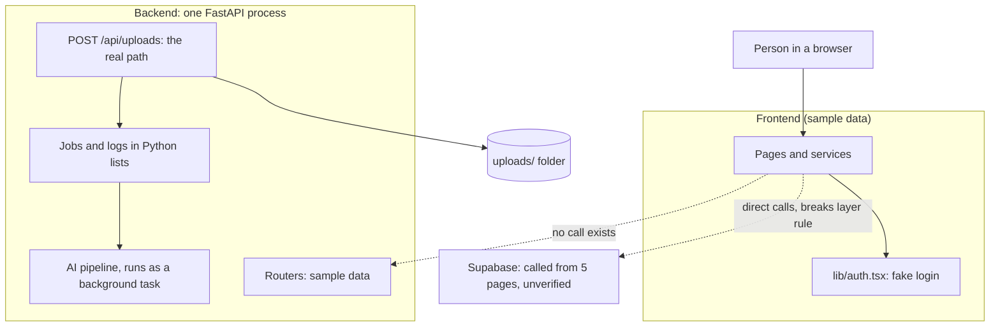
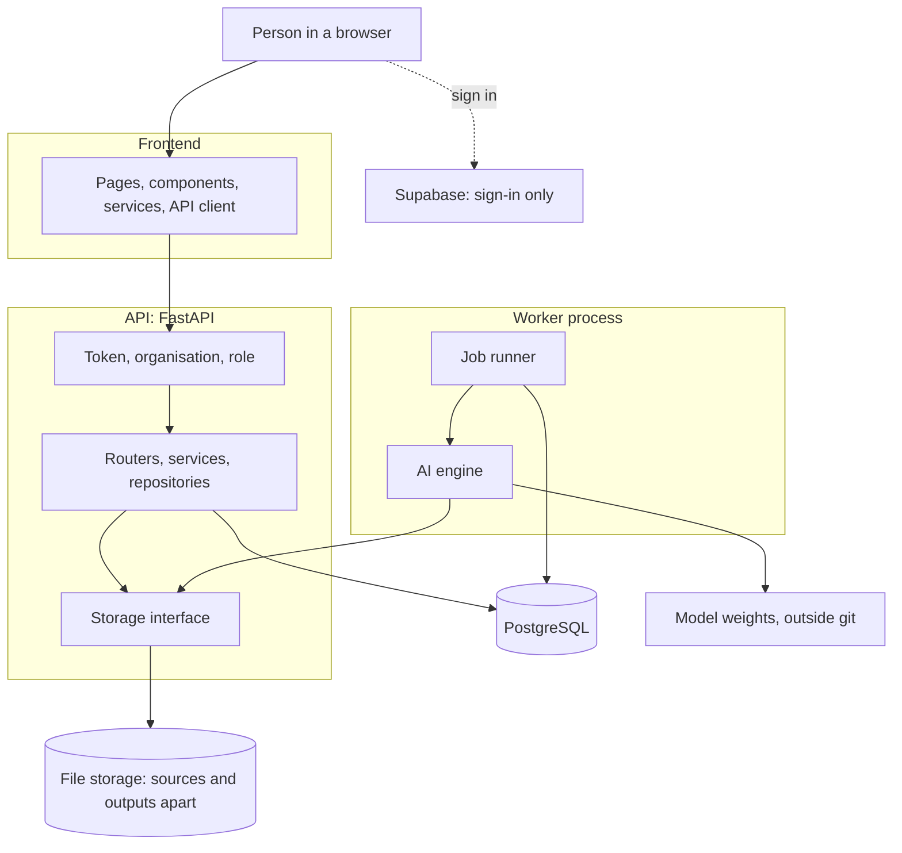
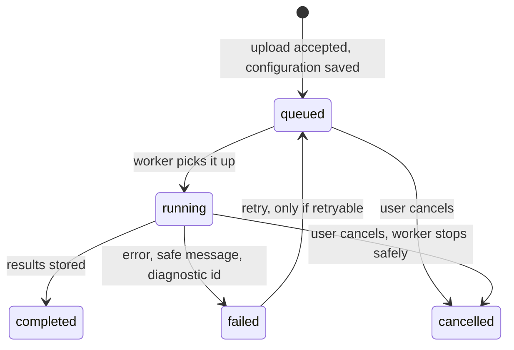
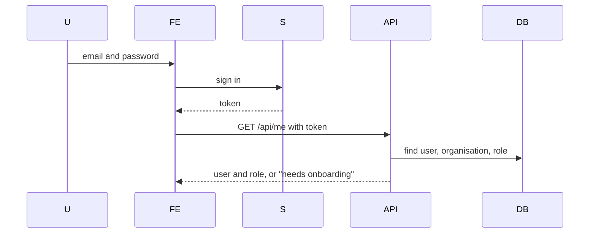
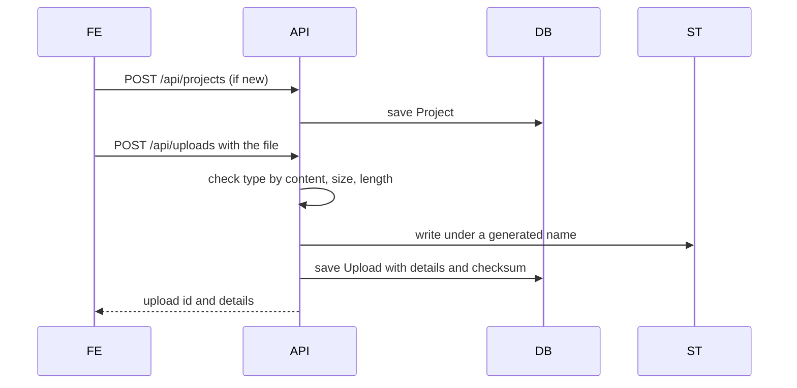
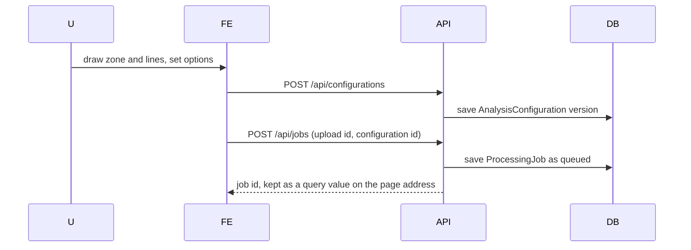
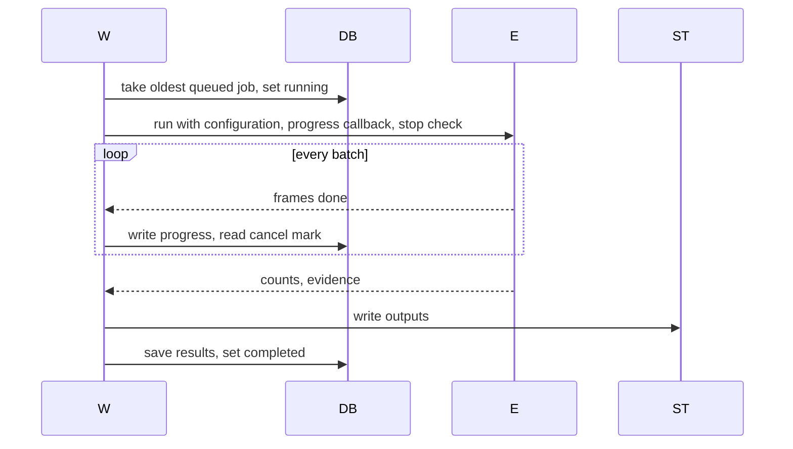
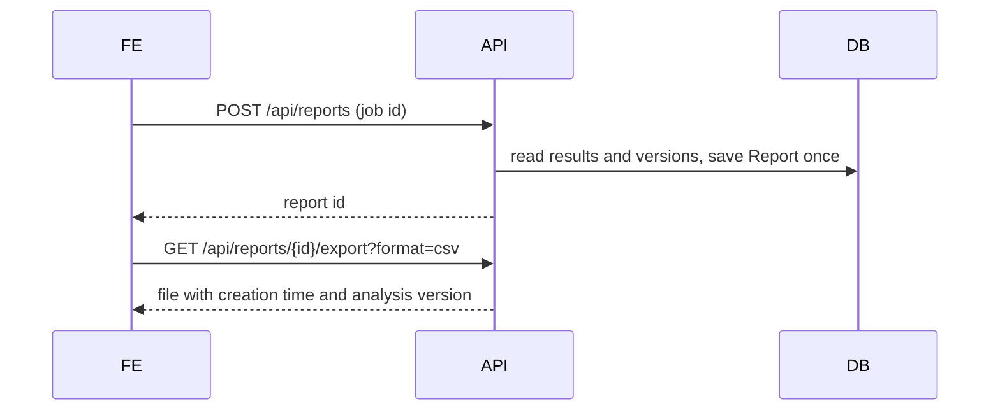

<!-- Adrishikhar - 7 November 2026, 17:54 (Asia/Dhaka) · Fix approved
Requested/approved by: Adrishikhar Barua. Changed by: Codex.
Fix: FD16/FD17/FD20/FD21: align API status, report regeneration, trace IDs and source retention. Documentation only; runtime implementation pending. -->
<!-- Adrishikhar - 7 November 2026, 17:32 (Asia/Dhaka) · Fix approved
Requested/approved by: Adrishikhar Barua. Changed by: Codex.
Fix: reconcile database decisions, counting contracts and flow rules. Documentation only; runtime pending. -->
# Johnson Road — Architecture

Version: 0.2 · Date: 2026-11-07 · Status: **draft, awaiting approval**

0.2 corrects errors found by an independent recheck. API paths and call orders remain proposals except where an approved FD decision defines the contract; LOW_LEVEL_DESIGN is the detailed contract reference.

How the parts of Johnson Road fit together: what each part does, what talks to what, where the rules sit. Builds on `docs/SCOPE.md` (v0.4, approved) and `docs/REQUIREMENTS.md` (v0.3) and reuses their IDs. Runtime descriptions are source observations. Static documentation checks and counting-rule simulations have run; backend and PostgreSQL execution remain unverified. The `ARCHITECTURE.md` in the project root is the user's own layer diagram and is not replaced.

## Tag key

One tag per line or table row.

- **As built**: checked in code, file and line given, read not run.
- **Target**: a design for later, not built.
- **Open**: the user has not decided. Owner: the user. A default is given; a default is not a decision.
- **Proposal**: my suggestion, not from the blueprint or REQUIREMENTS, needs the user's approval.

## Defaults used (not decided)

| Topic | Default | Item |
|---|---|---|
| Sign-in | Supabase sign-in; backend checks Supabase tokens | O1 |
| Where projects, jobs, reports live | **B, decided by the user on 2026-11-07 (SCOPE section 9)**: backend PostgreSQL is the record; Supabase for sign-in only | O48 |
| Production database | PostgreSQL locally and in production (O72 approved; hosting remains open) | O2 |
| Production file storage | S3-compatible behind a storage interface; local folder in development | O3 |
| Queue | FastAPI background task until Sprint 3; then a separate worker process with a jobs table | O4 |
| Job status word | `running` | O7 |
| Hooks layer | Not created | O16 |
| Hosting | **No default.** Section 11.3 is provider-neutral | O5 |

---

## 1. Two pictures of the system

### 1A. As built today

Screens exist and show made-up numbers. The backend also serves made-up numbers. They do not talk to each other. One real path exists: a posted file is saved and handed to YOLO. Five pages call Supabase directly.

- **As built**: no frontend code calls the backend. `services/api.ts:3-5` makes a client; only `auth.service.ts` mentions it and nothing imports that file (SCOPE section 3).
- **As built**: frontend services read sample arrays from `lib/mockData` (`dashboard.service.ts:13`, `report.service.ts:1`, `upload.service.ts:1`, `project.service.ts:1`, `processing.service.ts:1`).
- **As built**: the real path is `POST /api/uploads`, then a background task, then the AI pipeline (`routers/uploads.py:20-33`, `upload_service.py:152-153`).



### 1B. Target (default B)

The browser signs in with Supabase. Every backend request carries that token. The backend owns projects, uploads, jobs and reports in its own PostgreSQL. A separate worker runs the AI engine and writes progress to the database. The browser asks the backend for progress.



---

## 2. Containers

| Container | Job | Technology (in the repo) | As built | Target |
|---|---|---|---|---|
| Frontend | Screens, drawing boards, polling | React, TypeScript, Tailwind, React Router, axios, framer-motion | Sample data, fake login (`lib/auth.tsx:63-111`), no backend call | Services call the API; real session |
| API | Sign-in check, rights, validation, data, job creation | FastAPI, Pydantic, SQLAlchemy | Runs; sample data except upload; no sign-in check (`main.py`) | Real routes, token check, database, storage interface |
| Worker | Run one job at a time through the engine, write progress | Python, same code base | None; a background task in the API process does it (`upload_service.py:152-153`) | Separate process (Sprint 3, O4) |
| Database | The record | SQLAlchemy; SQLite path fixed (`database.py:4`) | One `Project` model, never created or read (`models.py:7-36`) | PostgreSQL locally and in production (O72; hosting open) |
| File storage | Source videos; separately, generated output | Local `uploads/` (`upload_service.py:12`) | Local folder, no checks | S3-compatible behind an interface (O3) |
| Supabase auth | Accounts, passwords, verification and reset emails, tokens | `@supabase/supabase-js` (`lib/supabase.ts`) | Called from 5 pages; whether a project is running is unknown | Sign-in only under B |
| AI engine | Read video, detect, track, count | Python, Ultralytics YOLO, PyTorch (`yolo_detector.py:9-10`) | Inside the API process; detection real, rest placeholder | Inside the worker |

- **As built**: `requirements.txt` lacks `ultralytics` and `torch` (D2, GAP-18).
- **Open**: hosting of every container. Owner: the user. No default (O5).

---

## 3. Layers and their rules

The user's diagram: Pages, Components, Hooks, Services, API Client, Backend, Database, AI Engine. `AI_RULES.md` adds the rules.

- **Proposal**: Deviation from your layer order. The root `ARCHITECTURE.md` order is linear: Pages, Components, Hooks, Services, API Client, Backend, Database, AI Engine. This document places the AI engine beside the services and lets the worker call it directly (diagram 1B). It needs the user's approval (O55).

| Layer | May | May not | Today |
|---|---|---|---|
| Pages | Compose components, hold page state, call services | Fetch directly, call Supabase, import sample data | Breaks all three (below) |
| Components | Show UI from props, under 250 lines | Call the network, duplicate | `GlobalSearch.tsx:5`, `NotificationPanel.tsx:5` import sample data |
| Hooks | Shape service results (loading, error, polling) | Network on their own | Does not exist (O16) |
| Services | Return typed promises, call the API client | Hold backend rules | Return sample arrays |
| API client | Base URL, token, one error shape | Know screens | Exists, unused, adds no token (`api.ts`) |
| Backend | Check rights, apply rules, own data | Trust the browser | No checks (`main.py:22-26`) |
| Database | Keep the record | Hold decisions | No route uses it |
| AI engine | Turn video plus configuration into counts | Know HTTP, users, screens | Reached through `ai_pipeline` (`ai/__init__.py:1-3`) and also directly: `backend/app/main.py:4` imports `app.ai.runtime` (`airuntime`) and uses it at `main.py:31` and `:46` |

- **As built**: pages call Supabase directly in five files, ten calls: `MyProfilePage.tsx:64,86`, `OrganizationPage.tsx:53,76,101`, `OnboardingPage.tsx:36,48,63`, `RegisterPage.tsx:32`, `ForgotPasswordPage.tsx:19` (SCOPE section 11). All ten calls were re-verified by the independent recheck; `OnboardingPage.tsx` and `ForgotPasswordPage.tsx` sit under `pages/auth/`.
- **As built**: pages import sample data directly: `SupportPage.tsx:14`, `BillingPage.tsx:15`. Pages read service arrays without a promise: `JobQueuePage.tsx:15`, `ProcessingPage.tsx:23-29`, `UploadPage.tsx:34-35` (FR-10).
- **Open**: create the Hooks layer. Owner: the user. Default: **not created** (O16). If created, hooks own polling and loading states.

---

## 4. Backend layout

- **Proposal**: a folder may call the one below it, never above. This is the author's own rule; the blueprint lists the backend folders (lines 250-259) but states no call-direction rule.

```
routers -> services -> repositories -> database
              +-> ai (one entry point)      schemas, core: used by all
```

| Folder | Owns | Today | Rule that must hold |
|---|---|---|---|
| `routers/` | HTTP paths, status codes | 5 routers registered (`main.py:22-26`); unknown job id returns 200 `not_found` (`routers/processing.py:20-28`) | No business rules, no database calls |
| `schemas/` | Request and response shapes | Only processing and upload declare them (REQ 4.2) | Every route declares its response (REQ 4.35) |
| `services/` | Rules: validation, state moves, who may do what | `upload_service.py` also saves files and runs jobs (`:28-38,64-149`) | No direct file or SQL work |
| `repositories/` | Stored data | Python lists from `mock_data` (`processing_repository.py:6-10`) | Only place that talks to the database |
| `database/` | Engine, session, models | SQLite path in code; no table created (PJ-3) | Models follow DATA_MODEL |
| `ai/` | The counting engine | Section 5 | Never imports routers, services, repositories |
| `core/` | Settings | Fixed values (`core/config.py:5-12`); AI settings read env separately (`ai/settings.py:6-18`) | One settings object |

- **As built**: `upload_service.py:8` imports the pipeline object, built at import (`pipeline.py:76`), so the detector loads before startup runs (F3).
- **As built**: a second projects router `backend/app/api/projects.py:1-28` is not registered and imports names that do not exist (GAP-3, REQ 4.8).
- **Target**: one projects router; the stray file is merged or removed only when the user says (O54).
- **Target**: new modules for the storage interface and the job runner, and a test that fails if `ai/` imports from `routers`, `services` or `repositories`.

---

## 5. AI engine design

### 5.1 Parts, in order

| Part | Job | As built | Target |
|---|---|---|---|
| Video loader | Open file, report length, size, resolution, frame rate | Only checks the path exists (`video_loader.py:5-9`) | Real video reader; unreadable file fails with a reason (REQ 5.2) |
| Frame reader | Real frames in order, in batches, with number and time | Fixed batch, `frame_count = 6` (`frame_reader.py:8,12-13`) | Real batches; applies `FRAME_SKIP` (REQ 5.4, 5.14) |
| Detector | Find vehicles | YOLO on the whole video path (`yolo_detector.py:114-117`); `Detection` built without `class_id` (`:103-109` vs `interfaces.py:5-10`, D1) | Works on frames; keeps classes of interest (REQ 5.6) |
| Tracker | Same id for same vehicle | One track per detection (`bytetrack_tracker.py:13-27`) | Real ByteTrack, BoT-SORT, SORT (REQ 5.8) |
| Counter | Distinct vehicles crossing a line, by direction | `len(tracks)` (`counter.py:6`) | Line crossing with jitter guard (REQ 5.10) |
| Analytics | Counts by class, direction, time bucket, zone | Seven functions raise `NotImplementedError` (`analytics.py:1-26`) | REQ 5.11; speed, density, queue, turning, lanes, peak hour Open (O35) |
| Annotator | Evidence frames, output video | Does not exist | Optional (REQ 5.15, O36) |

- **As built**: `AIPipeline.run` runs load, read, detect, track, count with a timing mark each (`pipeline.py:41-73`) and returns frames, detections, tracks and a count (`:16-23`).
- **As built**: any exception becomes one `PipelineError` with the raw text (`pipeline.py:72-73`). Frames are reported as 6 whatever the video (`pipeline.py:67`, F4).
- **As built**: an unknown tracker name falls back silently to ByteTrack (`trackers/factory.py:10-15`).

### 5.2 Interfaces

- **As built**: `Detector.detect(frames) -> list[Detection]` (`ai/base.py:7-10`); `Tracker` has `initialize`, `update`, `reset` (`trackers/base.py:15-26`).
- **Target**: one entry point for the engine, used by the worker and tests alike. Input: video location, analysis configuration (model, tracker, thresholds, frame skip, zone, lines, classes), a progress callback, a stop check. Output: counts by class, direction, bucket and zone; model and configuration versions; evidence paths; frames processed.
- **Target**: detector and tracker receive frames, not file paths. The counter receives tracks and lines and returns crossings.

### 5.3 Where zones and lines enter

- **As built**: zones and lines stay in component state (`DetectionZoneCanvas.tsx:17`, `CountLineCanvas.tsx:24`); nothing reaches the backend (AN-1, AN-2).
- **Target**: points are saved with the configuration as positions between 0 and 1 of the real frame (REQ 2.26, 2.27).
- **Target**: the zone drops detections outside it before tracking; lines are used only by the counter, after tracking.
- **Decided (O42)**: at least one line or zone is required. FD1 in LOW_LEVEL_DESIGN section 18 defines line-crossing and zone-presence modes; geometry details O28/O79 remain separate.

### 5.4 How a job calls the engine

- **Target**: the worker loads the job and its saved configuration, builds the engine from that configuration (not environment variables), runs it with progress callback and stop check, then writes results in one step.
- **Target**: each engine failure maps to a short code plus a diagnostic id; raw text goes to the log only (REQ 5.19).

### 5.5 Runtime and health

- **As built**: `AIRuntime` is a shared object that creates the detector once, optionally warms up, and reports status (`runtime.py:40-143`). `MODEL` starting with `yolo` loads YOLO, anything else the stub (`:63-75`). In warm-up only the inner `detect()` error is swallowed (`runtime.py:98-101`); the outer except at `runtime.py:103-104` re-raises `DetectorLoadError`.
- **As built**: `/health` reports initialized, detector loaded, name, device, model path (`main.py:44-55`).
- **Target**: `/health` also reports tracker and queue readiness (REQ 4.24, 5.26).

### 5.6 Model files (F2, F3)

- **Verified 2026-11-07**: `git ls-files backend/yolov8n.pt backend/yolo11n.pt` lists both model files; both are tracked. Tracking does not prove model compatibility or runtime loading.
- **As built**: default `MODEL_PATH=yolov8n.pt` is relative (`ai/settings.py:8`), so it works only when the server starts in `backend/`. The fallback looks in the repository root (`runtime.py:89`, `yolo_detector.py:68`), where no weights exist (F2).
- **Target**: model location is one setting (absolute path or storage location); weights stay out of git; each job records the model file identity (REQ 5.25, 5.28).
- **Open**: where weights live in production. Owner: the user. Default: a models folder set by a setting, filled at deploy, outside git (O49).

---

## 6. Job execution

### 6.1 Today

- **As built**: `POST /api/uploads` saves the file, adds a dict to a list, and schedules `advance_job` as a background task in the web process (`routers/uploads.py:26-28`, `upload_service.py:41-61,152-153`).
- **As built**: `advance_job` sets `queued`, sleeps 1 second, sets `processing` at 35, runs the pipeline, then `completed` 100 or `failed` 0 (`upload_service.py:64-135`). Progress values are fixed.
- **As built**: jobs and logs live in module-level lists and vanish on restart (`processing_repository.py:6-10,35-38`). A failure puts raw exception text in the returned log list (`upload_service.py:133`).
- **As built**: no cancel, timeout, retry or restart recovery (GAP-8, GAP-10).

### 6.2 Target



- **Target**: this is SCOPE section 4 and REQUIREMENTS 3.32; the moves stay Open until approved (O9).
- **Target**: the API creates the job row as `queued`. The worker takes the oldest `queued` row and sets `running` in one database step, so two workers cannot take one job.
- **Target**: the worker writes stage, frames done out of total and time to the job row after each batch; the API only reads it (REQ 5.17).
<!-- Adrishikhar - 7 November 2026, 17:40 (Asia/Dhaka) · Fix approved
Requested/approved by: Adrishikhar Barua. Changed by: Codex.
Fix: FD5: align cancellation with independent supervision. Documentation correction; runtime implementation pending. -->
- **Decided (FD5)**: cancellation records a request; a supervisor checks it independently of frame batches, download, model loading and output storage. Try cooperative stopping first, then terminate that attempt's isolated analysis process after configured grace. Mark cancelled only after stopping; completion/recovery must recheck attempt ownership and cancellation under the job lock. Timing values remain open (O46/O81).
- **Target**: a job past its timeout becomes `failed` with a safe message (REQ 3.44); on start, the worker sets jobs left `running` by a dead worker to `failed`, retryable (default for O40).
- **Target**: the database refuses moves outside the table; `completed` is written only with stored results (REQ 3.33).
- **Target**: Sprint 2 keeps the background task but builds the job row and state rules in the API, so Sprint 3 only moves the runner.

| Still Open | Question | Default | Owner |
|---|---|---|---|
| O4 | Queue product | Jobs table polled by the worker; no named product | the user |
| O9 | Allowed moves | The diagram above | the user |
| O40 | Job left `running` after restart | `failed`, retryable | the user |
| O46 | Timeout values, retry rules | None; measure first | the user |
| O50 | Jobs per worker at once | One | the user |

---

## 7. Key flows (Target)

Each flow names the API call and the data. Data names are the entities from `blueprint.md` section 7; real tables are in DATA_MODEL. Paths below were initially proposals; approved FD contracts in LOW_LEVEL_DESIGN override them. The new job path `GET /api/jobs/{id}` would replace the existing `GET /api/processing/jobs/{job_id}` (`backend/app/routers/processing.py:17`). Also, `POST /api/uploads` today also creates the job (`routers/uploads.py:26-28`, REQUIREMENTS 4.6); under the target it would become upload only. That changes an existing route (AI_RULES "never break existing routes"): **Open** for the user, default: keep the old route working until the frontend is moved (O56). Call paths remain proposals except individually approved FD contracts.

### 7.1 Sign in



- **Proposal**: `GET /api/me` (path invented; REQUIREMENTS 4B names none); reads User, Organization, membership.
- **Target**: no membership shows onboarding. Onboarding is one call that creates organisation, owner membership and profile link in one database step or not at all (F11, REQ 1.13, 1.34).

### 7.2 Create project and upload



- **Proposal**: `POST /api/projects`, `POST /api/uploads` (paths invented; REQ 4.11, 4.13 name no paths); writes Project, Upload.
- **Target**: the file upload and the job creation are two separate calls (upload here, job in 7.3). This differs from today, where `POST /api/uploads` also creates the job (`routers/uploads.py:26-28`, REQUIREMENTS 4.6); see the route-change note at the top of section 7 (O56).
- **Target**: the file is written in pieces and stops at the size limit; the client's name never reaches the path; a refused file is deleted and the reason returned (D3, D4, REQ 4.50 to 4.53).

### 7.3 Configure and queue a job



- **Proposal**: `POST /api/configurations`, `POST /api/jobs` (paths invented; REQ 4.15, 4.16 name no paths); the job id is a query value on the existing page address (REQUIREMENTS O24), not a new route; writes AnalysisConfiguration, CountingZone or CountingLine, ProcessingJob.
- **Target**: a configuration used by a job cannot be edited; a change is a new version (REQ 5.22). Repeating the request must not create a second job (REQ 4.39); the method is for DATA_MODEL.

### 7.4 Job runs and reports progress



- **Target**: no API call. Reads ProcessingJob, AnalysisConfiguration, Upload; writes ProcessingJob, Detection/Track aggregate, evidence references.
- **Target**: on error the worker sets `failed`, stores the code and diagnostic id, and keeps the attempt (R5).

### 7.5 Browser refresh finds its job (O24)

- **Proposal**: the page reads the job id from a query value on the existing page address (REQUIREMENTS O24), not a new route, and calls `GET /api/jobs/{id}` (path invented; replaces `GET /api/processing/jobs/{job_id}`, see top of section 7) every 3 seconds while the job is `queued` or `running`; reads ProcessingJob; nothing comes from browser memory (REQ 3.39, 3.40).
- **Open**: job id in the address and the 3 second interval. Owner: the user. Default: both (O24).

### 7.6 Create and export a report



- **Decided (FD17)**: normal report creation returns version 1 idempotently. `POST /api/reports/{id}/regenerate` creates or returns the next version for that source report; the server assigns it under the job lock. See LOW_LEVEL_DESIGN section 10. Export behavior remains as described there.
- **Open**: Excel and share link. Owner: the user. Default: CSV and PDF only (O31).

---

## 8. Data and file storage

Entities only; tables and columns are in DATA_MODEL.

- **Target**: the database holds User, Organization, Project, Upload, ProcessingJob, AnalysisConfiguration, Detection/Track aggregate, CountingZone or CountingLine, Report, Notification, AuditEvent (`blueprint.md` section 7). Every result points to its upload, configuration version, model version and job (R6).
- **Target**: file storage holds videos and generated files; the database keeps only a storage key, size and checksum, never a full machine path.
- **Target**: sources and outputs live in separate places so the app can read sources and the worker write outputs only (NFR-4, AC-17).
- **Target**: files are reached only through a storage interface (save, open, delete, short-lived link) with a local-folder version for development and tests and an S3-compatible version for production (O3).
- **As built**: the only stored thing is the upload in `uploads/` (git-ignored, `.gitignore:13`), named `<12 hex>_<client name>` (`upload_service.py:29-30`); `*.db` is ignored (`.gitignore:10`).
- **Decided (FD7)**: automatic audit/result retention is disabled. Source/evidence retention periods remain open (O10); delete eligible objects before setting deletion markers. FD21 serializes source deletion with queue/rerun/retry using the upload lock, skips queued/running jobs, and rejects absent/deleted sources before queueing. Report-file retention awaits its own policy.

---

## 9. Sign-in and access

### 9.1 Design (default B)

- **Target**: the browser signs in with Supabase; the API client sends the token on every call (O1).
- **Target**: the backend checks the token's signature and expiry on every request except `/health` and `/` (O26 default: both public). The user id in the token is the key into the backend's own user and membership rows.
- **Target**: organisation and role come from the backend database, never from the browser and never from the editable profile fields (REQ 1.35).
- **Open**: how the token is checked: Supabase public keys or shared secret. Owner: the user. Default: public keys. Which one this project uses: not verified (O51).

### 9.2 Order of checks on each request

- **Proposal**: AC-12 in REQUIREMENTS (the blueprint states only the principle): 1 token valid; 2 which organisation; 3 does the thing belong to it, else "not found"; 4 does the role allow it, else "not allowed"; 5 input valid; 6 do the work.
- **Target**: checks 1 to 4 sit in one shared dependency every router uses, so no route can skip them. Roles follow the table AC-1 to AC-9; its "?" cells stay Open (O15).
- **Target**: the frontend hides what a role cannot do; the backend decides (AC-13).

### 9.3 The Supabase table problems under each option

| Problem | Default B | Option A |
|---|---|---|
| F11: onboarding cannot finish under the rules (`add_all_rls_policies.sql:9-13,49-59`; `OnboardingPage.tsx:36-63`) | **Target**: does not apply; onboarding is one backend call | Must be fixed: one database function, or another order |
| F12: an admin can make anyone, even themselves, an owner (`add_all_rls_policies.sql:49-79`) | **Target**: backend refuses it; roles live in the backend table | Must be fixed in the security rules |
| Eleven Supabase tables exist (F9) | **Open**: owner the user; default leave unused and not applied to production (O54) | They become the record |

- **As built**: table definitions are in `frontend/supabase/migrations/` (F9). Nothing shows a Supabase project with them is running.
- **As built**: fake login accepts any non-empty email and password (`auth.tsx:100-111`) and loads a fixed user (`auth.tsx:73-91`). Both go when real sign-in lands (D5, GAP-2).

---

## 10. Real-time

- **Proposal**: default is polling. `GET /api/jobs/{id}` (path invented; REQUIREMENTS 4B names no paths; see the route-change note at the top of section 7) every 3 seconds while a job is `queued` or `running` (O24).
- **Target**: cost of polling: one small request per 3 seconds per open job page; progress can be 3 seconds late; works behind any provider; a page left open on a long job keeps asking.
- **Open**: WebSocket or server events instead. Owner: the user. Default: polling. The blueprint says "polls or subscribes" (`blueprint.md` section 8 step 12) (O52).
- **As built**: no polling exists; Processing adds random log lines every 2.4 s (`ProcessingPage.tsx:51-67`).

---

## 11. Configuration and environments

### 11.1 Where settings come from

| Group | As built | Target |
|---|---|---|
| AI model, tracker, device, thresholds, batch, frame skip, limits, timing, logging, warm-up | Env vars read at load (`ai/settings.py:6-18`) | Defaults from env; thresholds and tracker also saved per job |
| API name, prefix, CORS | Fixed (`core/config.py:5-12`); `.env` values for name and prefix not read | From env (REQ 4.41, NFR-5) |
| Database URL | Fixed SQLite path (`database.py:4`) | From env |
| Storage | Fixed folder `uploads` (`upload_service.py:12`) | From env, behind the interface |
| Frontend URLs | `VITE_API_URL` (`api.ts:4`), `VITE_SUPABASE_URL`, `VITE_SUPABASE_ANON_KEY` (`lib/supabase.ts:3-4`) | Same names; a missing value gives a clear message (REQ 1.30, F1) |

- **As built**: no backend file loads a `.env` file (SCOPE 6.1). `core/config.py:7` says `model = "stub"`, `ai/settings.py:6` defaults to `yolo8`; nothing reads the first.
- **As built**: no `.env.example` exists and `.gitignore:29` (`.env.*`) would hide it (F7).
- **Target**: tracked `.env.example` without secrets, `!.env.example` in `.gitignore`, one backend settings loader (REQ 6.7, 6.8); secrets from the platform store, never git (NFR-3).

### 11.2 Three environments

| Environment | Purpose | Database | Files | Queue | Sign-in |
|---|---|---|---|---|---|
| Local | One developer, tests | PostgreSQL (O72 decided) | Local folder | Background task, later the worker run by hand | Test Supabase project, or a test token in test code only |
| Staging | Copy of production for acceptance | Separate PostgreSQL | Separate bucket | Worker | Separate Supabase project |
| Production | Real users | Managed PostgreSQL | Object storage, encrypted | Worker, sized by measurement | Production Supabase project |

- **Open**: a separate staging environment. Owner: the user. Default: yes (O53).
- **As built**: `backend/.venv` was made on a Mac and cannot run here (F6). `ultralytics` and `torch` versions: O14.
- **As built**: the server must start from `backend/` for the model and `uploads` to be found (F2; `upload_service.py:12`, `database.py:4`). **Target**: all paths come from settings (REQ 5.28).

### 11.3 Deployment, provider-neutral

- **Target**: static frontend files on any static host, over HTTPS.
- **Target**: API and worker are built from one code base and run as separate processes, scaled and restarted alone.
- **Target**: managed PostgreSQL, S3-compatible object storage, a secret store, log and metric collection.
- **Target**: the worker needs the weights and enough memory; a GPU is optional (`DEVICE` defaults to `cpu`, `ai/settings.py:9`). CORS accepts only the real frontend address (NFR-5).
- **As built**: no Dockerfile, CI or deployment file found (GAP-17).
- **Open**: every hosting choice. Owner: the user. No default (O5, O47).

---

## 12. Security overview (Target)

| Area | Design | REQUIREMENTS |
|---|---|---|
| Who is calling | Token checked on every route except `/health` and `/` (existing paths) | 4.10, 4.30 |
| Organisation scoping | Every query filtered by the caller's organisation; foreign ids answer "not found" | AC-10, AC-12, 4.31 |
| Roles | Checked in the backend; frontend only hides buttons | AC-1 to AC-9, AC-13 |
| Uploaded video | Untrusted: type by content, size stopped while writing, length by reading | NFR-1, 4.52, 4.53 |
| File names | Never in a path; generated id plus allowed extension (D4) | NFR-2, 4.50 |
| Secrets | Platform secret store; not in git, logs or messages | NFR-3 |
| Storage | Sources and outputs apart; least access; short-lived links; encrypted in production | NFR-4, NFR-18, AC-17 |
| Origin, errors | CORS from settings; one error shape with no stack traces, paths, secrets | NFR-5, NFR-9, 4.32, 4.33 |
| Abuse, privacy, audit | Rate limits (values Open, O43); no face, plate or identity model; audit of sign-in, uploads, jobs, reports, role changes, refusals | 4.40, 4.42, 5.27, NFR-6 |

- **As built**: none of these is enforced in the backend (`main.py:22-26`; GAP-16). Two unsafe habits exist: raw exception text in the log list (`upload_service.py:133`) and the client file name in a path (`upload_service.py:30`).

## 13. Observability (Target)

| What | How | REQUIREMENTS |
|---|---|---|
| Correlation identifiers | request_id identifies one HTTP attempt; job_id links the durable job and attempt_no identifies a worker run. Worker logs retain the creation request ID; unrelated HTTP requests have no job ID | NFR-11, FD20 |
| Structured logs | Fixed shape; secrets and personal data removed | NFR-7, NFR-11 |
| Metrics | Route time and errors; upload outcomes; queue size, job time, retries, cancellations, frames per second | NFR-16 |
| Per-job record, health | Model, configuration version, device, code version on the job row; `/health` for API and worker | 5.25, 4.24, 5.26 |
| Alerts and runbooks | Queue growth, repeated worker failures, full storage, rising API errors; written backup, restore, rollback, incident steps | NFR-17 |

- **As built**: `log_inference` (`ai/runtime.py:113`) is defined and never called. The only live log calls are `logger.info("ai.job", extra=...)` and `logger.error` in `upload_service.py:112-125,136-149`. There is no `logging.basicConfig`, `dictConfig` or `Formatter` anywhere in `backend/app` (only three `getLogger` calls), so the `extra=` fields cannot print, and the info line is probably not emitted at all unless the server's own logging applies. REQUIREMENTS NFR-11 (request IDs and job/attempt links where applicable) is therefore not met today. `timing` keeps only the latest values in a dict that nothing exports (`runtime.py:129-131`).
- **Open**: performance numbers. Default: none, measure first (O17).

---

## 14. Technology choices

**Proposal** note: no API paths are named in this section's table; the paths in sections 7 and 10 are all Proposals (REQUIREMENTS 4B names no paths).

| Choice | Reason | State |
|---|---|---|
| React, TypeScript, Tailwind, React Router, axios | Every screen uses them; `AI_RULES.md` forbids replacing Tailwind | As built |
| FastAPI, Pydantic, SQLAlchemy, SQLite locally | Already used and set up (`main.py`, `database.py`) | As built |
| PostgreSQL in production | Blueprint says managed relational database; same SQLAlchemy code | Open, default PostgreSQL (O2) |
| Supabase for sign-in; not as data store | Register, reset, onboarding already call it | O1 open, default Supabase; O48 decided: no, Supabase is not the data store |
| Ultralytics YOLO with PyTorch | Already the detector | As built; versions Open (O14) |
| ByteTrack, BoT-SORT, SORT | Names in the blueprint; classes are placeholders | As built names; DeepSORT dropped by default (O20) |
| S3-compatible storage | Many providers, no lock-in | Open, default (O3) |
| Separate worker with a jobs table | Long jobs, cancel, survives an API restart | Open, default Sprint 3 (O4) |
| Polling for progress | Simple, works behind any provider | Open, default (O24, O52) |
| Hosting, CI, log service, secret store | None chosen | Open, no default (O5, O47) |

---

## 15. Option A and Option B (O48)

The plan above uses B as a default only. This table does not choose.

| Point | A: Supabase tables are the record | B: backend PostgreSQL is the record |
|---|---|---|
| In plain words | The frontend reads and writes projects, jobs, reports in the Supabase tables in `frontend/supabase/migrations/`. FastAPI does upload and AI only | The frontend talks only to FastAPI, which owns the data. Supabase holds accounts |
| Layers | Services call Supabase for data; the Backend box in the user's diagram is skipped for most data | Matches the diagram: Services, API client, Backend, Database |
| Data flow | Two writers: browser and FastAPI/worker | One writer: the backend |
| Auth | Token used by Supabase rules directly; FastAPI still checks tokens for upload and AI | Token checked once, in the backend |
| Organisation scoping | In Supabase security rules (F9); F11 and F12 must be fixed there | In backend code (AC-12), tested with the backend |
| Code to write | Fix F11 (onboarding rules); fix F12 (admin escalation); fix F10 (ids); add jobs columns that are missing (source path, configuration, frame counts, error code; F13); frontend Supabase services; a way for the worker to write job progress and results into Supabase; resolve the AI_RULES conflict of pages calling Supabase directly (move calls behind services) | Backend tables and migrations; every route; frontend API services; the backend must own users, organisations, memberships, invites and roles (O12, O38, AC-2); rewrite `MyProfilePage`, `OrganizationPage`, `OnboardingPage` (ten Supabase calls, defect D5); the Supabase sign-up trigger `handle_new_user` (SCOPE F9) that creates profiles must be dropped or reconciled; role and invite rules re-implemented in the backend (F11, F12) |
| Existing work reused | Eleven tables, row rules, sign-up trigger (F9) | Only Supabase sign-in |
| Worker | Reaches Supabase's PostgreSQL from outside with a service credential that skips the rules | Uses the same database as the API |
| Rules from AI_RULES | Pages calling Supabase directly conflicts with the layer rules until moved behind services; "never break existing routes" is untouched for the data path | "Never break existing routes" is touched by the upload and job route changes (O56); pages stop calling Supabase for data |
| Risks | Rules (state moves, limits, role limits) are hard to test; the browser can try every write; two places to keep in step; lock-in to Supabase | More work before the first real screen; the written tables go unused (F9); sign-in still depends on Supabase |
| Biggest risk | Security rules F11 and F12 left wrong, with the browser able to write directly | Large rewrite of users, organisations and roles before any screen is real |
| Same in both | Upload, validation, storage, worker, AI engine; tied item O1 and O3 | Same. O2 and O12 differ: under A the Supabase PostgreSQL is the record; O12 follows O48 |

**Decided by the user on 2026-11-07: B (SCOPE section 9, O48).** Option A stays in this section only to show what was not chosen.

---

## 16. Open items

Owner for all: the user. A default is what this plan assumes until the user answers. O1 to O14 are SCOPE's (v0.4); O15 to O48 are REQUIREMENTS' (v0.3; O32 and O33 unused); O49 onward are new here. Defaults are unchanged. Those this document relies on:

| ID | Question | Default | Section |
|---|---|---|---|
| O1 to O5, O7, O16 | See "Defaults used" at the top | As listed there | 1B to 14 |
| O8 | Upload limits and unit of `MAX_VIDEO_LENGTH` | Not decided | 7.2 |
| O9 | Allowed job moves | Diagram in 6.2 | 6.2 |
| O10 | Retention | None; needed before Sprint 6 | 8 |
| O12 | Profiles and organisations: Supabase or backend | Follows O48 | 9.3 |
| O14 | `ultralytics`, `torch` versions; CPU or GPU | CPU-only | 11.2 |
| O15 | Persona to role mapping | Three code roles | 9.2 |
| O17, O43 | Performance targets; rate limits | None; measure first | 12, 13 |
| O24 | Refresh finds job; interval | Job id in address; 3 seconds | 7.5, 10 |
| O26 | Error shape; public `/health` and `/` | `{ "error": { "code", "message", "diagnosticId" } }`; both public | 9.1 |
| O28, O42 | Zone required; line required | No; at least one line or one zone | 5.3 |
| O31, O35, O36 | Formats beyond CSV and PDF; other analytics; annotated video | CSV and PDF only; out; on | 5.1, 7.6 |
| O40, O46 | Job left `running` after restart; timeouts and retries | `failed`, retryable; none, measure first | 6.2 |
| O20 | Tracker list in the wizard: DeepSORT is offered but no DeepSORT code exists | Offer only trackers the backend supports; SORT replaces DeepSORT (REQUIREMENTS default) | 14 |
| O41 | Pages call Supabase directly | Leave until real login is built (Sprint 1), then move the calls into an auth service | 3 |
| O47 | Production services, recovery, acceptance | Not decided | 11.3 |
| O48 | Where projects, jobs, reports live | **Decided: B** (user, 2026-11-07) | 1B, 15 |

New in this file (defaults, not decisions):

| ID | Question | Default | Section |
|---|---|---|---|
| O49 | Where model weights live in production and how they reach the worker | Models folder set by a setting, filled at deploy, outside git | 5.6 |
| O50 | Jobs one worker runs at once | One | 6.2 |
| O51 | How the backend checks Supabase tokens | Public keys; not verified which this project uses | 9.1 |
| O52 | WebSocket or server events instead of polling | Polling | 10 |
| O53 | Separate staging environment | Yes | 11.2 |
| O54 | Fate of the eleven Supabase tables and the unregistered `api/projects.py` under B | Tables unused and not applied to production; file merged or removed only when the user says | 4, 9.3 |
| O55 | **Proposal**: deviation from your layer order (AI engine beside services, worker calls it directly) | Keep the deviation as drawn in 1B | 3, 1B |
| O56 | **Proposal**: new job path replaces `GET /api/processing/jobs/{job_id}`; `POST /api/uploads` becomes upload only (changes an existing route) | Keep the old routes working until the frontend is moved | 7 |

---

## 17. Traceability

| Section | REQUIREMENTS IDs | SCOPE / REQUIREMENTS IDs |
|---|---|---|
| 1 Pictures, 2 Containers | 1.4, 2.11, 3.17, 4.1, 4.4, 4.10 to 4.25, 4.41, 6.16, 6.20, AC-10 | Section 3, UP-2b, GAP-2, GAP-3, GAP-5, GAP-8, GAP-17, GAP-18, D2, R7, O48 |
| 3 Layers, 4 Backend layout | FR-1 to FR-14, 1.22, 1.23, 4.2, 4.8, 4.35, 4.37 | R10, F3, F14, GAP-3, GAP-7, PJ-3 |
| 5 AI engine | 5.1 to 5.32, 2.26, 2.27 | PR-2 to PR-4, PR-10, PR-11, GAP-11 to GAP-14, D1, F2 to F4 |
| 6 Job execution | 3.30 to 3.45, 5.17 to 5.19 | R4, R5, section 4, GAP-6, GAP-8 to GAP-10, F13 |
| 7.1 Sign in | 1.5, 1.12, 1.13, 1.34 | AU-1, AU-5, AU-10, F11 |
| 7.2 Upload | 2.20, 2.21, 4.11, 4.13, 4.50 to 4.53 | UP-2 to UP-5, D3, D4, GAP-4 |
| 7.3 Queue | 2.26, 2.27, 2.49, 4.15, 4.16, 5.22 | AN-1 to AN-4, PR-1 |
| 7.4 Job runs, 7.5 Refresh | 3.5, 3.33, 3.39 to 3.41, 3.44, 5.17 to 5.21, 5.25 | PR-5, PR-7, R5, R6, O24 |
| 7.6 Reports | 3.19 to 3.24, 4.21 | RP-1 to RP-5, GAP-15 |
| 8 Data and files | 4.43, NFR-4, NFR-8, AC-17 | Blueprint section 7, O3, O10 |
| 9 Sign-in and access | 1.34, 1.35, 4.30, 4.31, AC-1 to AC-17 | AU-9, AU-10, R7, F9, F11, F12, GAP-16 |
| 10 Real-time, 11 Configuration | 1.30, 4.41, 5.28, 6.7 to 6.9, NFR-3, NFR-5 | Section 6, F1, F2, F6, F7, GAP-1, GAP-17 |
| 12 Security | NFR-1 to NFR-9, NFR-18, 4.32 to 4.43 | GAP-16, D3, D4 |
| 13 Observability, 14 Technology | NFR-11, NFR-16, NFR-17, 4.24, 5.26, 6.16, 6.20, 6.22 | PR-11, GAP-17, O1 to O3, O14, O20 |
| 15 Option A and B | 1.34, 1.35, 4.31 | O12, O48, F9 to F14 |


### Approved flow correction reference — 2026-11-07

[LOW_LEVEL_DESIGN section 18](LOW_LEVEL_DESIGN.md#18-approved-backend-flow-corrections) records FD1–FD8: counting modes and totals, generated storage keys, metadata locking and snapshots, independent worker supervision with attempt checks, transactional notifications, retention restrictions, and one video per workflow. Adrishikhar Barua approved these documentation corrections; Codex edited them. Runtime implementation remains pending. Dated approved decisions override earlier blueprint statements and draft defaults; unrelated open items remain open.
