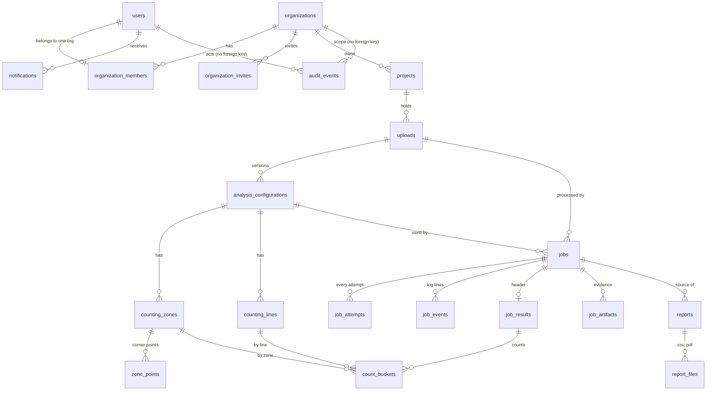

<!-- Adrishikhar - 7 November 2026, 17:54 (Asia/Dhaka) · Fix approved
Requested/approved by: Adrishikhar Barua. Changed by: Codex.
Fix: FD14/FD17: align invitation delivery and report version semantics. Documentation only; runtime implementation pending. -->
<!-- Adrishikhar - 7 November 2026, 17:32 (Asia/Dhaka) · Fix approved
Changed by: Codex. Fix: Reconcile approved backend flow and database decisions; see LOW_LEVEL_DESIGN section 18. Runtime implementation pending. -->
# Johnson Road — Data Model

Version: 0.3 · Date: 2026-11-07 · Status: **draft, awaiting approval**

Change in 0.3: review fixes. Purge exception for the lock triggers (`jr.purge` setting, O76 added), lock check on old and new row of a child update, ownership-transfer order corrected, stale invariant count removed, completed-job note added. Same note is in the `schema.sql` header.

The runnable-looking SQL is `docs/schema.sql`. This file explains it in plain words. It builds on SCOPE v0.4, REQUIREMENTS v0.3 and ARCHITECTURE v0.2 and inherits their IDs (R, F, D, GAP, AC, NFR, O1 to O56).

<!-- Adrishikhar - 7 November 2026, 17:45 (Asia/Dhaka) · Fix approved
Requested/approved by: Adrishikhar Barua. Changed by: Codex.
Fix: Distinguish completed static checks from pending PostgreSQL execution. Runtime implementation pending. -->
> **The SQL has not been executed or validated against PostgreSQL.** Static consistency and whitespace checks have been performed; they do not prove SQL execution, trigger behavior or service invariants. Run the draft on a fresh, empty PostgreSQL 16 test database and exercise its constraints before using it as a migration. It runs as one transaction (`BEGIN` ... `COMMIT`), intentionally without `IF NOT EXISTS`. Later changes need the migration tool (O63).

> **SQLite cannot run this file.** Eight of the 31 invariants in section 6 need Postgres-only triggers or `NULLS NOT DISTINCT` (8, 10, 11, 12, 17, 23, 27, 28). The file also uses `btrim()` (SQLite has `trim`), `jsonb_typeof()` inside a CHECK, and SQLite ignores foreign keys unless `PRAGMA foreign_keys=ON` is set on every connection. Decision O72 (SCOPE section 9) approves PostgreSQL for local development too.

## Tag key

Every statement has exactly one tag. Tags are never mixed in one line.

- **As built**: verified in code or in the Supabase SQL. File and line given. Read, not run.
- **Target**: design for later. Nothing below exists yet unless tagged As built.
- **Proposal**: my suggestion. Not from the blueprint or REQUIREMENTS. Needs the user's approval.
- **Open**: the user has not decided. Owner is the user. A default is given and used until the user answers.
- Where I could not verify something, the line says so.

## Decisions in force

| Decision | Source | Effect on this file |
|---|---|---|
| **B**: the backend's own PostgreSQL is the record for organisations, members, projects, uploads, jobs, results and reports. Supabase is used for sign-in only | SCOPE section 9, O48, decided by the user 2026-11-07 | The backend owns every table here. Supabase tables are not the record |
| Local development uses PostgreSQL (decided 2026-11-07, O72, SCOPE section 9) | SQLite is not used for this schema, because it cannot run it (see top of file). Today the backend code still points at a SQLite file (`database.py:4`) and must change when this is built | Postgres-only parts are marked P1 to P10 in `schema.sql` |
| Job status word is `running` | O7 default | CHECK set `queued, running, completed, failed, cancelled` |
| Allowed job moves are REQUIREMENTS 3.32 | O9 open, default in force | Enforced in the service and by a Postgres-only trigger |
| Retention is not decided | O10 open | No default period anywhere (section 8) |
| Roles are owner, admin, researcher | O15 open, default in force | CHECK set on `organization_members.role` |

---

<!-- Adrishikhar - 7 November 2026, 17:40 (Asia/Dhaka) · Fix approved
Requested/approved by: Adrishikhar Barua. Changed by: Codex.
Fix: FD3/FD4: include nested storage categories and metadata snapshot columns. Documentation correction; runtime implementation pending. -->
## 1. Conventions

| Topic | Rule | Tag |
|---|---|---|
| Ids | `uuid`, made by the database in Postgres (`gen_random_uuid()`, P1). Exceptions: `audit_events`, `job_events`, `count_buckets` use a growing number (many rows, never shown to users). `zone_points` (key `zone_id, seq`) and `job_attempts` (key `job_id, attempt_no`) have composite keys and no id column. `settings` has a text key | Proposal |
| Ids from outside | The sign-in provider's user id is stored as `auth_subject` text, not as a uuid, so a change of provider (O1) does not break the table | Proposal |
| Time | `timestamptz` (P2), UTC. Recorded wall-clock times of a video are a `date` and two `time` values with no zone (O68), each checked to be before `24:00:00` | Proposal |
| Names | Lower-case snake_case, plural table names. Foreign keys are `<thing>_id`. Constraint and index names end in `_uq` (unique), `_ix` (index), `_trg` (trigger) | Proposal |
| `updated_at` | Every table whose rows change after creation has `updated_at`; the service sets it, no trigger does. **Has it (9)**: `users`, `organizations`, `organization_members`, `organization_invites`, `projects`, `uploads`, `analysis_configurations`, `jobs`, `settings`. **Immutable, no `updated_at` (6)**: `job_events`, `job_results`, `count_buckets`, `reports`, `report_files`, `audit_events`; also a configuration once locked. **Change recorded by their own dated column (3)**: `job_attempts` (`started_at`, `finished_at`), `notifications` (`read_at`), `job_artifacts` (`deleted_at`). **Drawn with a configuration (3)**: `counting_zones`, `zone_points`, `counting_lines` change only while the configuration is unlocked; the service then updates the configuration's `updated_at` | Proposal |
| Word sets | `CHECK (col IN (...))`, not Postgres enums. A new word needs a small migration and works in SQLite | Proposal |
| Delete rules | No general soft delete. Projects are archived with `archived_at` and never hard-deleted. An upload whose file was removed by retention keeps its row (`source_deleted_at`) because results point to it. Foreign keys to a record that is evidence (uploads, configurations, jobs, results, artifacts, reports and the projects and organisations above them) are `ON DELETE RESTRICT`. `ON DELETE CASCADE` is used only for pure child rows: `counting_zones`, `zone_points` and `counting_lines` of one configuration, `job_attempts` and `job_events` of one job, `count_buckets` of one result, `report_files` of one report, `organization_members` and `organization_invites` of one organisation, `notifications`. "Delete organisation" (AC-1) is a purge run by the service in dependency order (O73). Users are suspended, not deleted: `organization_invites.invited_by` has no cascade, so deleting a user who sent an invite is refused | Open, O60 and O73, defaults as stated |
| Money | Not needed. No payments, VAT, vendors or marketplace in this version | Target |
| JSON columns | Used only for small bags that are read whole and never filtered: `projects.default_options`, `analysis_configurations.classes`, `jobs.metadata_snapshot`, `reports.metadata_snapshot`, `reports.options`, `audit_events.details`, `settings.value`. Everything that is searched or checked (zone points, lines, counts) has real columns | Proposal |
| Scoping | The database refuses a wrong pairing only along the chain project, upload, configuration, job, result, report (composite foreign keys such as `(project_id, organization_id)`), and for `based_on_id`, `rerun_of_job_id`, `notifications.job_id` and `job_events.attempt_no`. Every other link is a service rule, listed in section 6 invariant 5 | Proposal |
| Storage keys | Backend-generated relative keys validated against LOW_LEVEL_DESIGN FD3: sources use `tmp/<upload-uuid>.part`, `<upload-uuid>.<ext>`, `previews/<upload-uuid>.jpg`; outputs use `jobs/<job-uuid>/attempts/<attempt>/<artifact-uuid>.<ext>` and `reports/<report-uuid>/<export-uuid>.<ext>`. Category-specific extensions, canonical UUIDs, positive attempts and root containment are mandatory. No machine paths or client filenames | Decided, FD3 |
| Secrets | No password, no token, no key stored. Invite tokens are stored only as a hash | Target |

---

## 2. Entity overview

- **Target**: 21 tables: `users`, `organizations`, `organization_members`, `organization_invites`, `projects`, `uploads`, `analysis_configurations`, `counting_zones`, `zone_points`, `counting_lines`, `jobs`, `job_attempts`, `job_events`, `job_results`, `count_buckets`, `job_artifacts`, `reports`, `report_files`, `notifications`, `audit_events`, `settings`.
- **Target**: the blueprint entities map as follows. User = `users`. Organization = `organizations` plus `organization_members`. Project = `projects`. Upload = `uploads`. ProcessingJob = `jobs`. AnalysisConfiguration = `analysis_configurations`. CountingZone or CountingLine = `counting_zones` and `counting_lines`. Detection/Track aggregate = `job_results` and `count_buckets`. Report = `reports`. Notification = `notifications`. AuditEvent = `audit_events` (`blueprint.md` section 7).
- **Target**: every result row reaches its upload, configuration version, model version and job id (R6). `count_buckets` carries `job_id`, `upload_id` and `configuration_id` itself and reaches the model through `result_id`, which is the header that records the model file actually used.

---

## 3. What exists today

| Fact | Tag |
|---|---|
| No table has been created by the backend. `database/models.py:7-36` defines one `Project` table (integer id, `media_path`, `roi_completed`, `analysis_completed`); no code creates or reads it | As built |
| The SQLite path is fixed in code (`database/database.py:4`), relative to the folder the server starts from | As built |
| Jobs and logs are Python lists that vanish on restart (`processing_repository.py:6-10`); the job is a dict with `sourcePath`, `progress`, `status`, `stage` and others (`upload_service.py:43-59`) | As built |
| The only stored thing is the uploaded file in `uploads/`, named `<12 hex>_<client name>` (`upload_service.py:29-30`) | As built |
| Eleven Supabase tables are defined in `frontend/supabase/migrations/20260729043122_create_all_tables.sql` (lines 22-155) with row-level security. Whether a Supabase project with them is running: not verified | As built |
| The Supabase `projects.status` and `videos.status` use `processing`; `processing_jobs.status` uses `running` (`create_all_tables.sql:59,84,103`) | As built |

---

## 4. Tables by domain

### 4.1 Identity link: `users`

- **Target**: purpose: one row per person who can sign in. Supabase keeps the password and the verification and reset emails; this table keeps who the person is inside Johnson Road.
- **Target**: key columns: `id`, `auth_subject` (unique; the provider's user id from the token), `email` (unique ignoring case; a copy for display and invites), `full_name`, `avatar_url`, `status` (`active` or `suspended`).
- **Target**: no password, no role and no organisation id on this table. The role lives only in `organization_members` (REQ 1.35; the Supabase `profiles.role` could be edited by the user and nothing read it, F12).
- **Target**: the row is created by the backend on the person's first call after sign-in, found by `auth_subject`.
- **Open**: when the row is created, at first call or at registration. Owner: the user. Default: at first call (O65 covers the Supabase sign-up trigger).

### 4.2 Organisations, members, invites

| Table | Purpose | Key columns | Rule enforced | Tag |
|---|---|---|---|---|
| `organizations` | A company or team. Everything else hangs off one | `name` (not empty), `slug` (unique), `plan` (`starter`, `pro`, `enterprise`) | Plan words copied from `supabase.ts:14` | Target |
| `organization_members` | Who belongs to which organisation, and the role | `organization_id`, `user_id`, `role` (`owner`, `admin`, `researcher`), `status` (`active`, `suspended`) | One owner per organisation (partial unique index). One row per person (O67) | Target |
| `organization_invites` | A pending invitation | `email`, `role` (`admin` or `researcher` only), `token_hash` (unique), `invited_by`, `expires_at`, `accepted_at`, `revoked_at` | An invite cannot name `owner` (F12). One open invite per email and organisation | Proposal |

- **Proposal**: invites are a separate table. The Supabase table kept invites as members with `status = 'invited'` and a nullable `user_id` (`create_all_tables.sql:42-52`). Separating them keeps `organization_members.user_id` always filled.
- **Open**: one organisation per person (AC-10 says "default; not decided"). Owner: the user. Default: yes, `UNIQUE (user_id)` on members (O67).
- **Target**: the open-invite unique index (organisation, lower email, where not accepted and not revoked) cannot test `expires_at`, because `now()` is not allowed in an index condition. Service rule: when an invite expires the service sets `revoked_at` (a daily job, or on the next invite to the same email), otherwise an expired invite would block a new one.
- **Open**: when the service revokes expired invites. Owner: the user. Default: on the next invite to the same email, plus a daily job (O74).
- **Open**: invite lifetime. Owner: the user. Default: 7 days (O69).
<!-- Adrishikhar - 7 November 2026, 19:07 (Asia/Dhaka) · Provider selected
Changed by: Codex. Decision: EMAIL-01 in PREREQUISITES.md; Resend selected by Adrishikhar Barua, implementation pending. -->
- **Decided (FD14)**: pre-membership invitations go to the invited email, regardless of whether a users row exists. They do not create organisation notifications for non-members. Resend is selected by [EMAIL-01](PREREQUISITES.md); sending and retry integration remain O38 implementation work.
- **Target**: onboarding creates `users` (if new), `organizations` and the owner membership in one database transaction, or nothing (REQ 1.13, 1.34, F11).
- **Target**: the owner is created only by onboarding or by an owner's ownership transfer. An admin cannot create or promote an owner (service rule, fixes F12, REQ 1.35).
- **Target**: transfer of ownership is one transaction made of two separate statements, in this order: first demote the old owner, then promote the new one. The partial unique index is not deferrable, so it is checked row by row, not at the end of the statement or at commit. A single UPDATE that swaps both roles, or promoting the new owner before demoting the old one, fails (the single-UPDATE case may also depend on row order). This order is a service rule and a test case (section 9).
- **Target**: a rule the database cannot hold: an organisation must always keep one owner. The service refuses to demote, suspend or remove the last owner.

### 4.3 `projects`

- **Target**: purpose: a place to group uploads and jobs for one road, site or study.
- **Target**: key columns: `organization_id`, `name` (not empty), `location`, `description`, `owner_user_id` (the blueprint's "owner" field), `created_by`, `default_options` (jsonb, analysis defaults, REQ 2.3), `archived_at`.
- **Target**: rule: no two live projects with the same name in one organisation (partial unique index on `lower(name)` where `archived_at` is null). Archive sets `archived_at`; the screen has no hard delete (REQ 2.2).
- **Proposal**: the name rule is mine; the blueprint does not ask for unique names. Open question is whether names may repeat; default is unique among live projects.
- **Target**: the Supabase `projects` columns `status`, `duration`, `video_count`, `vehicle_count`, `avg_flow`, `peak_hour`, `confidence` and `storage_used` are not stored. They are computed from jobs and results (section 5b), so they can never disagree with them.
- **Target**: project "status" shown on screens is computed: failed if the latest job failed, processing if any job is queued or running, completed if the latest job completed.

### 4.4 `uploads`

Purpose: one stored video and what the server learned about it (blueprint section 6 Uploads, REQ 4.13).

| Column group | Columns | Tag |
|---|---|---|
| Where | `organization_id`, `project_id`, `uploaded_by` | Target |
| File | `original_name` (display only, cleaned and shortened), `storage_key` (unique, `<id>.<ext>`), `extension` (`mp4`, `mkv`, `avi`) | Target |
| Read by the server | `size_bytes`, `checksum_sha256`, `duration_seconds`, `width_px`, `height_px`, `frame_rate`, `frame_count`, `preview_frame_key` | Target |
| Wizard notes (all optional) | `camera_id`, `road_name`, `recorded_date`, `recorded_start_time`, `recorded_end_time`, `weather`, `notes` | Target |
| State | `status` (`receiving`, `ready`, `failed`), `failure_code`, `source_deleted_at`, `created_at` (the upload time) | Target |
| Repeat safety | `idempotency_key` (unique per organisation when present) | Proposal |

- **Target**: the client's file name never reaches a path (D4, REQ 4.50). `original_name` is text for screens only.
- **Target**: a row can be `ready` only when size, checksum, length, resolution and frame rate are all filled (CHECK).
<!-- Adrishikhar - 7 November 2026, 19:28 (Asia/Dhaka) · Fix approved
Requested/approved by: Adrishikhar Barua. Changed by: Codex.
Decision reference: FD15. Evidence: "fix" following the failed-upload history finding.
Fix: replace the stale Open label with the approved failure/replay rules. Documentation only; runtime implementation pending.
Verification: checked against LOW_LEVEL_DESIGN 6.1 and IMPLEMENTATION_PLAN F22; targeted consistency and Git whitespace checks. -->
- **Decided (FD9/FD15)**: rejection before row insertion leaves no upload row. A confirmed failure after insertion but before the ready commit retains the `failed` row with its `failure_code` and idempotency key as immutable history; clean its exact temporary/promoted objects or schedule cleanup. Replaying that key returns `409 upload_retry_required` with the existing upload ID; a deliberate retry uses a fresh key and upload UUID. If the response disconnects after the ready commit, preserve the ready row and files; do not turn a successful upload into a failed one. For an interrupted writer, confirm it is inactive before recovery marks failure or cleans its files (FD7). See [LOW_LEVEL_DESIGN](LOW_LEVEL_DESIGN.md), section 6.1.
- **Open**: allowed extensions are `mp4`, `mkv`, `avi` as the screen says; the real list is O18. Max size and length are O8 and live in `settings`, not in this table.
<!-- Adrishikhar - 7 November 2026, 17:40 (Asia/Dhaka) · Fix approved
Requested/approved by: Adrishikhar Barua. Changed by: Codex.
Fix: FD4/O19: metadata fields are decided, with typed date/time values. Documentation correction; runtime implementation pending. -->
- **Decided (FD4/O19)**: store the optional camera, road, weather and notes as text, recorded date as a date and start/end as times. Freeze all but notes after the first job; serialize metadata edits and job creation on the upload row and preserve immutable job/report snapshots. Camera timezone handling remains open (O68).
- **Target**: PostgreSQL accepts `24:00:00` in a `time` column, so each of the two time columns has a CHECK that it is before `24:00:00`. The screen's default `24:00` (REQUIREMENTS 2C) is not a valid input time either. It must change to `23:59`, or the service refuses it with a clear message. Open, owner the user, default: change to `23:59` (O75).
- **Target**: `preview_frame_key` holds one real frame for the drawing boards (REQ 2.45) and also serves as the project thumbnail. The frontend `Project.thumbnail` has no source today (section 5b).
- **Target**: a repeated file is spotted by `checksum_sha256` (non-unique index). Default: warn only, do not block. This is **Open**, owner the user, default warn only.
- **Target**: an upload with any job, configuration or result cannot be deleted (`ON DELETE RESTRICT`, REQ 4.14). An upload also cannot be removed by deleting its project, because projects are archived, never hard-deleted.

### 4.5 Analysis configurations: `analysis_configurations`, `counting_zones`, `zone_points`, `counting_lines`

- **Target**: purpose: the choices used for one job, saved in versions. A configuration belongs to one upload, because zones and lines are drawn on that camera view.
- **Target**: `analysis_configurations` columns: `upload_id`, `version_no` (1, 2, 3 per upload), `based_on_id`, `model_name`, `tracker` (`bytetrack`, `botsort`, `sort`), `confidence_threshold` (0.10 to 0.95), `iou_threshold`, `frame_skip`, `batch_size`, `classes` (short list of class names), `bucket_seconds`, `generate_report`, `annotated_output`, `locked_at`.
<!-- Adrishikhar - 7 November 2026, 17:45 (Asia/Dhaka) · Fix approved
Requested/approved by: Adrishikhar Barua. Changed by: Codex.
Fix: FD11: freeze resolved class names when saving the configuration. Runtime implementation pending. -->
- **Decided (FD11)**: persist final values, including a nonempty explicit `classes` list. Resolve omitted/empty request classes from server defaults at save time and validate every element is a supported class name. Reject empty resolved defaults. SQL rejects stored empty/non-array classes and supplies no default; the service checks element types and model support. Retries/reruns never substitute current server defaults for the saved list. Other O23 control choices remain open.
- **Open**: `bucket_seconds` default 900 (15 minutes from video start, shifted by recorded start time). Owner: the user. Default as stated (O34).
- **Open**: `generate_report` default on (O22). `annotated_output` default on (O36).
- **Target**: immutability. `locked_at` is set when the first job uses the version. After that the row, its zones, points and lines cannot be changed or deleted; a change is a new `version_no` (REQ 5.22, trigger in schema section 9, Postgres-only P6). One exception, needed so a user can be deleted: when the user who created a locked configuration is deleted, the database sets `created_by` to null. The trigger allows an update that changes only `created_by` to null and leaves every other column equal, and refuses everything else. The trigger on zones, points and lines checks both the old and the new row on UPDATE and refuses if either belongs to a locked configuration, so a row cannot be moved out of a locked configuration by changing `configuration_id` or `zone_id`. `based_on_id` must point to a version of the same upload (composite foreign key). Rows have `updated_at` while unlocked.
- **Target**: purge exception on DELETE. The organisation purge (O73) must delete locked configurations, zones, points and lines. The lock triggers therefore allow a DELETE (not an UPDATE) while `current_setting('jr.purge', true) = 'on'`. The purge routine runs `SET LOCAL jr.purge = 'on'` as the first statement of its own transaction; the setting ends at commit or rollback. Plainly: any connected role can set that setting, so this guards against mistakes, not against a malicious or compromised app role. The application role cannot disable triggers, which is why a setting is used. The commented purge example is in `schema.sql` section 9.7.
- **Open**: a stronger purge design (a purge routine owned by a separate purge role, or `session_replication_role`). Owner: the user. Default: use the setting, and run purges only from the purge routine (O76).
- **Target**: `counting_zones` plus `zone_points` (`seq`, `x`, `y`). Points are 0 to 1 of the real frame, not the 480 by 270 board (REQ 2.26). CHECK keeps every value between 0 and 1. At least three points per zone is a service rule.
- **Target**: `counting_lines`: `x1,y1,x2,y2` (0 to 1, the two points must differ) and `direction` (`forward`, `backward`, `both`). Direction is read against the order of the two points (REQ 2.27).
- **Decided (O66, SCOPE section 9)**: forward crosses from the left of the arrow from point 1 to point 2 toward its right; backward is the opposite.
- **Decided (O42, SCOPE section 9)**: at least one line or one zone is required, checked by the service. Zero zones is valid when a line exists; FD1 resolves zone-only counting.
- **Proposal**: the dropped tracker DeepSORT is not in the CHECK set (O20 default). The screen still offers it today; the first migration must match the final list.

### 4.6 Jobs: `jobs`, `job_attempts`, `job_events`

`jobs` is one processing request and its live state. The worker writes it; the API reads it (ARCHITECTURE 6.2).

| Column group | Columns | Tag |
|---|---|---|
| Links | `organization_id`, `project_id`, `upload_id`, `configuration_id`, `rerun_of_job_id`, `created_by` | Target |
| State | `status` (`queued`, `running`, `completed`, `failed`, `cancelled`), `stage`, `progress_percent`, `frames_total`, `frames_done`, `processing_fps`, `priority` | Target |
| Timing | `queued_at`, `started_at`, `finished_at`, `last_heartbeat_at`, `timeout_seconds` | Target |
| Source context | `metadata_snapshot` jsonb object, required and immutable from creation; metadata patch and queue lock the same upload row (FD4) | Decided |
| Failure | `error_code`, `safe_message`, `diagnostic_id`, `is_retryable` | Target |
| Cancel | `cancel_requested_at`, `cancel_requested_by` | Target |
| Provenance | `attempt_no`, `worker_id`, `device`, `model_name`, `model_file_name`, `model_file_sha256`, `code_version` | Target |
| Repeat safety | `idempotency_key` (unique per organisation when present) | Proposal |

- **Target**: a job can only be inserted as `queued`; a `BEFORE INSERT` trigger refuses any other status (the move trigger sees updates only). Postgres-only.
- **Target**: status moves are REQUIREMENTS 3.32: new to `queued`; `queued` to `running` or `cancelled`; `running` to `completed`, `failed` or `cancelled`; `failed` to `queued` only if `is_retryable`. Nothing leaves `completed` or `cancelled`. The service applies them; a Postgres-only trigger refuses the rest. The moves themselves are **Open**, owner the user, default these (O9). A change of moves means a change of the trigger.
- **Target**: a `failed` row must carry `error_code`, `safe_message` and `diagnostic_id` (CHECK, R5). The raw error text is never stored in the database; it stays in the server log, found by `diagnostic_id`.
- **Target**: `completed` is allowed only when a `job_results` row exists. Checked at commit by a deferred trigger (near REQ 3.33 and 5.20; not an exact quote of either). It also requires `progress_percent = 100`, `started_at` and `finished_at`.
- **Target**: when the worker moves a job to `completed`, the database checks (CHECK constraints and the commit-time trigger) refuse the update unless `progress_percent = 100` and `finished_at` are set in that same update and `started_at` was already set when the job began running. The database does not fill them in; the worker must. The result row must be inserted while the job is still `running`, in the same transaction as the move to `completed`; the order is result first, then the status update.
<!-- Adrishikhar - 7 November 2026, 17:54 (Asia/Dhaka) · Fix approved
Requested/approved by: Adrishikhar Barua. Changed by: Codex.
Fix: FD13: reconcile observed progress with estimated totals. Documentation only; runtime implementation pending. -->
- **Decided (FD13)**: when observed frames would exceed an estimate, atomically set frames_total NULL with the frames_done update; completion records observed counts in both fields. Percent remains below 100 until verified completion. Retry clears frame estimates and measured processing speed. The existing SQL CHECK is retained.
- **Target**: model name and file identity, code version and device are filled when the job starts running. They record what actually ran (REQ 5.25).
<!-- Adrishikhar - 7 November 2026, 17:32 (Asia/Dhaka) · Fix approved
Changed by: Codex. Fix: Fence attempts and separate liveness from processing. Runtime implementation pending. -->
- **Decided (FD5)**: an independent supervisor heartbeats during loading, processing and storage. All worker writes check job, attempt, worker and running status; completion and recovery lock/recheck ownership. Numerical timing and retry settings remain open (O46/O81).
- **Decided (O57, SCOPE section 9)**: retry reuses the job, increments `attempt_no` and preserves failed attempts. FD4: preserve immutable `metadata_snapshot`; same-configuration reruns copy it. New configurations take a fresh snapshot.
- **Target**: a **Rerun** is always a new job; `rerun_of_job_id` links it to the earlier one in the same project (composite foreign key, REQ 3.32).
- **Open**: `priority` column. The Supabase table and the frontend type have it. Default: kept, always `normal`, not used to order the queue (the worker takes the oldest `queued` row, ARCHITECTURE 6.2). Owner: the user (O61).
- **Open**: `stage` names. Owner: the user. Default list in the order the pipeline runs: `queued`, `loading_video`, `reading_frames`, `detecting`, `tracking`, `counting`, `aggregating`, `annotating`, `finishing` (O70). The column is text, so the list can change without a migration.
- **As built**: today the stage words are free text such as `Queued`, `Frame Reading`, `Failed`, `Completed` (`upload_service.py:70,81,127`, `pipeline.py:23`).
- **Target**: queue position is not stored. It is the number of older `queued` rows (computed, REQ 3.34).

`job_attempts`:

- **Target**: purpose: every attempt of a job is kept, including failed and cancelled ones (SCOPE section 4, R5).
- **Target**: columns: `job_id`, `attempt_no` (together the primary key), `outcome`, `started_at`, `finished_at`, `worker_id`, `device`, `error_code`, `diagnostic_id`. Rows are deleted with their job (cascade; a job is itself protected by RESTRICT from results and reports).
- **Target**: the current `jobs.attempt_no` must have a `job_attempts` row: service rule (the service creates the row when the attempt starts).

`job_events`:

- **Target**: purpose: the log lines the Processing page shows, replacing the invented lines at `ProcessingPage.tsx:51-67` (REQ 3.6).
- **Target**: columns: `job_id`, `attempt_no`, `at`, `level` (`info`, `success`, `warn`, `error`), `event_code`, `message`. `(job_id, attempt_no)` is a composite foreign key to `job_attempts`, so a log line cannot name an attempt that does not exist; the service creates the attempt row before the first log line. Messages are safe text; no exception text, path or secret (NFR-9).
- **As built**: today the log entry is `{id, time, level, message}` with the raw exception text put into the message on failure (`upload_service.py:128-135`).

### 4.7 Results: `job_results`, `count_buckets`

<!-- Adrishikhar - 7 November 2026, 17:32 (Asia/Dhaka) · Fix approved
Changed by: Codex. Fix: FD1–FD2: store method and sum of event buckets, never a unique-vehicle claim. Runtime implementation pending. -->
- **Target**: `job_results`: one header row per completed job. Columns: `job_id` (unique), `upload_id`, `configuration_id`, `model_name`, `model_file_sha256`, `code_version`, `method` (`line_crossing` or `zone_presence`), `is_estimate` (true), `bucket_seconds`, `time_base` (`video_start` or `recorded_clock`), `frames_processed`, `detections_total`, `tracks_total`, `vehicles_counted`, `confidence_mean`, `confidence_min`, `confidence_max`.
- **Target**: the header repeats the model identity from the job on purpose, so a result still says which model made it even if a retry later used a different file. The pair `(job_id, upload_id, configuration_id)` is a composite foreign key to the job, so the three cannot disagree.
- **Target**: counts are labelled as estimates with method and confidence (R2, REQ 3.23): `method`, `is_estimate`, the confidence columns.
- **Target**: `count_buckets`: one row per time bucket, vehicle class, direction (`forward`, `backward` or `not_applicable`) and line or zone. Columns: `result_id`, `job_id`, `upload_id`, `configuration_id`, `bucket_index`, `bucket_start_s`, `vehicle_class`, `direction`, `line_id`, `zone_id`, `vehicle_count`, `confidence_mean`.
- **Decided (FD1)**: bucket references must belong to its configuration. Line buckets require a line and forward/backward direction; zone-only buckets require a zone, no line and `not_applicable`. The service verifies method/configuration consistency; see LOW_LEVEL_DESIGN section 18.
- **Target**: no duplicate rows: unique on result, bucket, class, direction, line, zone, with empty line or zone counting as equal (`NULLS NOT DISTINCT`, PostgreSQL 15 or newer, P5). PostgreSQL enforces this; SQLite is not a supported target.
- **Target**: result rows are written in the same transaction that sets the job `completed`, so a failed or cancelled attempt leaves no partial counts.
- **Target**: a `job_results` row can be inserted only while its job is `running` (`BEFORE INSERT` trigger, Postgres-only). The result is inserted first, then the job is set `completed` in the same transaction.
- **Target**: deleting a result after completion is a service rule, not a trigger. A trigger on delete would also block the organisation purge (O73) and cannot tell the two apart. Results are deleted only by the purge. `count_buckets` rows being added only while the job is running is also a service rule.
- **Open**: store raw per-frame detections or per-vehicle tracks. Owner: the user. Default: not stored; only the aggregate above (O58). Reason for the default: the blueprint names an aggregate, not raw rows, and raw rows grow with video length. If the user says yes, a `tracks` table is added; it is not in this version of the SQL.
- **Open**: other analytics (speed, density, queue length, turning, lanes, peak hour) are out (O35). Peak hour is computed from buckets.

### 4.8 Evidence and output files: `job_artifacts`

- **Target**: purpose: annotated video and annotated frames made by a job (REQ 5.15). Rows are immutable except `deleted_at`, set once by retention. The foreign key to the job is RESTRICT, because the row is the only record of a stored file.
- **Target**: columns: `job_id`, `kind` (`annotated_video`, `annotated_frame`), `storage_key` (unique), `content_type`, `size_bytes`, `checksum_sha256`, `frame_index`, `at_seconds`, `deleted_at`.
- **Target**: outputs live in a different storage area from sources, so the app can read sources and the worker write outputs only (NFR-4, AC-17). The database stores only the key, never a machine path.
- **Open**: annotated output on by default (O36).

### 4.9 Reports: `reports`, `report_files`

<!-- Adrishikhar - 7 November 2026, 17:32 (Asia/Dhaka) · Fix approved
Changed by: Codex. Fix: FD2/FD4: reproducible report totals and context. Runtime implementation pending. -->
- **Target**: `reports` columns: `organization_id`, `project_id`, `job_id`, `title`, `report_type` (`summary`, `daily`, `weekly`, `peak`, the set in `types/report.ts:7`), `options` (jsonb filters: period, classes, directions, zone), `options_hash`, `version`, `vehicles_counted`, `method`, `metadata_snapshot` (copied from the job; exports never read live upload metadata), `generated_by`, `generated_at`.
- **Target**: making the same report twice gives one report; regenerating from the same source report twice returns the same successor (REQ 3.22, FD17). The key is `(job_id, report_type, options_hash, version)`. A repeat request finds the existing row.
- **Decided (FD17)**: normal report creation returns version 1 for its job/type/normalized options. Regeneration from a source report creates or returns its version plus one; lock the job, let the server assign the version, and reuse the unique successor on repeats. Copy the source method and snapshot. No client-assigned version.
- **Target**: a report can be made only from a `completed` job of the same project (service rule; the foreign key proves the project match). Foreign keys from a report to its project and job are RESTRICT; only `report_files` cascade from their report.
- **Target**: `report_files`: one row per exported file: `format` (`csv`, `pdf`), `storage_key`, `size_bytes`, `checksum_sha256`, `analysis_version` (configuration version and model written into the file), `generated_at` (the export time, REQ 3.21). One file per format per report.
- **Open**: Excel and share link are not in the CHECK set (O31 default CSV and PDF only).
- **Target**: report filters (project, period, class, direction, zone) are query filters on `reports` and `count_buckets`, not stored columns (REQ 3.20).

### 4.10 `notifications`

<!-- Adrishikhar - 7 November 2026, 17:32 (Asia/Dhaka) · Fix approved
Changed by: Codex. Fix: Make notification records durable with state changes. Runtime implementation pending. -->
- **Decided (FD6)**: insert notifications in the same transaction as the upload/job/report transition. Failure rolls back both; entity locking and actual-transition checks prevent duplicates. Browser delivery and email are separate.
- **Target**: columns: `user_id`, `organization_id`, `kind` (`upload_ready`, `upload_failed`, `job_completed`, `job_failed`, `job_cancelled`, `report_ready`, `invite`, `info`), `title`, `detail`, `link` (an address inside the app), `job_id`, `read_at` (empty = unread). `(job_id, organization_id)` is a composite foreign key to the job, so a notice cannot point to a job of another organisation (skipped when `job_id` is empty). That `user_id` is a member of the organisation is a service rule.
- **Proposal**: `read_at` replaces the Supabase boolean `read` so the table also says when it was read.
- **Proposal**: the kind list is mine; the Supabase table had free text `type` (`create_all_tables.sql:115`).

### 4.11 `audit_events`

- **Target**: purpose: append-only history (REQ 4.42): sign-in, uploads, job changes, report creation, member and role changes, refused requests.
- **Target**: columns: `occurred_at`, `organization_id`, `actor_user_id`, `actor_kind` (`user`, `system`, `worker`), `action`, `entity_type`, `entity_id`, `outcome` (`success`, `refused`, `failed`), `reason_code`, `request_id` (the correlation id, NFR-11), `details` (jsonb, small facts such as old and new role).
- **Target**: no foreign keys on purpose. Deleting an organisation or user must never change or remove history.
- **Target**: never updated, deleted or truncated: row triggers refuse update and delete, and a statement-level `BEFORE TRUNCATE` trigger refuses truncate (P6).
- **Target**: plainly: this protection is NOT enforced against the table owner (or a superuser), who can drop or disable a trigger or grant themselves anything. It holds only after the roles and grants exist (O71) and the application does not connect as the owner. In `schema.sql` the grants are a commented block to be run once by the database owner after the roles are created; until then only the triggers protect the table, and only against a connection that is not the owner.
- **Proposal**: logging refused requests (AC-14) is mine; the blueprint names audit events only.
- **Open**: store the caller's IP address. Owner: the user. Default: not stored, because NFR-7 asks logs to remove personal data (O62).
<!-- Adrishikhar - 7 November 2026, 17:32 (Asia/Dhaka) · Fix approved
Changed by: Codex. Fix: Preserve audit and completed results. Runtime implementation pending. -->
- **Decided (FD7)**: automatic audit/result/bucket deletion is disabled. Reject non-null audit/result retention settings until a separately approved compatible policy exists. Audit remains append-only.

### 4.12 `settings`

- **Target**: purpose: server-wide limits and retention periods, read by the service. Keys: `upload.max_bytes`, `upload.max_duration_seconds`, `retention.source_days`, `retention.output_days`, `retention.result_days`, `retention.audit_days`, `retention.notification_days`.
- **Open**: every value. A `null` value means "not decided". Upload limits are O8 (the old code default of 20 GB is not accepted without asking); retention is O10 with no default.
- **Proposal**: settings are global, not per organisation. Per-organisation overrides can be added later.
- **Proposal**: the schema file contains a clearly marked optional seed that inserts these keys with `null` values.
- **Open**: plan limits (numbers behind `starter`, `pro`, `enterprise`) are O39. Default: show the plan name only, so no table holds limits.

---

## 5. Mapping from what exists

### 5a. Supabase tables to the new tables

Under B none of these tables is the record (O48). Columns map as follows. "Dropped" means the new model has no such column.

| Supabase table.column (`create_all_tables.sql`) | New home | Note | Tag |
|---|---|---|---|
| `organizations.id, name, slug, plan` (22-26) | `organizations` same | | Target |
| `organizations.owner_id` (27) | Dropped | Owner is the member with role `owner` | Target |
| `organizations.created_at, updated_at` | same | Now `NOT NULL` | Target |
| `profiles.id` (33) | `users.auth_subject` | The new `users.id` is a new uuid | Target |
| `profiles.full_name, avatar_url` (34-35) | `users.full_name, avatar_url` | | Target |
| `profiles.role` (36) | Dropped | Role is only on `organization_members` (F12) | Target |
| `profiles.organization_id` (37) | Dropped | Found through `organization_members` | Target |
| `organization_members.organization_id, role, created_at` (44-49) | same | | Target |
| `organization_members.user_id` (45) | `organization_members.user_id` | Now `NOT NULL`, points to `users.id` | Target |
| `organization_members.invited_email, status = 'invited'` (47-48) | `organization_invites` | Status `invited` removed from members | Proposal |
| `organization_members.status` `active`, `suspended` | same | | Target |
| `projects.id, organization_id, name, location, created_at, updated_at` (55-69) | `projects` same | | Target |
| `projects.created_by` (67) | `projects.created_by` | Now points to `users.id` | Target |
| `projects.status` (59) | Computed | See 4.3 | Target |
| `projects.duration, video_count, vehicle_count, avg_flow, peak_hour, confidence, storage_used` (60-66) | Computed | From uploads, jobs, results | Target |
| `videos.*` (75-86) | `uploads` | `name` to `original_name`; `resolution` text to `width_px`, `height_px`; `camera` to `camera_id`; `duration_hours` to `duration_seconds`; `fps` to `frame_rate`; `file_size_gb` to `size_bytes`; `status` `analyzed` has no stored form (computed from jobs) | Target |
| `reports.id, project_id, title, generated_at` (89-94) | `reports` same | | Target |
| `reports.type` (92) | `reports.report_type` | Now a CHECK set | Target |
| `reports.vehicle_count` (93) | `reports.vehicles_counted` | A copy at creation | Target |
| `processing_jobs.id, project_id, progress, stage, status, started_at` (98-109) | `jobs` | `progress` to `progress_percent` | Target |
| `processing_jobs.eta` (101) | Computed | From progress and `processing_fps` | Target |
| `processing_jobs.fps` (104) | `jobs.processing_fps` | | Target |
| `processing_jobs.gpu_usage, cpu_usage, memory_usage` (105-107) | Dropped | Shown only if the server supplies them (O25); no source | Target |
| `processing_jobs.priority` (108) | `jobs.priority` | O61 | Open |
| `notifications.*` (112-121) | `notifications` | See 4.10 | Target |
| `api_keys.*` (125-134) | Not in this version | Placeholder in the blueprint | Open, O59 |
| `invoices.*` (136-144) | Not in this version | Placeholder in the blueprint | Open, O59 |
| `user_sessions.*` (146-155) | Not in this version | The provider keeps sessions | Open, O59 |

- **Open**: api_keys, invoices, user_sessions out of this version; notifications in. Owner: the user. Default as stated (O59). Billing, API-key and support screens stay sample placeholders; the notifications screen becomes a real table (REQUIREMENTS 1.21, edited to match).
- **Open**: the sign-up trigger `handle_new_user` (`create_all_tables.sql:171-187`) inserts a row into the Supabase `profiles` table. Under B nothing reads that table. Owner: the user. Default: dropped, never applied to a Supabase project (O65, related to O54).
- **As built**: the Supabase tables are scoped to the organisation by row-level security, with the weaknesses F11 and F12 (`add_all_rls_policies.sql`, 36 policies, each paired with a drop statement, so 72 statements; counted by search and the file was read in full by the lead).

### 5b. Frontend type fields to columns or computed values

`P` = project, `J` = job, `U` = upload, `R` = report, `N` = none.

| Type.field (file) | Source | Tag |
|---|---|---|
| `Project.id, name, location` (`project.ts:4-6`) | `projects.id, name, location` | Target |
| `Project.status` | Computed (4.3). Word `processing` becomes `running` for jobs (O7); the project word set is **Open**, default keep `processing` for projects as the screen shows | Open |
| `Project.duration` | Computed: sum of `uploads.duration_seconds` | Target |
| `Project.videoCount` | Computed: count of ready uploads | Target |
| `Project.vehicleCount` | FD2: latest completed job per upload, summed separately by method; a scalar requires a method filter | Decided |
| `Project.avgFlow`, `peakHour` | Computed from `count_buckets` | Target |
| `Project.createdAt`, `updatedAt` | `projects.created_at, updated_at` | Target |
| `Project.thumbnail` | Computed: latest upload's `preview_frame_key`. No source today | Target |
| `Project.confidence` | Computed: mean of `job_results.confidence_mean` | Target |
| `Project.reportCount`, `aiJobCount` | Computed counts | Target |
| `Project.storageUsed` | Computed: sum of `size_bytes` of uploads and artifacts | Target |
| `ProjectVideo.id, name, resolution, fps, camera` (`project.ts:22-31`) | `uploads.id, original_name, width_px x height_px, frame_rate, camera_id` | Target |
| `ProjectVideo.duration`, `size` (text) | Formatted from `duration_seconds`, `size_bytes` | Target |
| `ProjectVideo.status` | Computed: `processing` if a job is queued or running, else `analyzed` if a completed job exists, else `queued` | Target |
| `ProjectReport.id, title, vehicleCount` | `reports.id, title, vehicles_counted` | Target |
| `ProjectReport.date`, `type` | `reports.generated_at`, `report_type` | Target |
| `JobQueueItem.id, projectId, progress, stage, status, priority, startedAt` (`processing.ts:4-19`) | `jobs.id, project_id, progress_percent, stage, status, priority, started_at` | Target |
| `JobQueueItem.projectName` | Join to `projects.name`. Today it is the file name (`upload_service.py:45`, REQ 4.51) | Target |
| `JobQueueItem.eta` | Computed from progress and `processing_fps`; empty if unknown | Target |
| `JobQueueItem.fps` | `jobs.processing_fps` | Target |
| `JobQueueItem.queuePosition` | Computed (4.6) | Target |
| `JobQueueItem.gpu, cpu, memory` | **No source.** Shown only if the server supplies them (O25) | Open |
| `ProcessingJob.id, progress, stage, eta, status, fps` (`processing.ts:21-31`) | As `JobQueueItem` | Target |
| `ProcessingJob.currentFrame` (text) | `jobs.frames_done` | Target |
| `ProcessingJob.vehicleCount` | **No source while running** (counts are written at completion). After completion `job_results.vehicles_counted`. Today the pipeline's count appears only in a log message (`upload_service.py:109`) | Open |
| `LogEntry.id, level, message` | `job_events.id, level, message` | Target |
| `LogEntry.time` | `job_events.at`, formatted | Target |
| `TimelineStage.*` (`processing.ts:40-46`) | **No source.** Would need stage start times per attempt; not stored. Default: derive from `job_events` with stage codes | Open |
| `Segment.*` (`processing.ts:48-54`) | **No source.** Per-segment ranges and vehicles; would be computed from `count_buckets` | Open |
| `UploadFile.id, name, size` (`upload.ts:1-10`) | `uploads.id, original_name, size_bytes` | Target |
| `UploadFile.duration, resolution, fps` | Formatted from the upload columns | Target |
| `UploadFile.progress`, `status` | **Not stored.** Browser-side during transfer; after it `uploads.status` (`receiving`, `ready`, `failed`) | Target |
| Existing `ReportAnalytics` count series (`report.ts:17-22`) | FD2 response moves these into each `countsByMethod` group, computed from the same selected job buckets and method; frontend adaptation pending | Decided contract |
| `PeakHour.road` | `uploads.road_name` | Target |
| `TrafficPoint.hour, vehicles, flow` (`dashboard.ts:15-19`) | Computed from `count_buckets`; `flow` is formatted text | Target |
| `VehicleClassBreakdownItem.color` | **No source.** A display choice made by the frontend | Open |
| Existing `DashboardKpis.totalVehicles`; other KPIs | FD2 replaces the combined vehicle scalar with `countsByMethod[].total`; a legacy scalar adapter must select one method and retain its label. `activeJobs`, `completedReports`, `avgConfidence`, `hoursAnalyzed` keep their independent meanings | Decided count contract |
| `DashboardKpis.*Delta` | Count comparisons must use the same method and filters in both periods; no mixed-method delta. Period remains open, default previous 7 days | FD2 restriction; period open |
| `AiInsight.*` (`dashboard.ts:33-39`) | **No source.** No table stores insights; the blueprint lists none | Open |
| `AiTimelineItem.*` | **No source.** Could derive from `job_events` | Open |
| `RecentActivityItem.*` (`dashboard.ts:48-55`) | Computed from `audit_events` or `jobs` and `reports`; default: from jobs and reports | Open |
| `QuickAction.*` | **No source.** Fixed frontend content | Open |
| `SegmentDetail.avgSpeed`, `peakDensity`, `events` (`dashboard.ts:64-71`) | **No source.** Speed and density are out of this version (O35) | Open |
| `InsightDetail.*` | **No source.** As for insights | Open |

- **Target**: `types/user.ts` is an empty file (REQ 1.22). The user and organisation types will follow the tables in 4.1 and 4.2.
- **Open**: the project word set. SCOPE F13 notes `projects.status` and the frontend `ProjectStatus` use `processing` while jobs use `running`. Owner: the user. Default: the project word is computed and stays as the screen shows; jobs use `running` (O7).

---

## 6. Invariants

Who enforces each rule. "Database" means a constraint or trigger. "Service" means backend code. Postgres-only means SQLite will not enforce it, so tests must cover it in the service.

| # | Rule | Where | Postgres-only | Tag |
|---|---|---|---|---|
| 1 | One owner per organisation | Database: partial unique index on `organization_members` where role is owner | No (SQLite supports partial indexes) | Target |
| 2 | An organisation always keeps one owner | Service | No | Target |
| 3 | An admin cannot create or promote an owner (fixes F12) | Service; invites cannot hold role `owner` (CHECK) | No | Target |
| 4 | Role and organisation are never read from user-editable fields | Service; the columns do not exist on `users` | No | Target |
| 5 | Everything belongs to one organisation | Database, **only along the chain project, upload, configuration, job, result, report**: composite foreign keys `(project_id, organization_id)`, `(upload_id, project_id)`, `(configuration_id, upload_id)`, `(job_id, upload_id, configuration_id)`, `(job_id, project_id)`, and the result-to-count chain. Also composite: `based_on_id` (same upload), `rerun_of_job_id` (same project), `notifications (job_id, organization_id)`, `job_events (job_id, attempt_no)`. **Service rule, not checked by the database**: `owner_user_id`, `created_by`, `uploaded_by`, `cancel_requested_by`, `generated_by` and `notifications.user_id` belong to the same organisation; `invited_by` is a member of the invite's organisation; `job_artifacts` and `job_events` reach the organisation only through their job (no organisation column); a `job_results` row's model fields match the job; `jobs.attempt_no` has a `job_attempts` row | No | Target |
| 6 | A person sees only their own organisation's data | Service, on every request (AC-12). The database does not enforce it | No | Target |
| 7 | Job status is one of five words | Database: CHECK | No | Target |
| 8 | Job status changes only by the allowed moves | Service, plus trigger | Yes (trigger) | Target |
| 9 | A failed job has a code, a safe message and a diagnostic id | Database: CHECK | No | Target |
| 10 | A job is `completed` only with a stored result | Database: deferred trigger | Yes | Target |
| 11 | A configuration used by a job cannot change | Database: trigger on configuration, zones, points, lines; plus service. Only exceptions: `created_by` set to null when its user is deleted; DELETE while `jr.purge` is `on` (organisation purge, O73, O76). Updates of zones, points and lines are checked on the old and the new row | Yes | Target |
| 12 | Creating a job locks its configuration | Trigger plus service | Yes | Target |
| 13 | Coordinates are 0 to 1; a line has two different points | Database: CHECK | No | Target |
| 14 | A zone has at least three points | Service | No | Target |
| 15 | Every result row names upload, configuration, job, and reaches the model through its header | Database: NOT NULL columns and composite foreign keys | No | Target |
| 16 | A count row uses a line or zone of its own configuration | Database: composite foreign key | No | Target |
| 17 | No duplicate count rows | Database: unique with `NULLS NOT DISTINCT` | Yes (PostgreSQL 15 or newer) | Target |
| 18 | A failed or cancelled attempt is kept | Service: `job_attempts` rows are never deleted except with their job. Database: the foreign keys run from `jobs` to `uploads` and to `analysis_configurations` (RESTRICT, so those cannot be deleted while a job uses them); `job_attempts` and `job_events` cascade from their job, and a job itself cannot be deleted once a result or report points to it | No | Target |
| 19 | Partial results are not left by a failed attempt | Service: counts are written in the same transaction as `completed` | No | Target |
| 20 | A record that is evidence cannot be lost by a delete higher up | Database: `ON DELETE RESTRICT` from uploads, configurations, jobs, results, artifacts and reports to their parents (an upload with a job, a job with a result or report, a project with any upload cannot be deleted). Cascade only for pure child rows (section 1). Projects are archived, not hard-deleted | No | Target |
| 21 | An upload is `ready` only when its details are filled | Database: CHECK | No | Target |
| 22 | The client's file name is never in a path | Service; the path column holds a generated key | No | Target |
| 23 | Audit rows are never updated, deleted or truncated | Database: row triggers (update, delete) and a statement trigger (truncate). **Not enforced against the table owner.** Role grants (insert and select only) are a commented block that holds only after the roles exist (O71) and the app does not connect as the owner | Yes | Target |
| 24 | A repeated create-job, create-upload or create-report request makes one row | Database: unique on idempotency key or report key; Service returns the existing row | No | Proposal |
| 25 | A report is made only from a completed job | Service | No | Target |
| 26 | Onboarding is all-or-nothing | Service: one transaction (REQ 1.13, F11) | No | Target |
| 27 | A new job starts as `queued` | Database: `BEFORE INSERT` trigger | Yes | Target |
| 28 | A result is inserted only while its job is `running` | Database: `BEFORE INSERT` trigger on `job_results`. Deleting a result after completion is a service rule | Yes | Target |
| 29 | An expired invite is revoked | Service sets `revoked_at` (daily job or on the next invite); the open-invite index cannot test `expires_at` (O74) | No | Target |
| 30 | Recording start and end times are before 24:00 | Database: CHECK on each column | No | Target |
| 31 | Projects are never hard-deleted; deleting an organisation is a purge | Service: archive sets `archived_at`; the purge runs in dependency order (O73); RESTRICT keys refuse anything else | No | Target |

- **Target**: audit grants: the application and worker database roles are revoked update, delete and truncate on `audit_events`. In `schema.sql` this is a commented block, run once by the database owner after the roles exist (O71, default `jr_app` and `jr_worker`). It is not active, and it never binds the owner (invariant 23).
- **Target**: Postgres-only invariants: 8, 10, 11, 12, 17, 23, 27, 28 (8 of 31). SQLite cannot run `schema.sql` (O72).
- **Target**: links the database does not check, listed in invariant 5, are service rules and need service tests.

---

## 7. Indexes that matter

| Screen or action | Query | Index | Tag |
|---|---|---|---|
| Projects list and search | Live projects of an organisation, newest first, name filter | `projects (organization_id, archived_at, created_at DESC)` | Target |
| Projects name search | Contains-text match | Plain b-tree is enough for prefix search. A trigram index needs the `pg_trgm` extension (Postgres-only); not in the SQL. Add when lists are large | Open, default not added |
| Duplicate name | Same name in one organisation | `projects (organization_id, lower(name))` unique, live only | Proposal |
| Project detail, uploads | Uploads of a project | `uploads (project_id, created_at DESC)` | Target |
| Repeated file | Same checksum in an organisation | `uploads (organization_id, checksum_sha256)` | Target |
| Job Queue tabs | Jobs of an organisation by status | `jobs (organization_id, status, queued_at DESC)` | Target |
| Worker picks a job | Oldest queued job | `jobs (queued_at) WHERE status = 'queued'` | Target |
| Restart recovery, timeout | Running jobs by last heartbeat | `jobs (last_heartbeat_at) WHERE status = 'running'` | Target |
| Project detail, jobs | Jobs of a project | `jobs (project_id, created_at DESC)` | Target |
| Processing page | Log lines of a job in order | `job_events (job_id, id)` | Target |
| Results page, charts | Counts of a job by bucket | `count_buckets (result_id, bucket_index)` | Target |
| Class split | Counts of a job by class | `count_buckets (job_id, vehicle_class)` | Target |
| Reports list and filters | Reports of an organisation, newest first | `reports (organization_id, generated_at DESC)` | Target |
| Project reports | Reports of a project | `reports (project_id, generated_at DESC)` | Target |
| Notification panel | A person's newest, and the unread | `notifications (user_id, created_at DESC)` and a partial index on unread | Target |
| Audit search | By organisation and time; by entity; by person | Three indexes on `audit_events` | Target |

- **Decided (FD2)**: dashboard totals sum buckets from the latest completed job per upload, separately by method. Matching reports use identical job sets, filters and time interpretation. No mixed-method vehicle scalar. Performance caching remains open (O17).

---

<!-- Adrishikhar - 7 November 2026, 17:54 (Asia/Dhaka) · Fix approved
Requested/approved by: Adrishikhar Barua. Changed by: Codex.
Fix: FD21: protect sources used by queued/running jobs. Documentation only; runtime implementation pending. -->
## 8. Retention

Retention is not decided (O10, needed before Sprint 6; NFR-8). The code reads nothing today.

| Data | Where kept | Period | Tag |
|---|---|---|---|
| Source video (file) | Sources storage; row stays with `source_deleted_at` | No default | Open, O10 |
| Refused or half-written upload file | Sources storage | Deleted at once (REQ 4.52, 4.53) | Target |
| Outputs: annotated video and frames | Outputs storage; delete object before setting `job_artifacts.deleted_at` | No default | Open period; FD7 ordering decided |
| Report files | Outputs storage and `report_files` | Disabled pending deletion-marker/re-export policy | FD7 |
| Results: `job_results`, `count_buckets` | Database | Automatic deletion disabled; controlled purge only | Decided, FD7 |
| Job log lines: `job_events` | Database | No default | Open, O10 |
| Audit events | Database, append-only | Automatic deletion disabled | Decided, FD7 |
| Notifications | Database | No default | Open, O10 |
| Invites | Database | No default | Open, O10 |

- **Decided (FD21)**: source retention locks the upload, skips any queued/running job, and holds the lock through object deletion and deletion-marker update. Queue, rerun and retry take that same upload lock before the job lock, check source_deleted_at and verify source existence. Missing/deleted sources yield 410; infrastructure failures yield 503. If deletion succeeded before a marker update crash, storage existence checks still prevent a new job. Preserve historical ready rows and results; see LOW_LEVEL_DESIGN FD21.

- **Decided (FD7)**: only eligible approved retention categories run. Delete objects before marking rows, retry failed deletion with markers unset, and preserve relational evidence. Temporary cleanup must verify inactivity; age alone is insufficient.
- **Open**: what happens to an organisation's data when it is deleted (AC-1). Owner: the user. Default in O73: a service-run purge in dependency order; no cascade does it. Audit rows stay (no foreign keys).

---

<!-- Adrishikhar - 7 November 2026, 17:54 (Asia/Dhaka) · Fix approved
Requested/approved by: Adrishikhar Barua. Changed by: Codex.
Fix: FD18: exercise deferred constraints, not rollback alone. Documentation only; runtime implementation pending. -->
## 9. Migration approach

- **As built**: nothing has been created. No migration tool is used by the backend. The SQLite path is fixed in code (`database.py:4`).
- **As built**: whether the Supabase tables have any real data: unknown. I could not verify it.
- **Open**: migration tool. Owner: the user. Default: plain numbered SQL files applied in order, as in the style model (O63). A tool such as Alembic is the alternative; none is installed (not verified; `requirements.txt` was not read for this file).
- **Open**: moving Supabase data, if any exists. Owner: the user. Default: none to move; start with empty tables (O64).
- **Open**: the sign-up trigger `handle_new_user`. Default: dropped, never applied (O65).
- **Proposal**: migration order: 1) extensions none, 2) tables in the order of `schema.sql`, 3) triggers, 4) optional settings seed, 5) role grants once roles exist.
- **Target (O72 decided, SCOPE section 9)**: SQLAlchemy models must match PostgreSQL locally and in production. No SQLite substitute is planned for this schema; runtime migration remains pending.
- **Target**: `schema.sql` is for a fresh, empty database, one transaction, no `IF NOT EXISTS` on purpose. The migration tool (O63) takes over after the first run.
- **Decided (FD18)**: tests of deferred completion constraints must force `SET CONSTRAINTS ALL IMMEDIATE` after the whole intended transaction, or commit isolated test transactions; rollback alone never proves a deferred guard. Test valid result-plus-completion and invalid completion-without-result paths.
- **Target**: migrations and constraints are tested once a real database exists (REQ 6.14). Test: run `schema.sql` on an empty PostgreSQL 16, then try each forbidden action in section 6 and expect it to be refused. Extra test cases: ownership transfer demote-then-promote works, and promote-first or one swapping UPDATE fails; moving a zone or line to an unlocked configuration (and a point to a zone of one) is refused; a purge without `SET LOCAL jr.purge = 'on'` fails on the first locked configuration and with it succeeds; a job set `completed` without `progress_percent = 100` or `finished_at` is refused.
- **Target**: the old unused `Project` model (`models.py:7-36`) is replaced; it has an integer id and fields (`media_path`, `roi_completed`) that do not match this design. Removal needs the user's word (O54 covers the related file).

---

## 10. Security notes

- **Target**: F10 (ids not valid uuids): the backend creates the ids, so the fake ids `"1"` and `"org-1"` (`auth.tsx:73-91`) cannot reach the tables. They go away with real sign-in (D5).
- **Target**: F11 (onboarding cannot finish): onboarding is one backend transaction that creates user, organisation and owner membership. No row-level rules are involved (invariant 26).
- **Target**: F12 (an admin can make anyone an owner): roles exist only in `organization_members`; the service refuses an admin who tries to set `owner`; invites cannot hold `owner`; the unique index allows only one owner (invariants 1 to 4).
- **Target**: Supabase row-level security does not protect these tables, because the browser never reads them. Protection is the backend's organisation check on every request (AC-12). A bug in that check would expose another organisation's data. The composite foreign keys limit what a wrong insert can do, but they do not stop a wrong read.
- **Proposal**: the database user the API uses is not the table owner and cannot change the schema. Names are placeholders (O71). Audit protection depends on this: it is not enforced against the owner.
- **Target**: audit design: written by the API and the worker; read by owners and admins through the API; the app roles cannot change or delete it once the grants exist (invariant 23). Sign-in, uploads, job changes, report creation, member and role changes and refused requests are recorded.
- **Target**: invite tokens, uploaded-file names and secrets: only the token hash is stored; the file name is display text; no secret appears in `details` or `message` fields (NFR-3, NFR-7).
- **Target**: storage keys are generated; a user-supplied value never builds a path (D4, NFR-2).
- **Target**: error text in the database is safe text only. The raw exception stays in the server log, found by `diagnostic_id` (R5, NFR-9).
- **Open**: field-level encryption of any column. None is planned; the table holds no payment or ID data. Owner: the user. Default: none.
- **Not verified**: how the backend will check Supabase tokens (public keys or shared secret) is O51; it decides how `auth_subject` is read but not the table design.

---

## 11. Open items

Inherited and not redefined: O1 to O56 (SCOPE section 10, REQUIREMENTS, ARCHITECTURE section 16). The ones this file relies on: O2, O7, O8, O9, O10, O12, O15, O18, O19, O20, O22, O23, O25, O28, O31, O34, O35, O36, O38, O39, O40, O42, O46, O48 (decided B), O51, O54.

New in this file (O57 to O76). Owner for all: the user. A default is used until the user answers.

| ID | Question | Default |
|---|---|---|
| O57 | Retry: reuse the same job row (`failed` back to `queued`, old attempt kept in `job_attempts`) or create a new linked job | Same row with `job_attempts`, as REQUIREMENTS 3.32 reads. **Decided 2026-11-07 (SCOPE section 9)** |
| O58 | Store raw per-frame detections or per-vehicle tracks | No; only aggregates |
| O59 | Supabase placeholder tables: `notifications` in, `api_keys`, `invoices`, `user_sessions` out | As stated |
| O60 | Soft delete | None, except `projects.archived_at` and `uploads.source_deleted_at` |
| O61 | Job `priority` column | Kept, always `normal`, not used to order the queue |
| O62 | Store caller IP in audit events | No |
| O63 | Migration tool | Plain numbered SQL files applied in order |
| O64 | Move any existing Supabase data | None to move |
| O65 | Supabase sign-up trigger `handle_new_user`; also when the `users` row is created | Dropped; row created at the first call after sign-in |
| O66 | Exact meaning of line direction `forward`, `backward`, `both` | `forward` = crossing from the left of the arrow point 1 to point 2 toward its right. **Decided 2026-11-07 (SCOPE section 9)** |
| O67 | One organisation per person in this version | Yes |
| O68 | Recorded date and times: time zone handling | Local clock at the camera, no zone |
| O69 | Invite lifetime | 7 days |
| O70 | Job stage names | `queued`, `loading_video`, `reading_frames`, `detecting`, `tracking`, `counting`, `aggregating`, `annotating`, `finishing` |
| O71 | Database role names for the API and worker, and their grants | `jr_app`, `jr_worker`; insert and select only on `audit_events`; the app never connects as the table owner |
| O72 | Local development database. PostgreSQL locally is approved in SCOPE section 9; SQLite cannot run this schema | PostgreSQL locally as well (a local install or a container). SQLite is not used for this schema. **Decided 2026-11-07 (SCOPE section 9)** |
| O73 | "Delete organisation" (AC-1): procedure, since foreign keys are RESTRICT and projects are archived, never hard-deleted | A service-run purge, owner-only, after an explicit confirmation, in dependency order: `count_buckets`, `job_results`, `job_artifacts` (and their files), `report_files`, `reports`, `job_attempts`/`job_events`, `jobs`, `analysis_configurations` (zones, points and lines cascade), `uploads` (and files), `projects`, then members, invites, notifications, the organisation. One audit row is written first; audit rows stay. The purge runs in one transaction that starts with `SET LOCAL jr.purge = 'on'` (needed for the lock triggers, O76). Example in `schema.sql` 9.7: `rerun_of_job_id` is set to null before jobs are deleted, and configurations are deleted leaf first (those no other configuration is based on), repeating until none remain |
| O74 | When expired invites are revoked (the open-invite index cannot test `expires_at`) | Service sets `revoked_at` on the next invite to the same email, plus a daily job |
| O75 | Screen default recording time `24:00` (the database refuses `24:00:00`) | Change the default to `23:59`; the service refuses `24:00` with a clear message |
| O76 | Purge protection: the lock triggers allow DELETE while `jr.purge` is `on`, and any connected role can set it. Stronger options: a purge routine owned by a separate purge role, or `session_replication_role` | Use the setting, and run purges only from the purge routine |

---

## 12. Traceability

| Table | REQUIREMENTS | SCOPE |
|---|---|---|
| `users` | 1.5, 1.22, 1.23, 1.35, 4.10, AC-10 | AU-1, AU-9, AU-10, F9, F12, O1 |
| `organizations`, `organization_members` | 1.11, 1.15, 1.31, 1.34, 1.35, AC-1 to AC-3, AC-10, AC-11, O15, O73 | AU-5, AU-8, AU-9, F11, F12, R7 |
| `organization_invites` | 1.16, 1.17, O38, O74 | AU-8, F12 |
| `projects` | 2.2 to 2.8, 4.11, 4.12, O60 | PJ-1 to PJ-5, GAP-3, R7 |
| `uploads` | 2.14, 2.20 to 2.22, 2.28, 2.33, 4.13, 4.14, 4.50 to 4.54, O19, O75 | UP-2 to UP-5, D3, D4, R3, GAP-4 |
| `analysis_configurations`, `counting_zones`, `zone_points`, `counting_lines` | 2.23 to 2.27, 2.31, 2.46, 2.47, 4.15, 4.38, 5.22, 5.25 | AN-1 to AN-4, R8 |
| `jobs`, `job_attempts` | 3.30 to 3.45, 4.16 to 4.18, 4.39, 5.17 to 5.19, 5.25 | PR-1, PR-5, PR-8, PR-9, R4, R5, GAP-6, GAP-9, GAP-10, F13 |
| `job_events` | 3.6, 3.10, NFR-9, NFR-11 | PR-7, R5 |
| `job_results`, `count_buckets` | 3.13, 3.16, 3.23, 4.19, 5.10 to 5.13, 5.20, 5.21 | PR-4, R1, R2, R6, GAP-11, GAP-14 |
| `job_artifacts` | 4.20, 5.15, 5.16, NFR-4, AC-17 | PR-10, GAP-14 |
| `reports`, `report_files` | 3.19 to 3.24, 4.21 | RP-1 to RP-5, GAP-15 |
| `notifications` | 1.21, 3.11, 4.23 | AU-11 |
| `audit_events` | 4.42, AC-14, O71 | PJ-5, GAP-16 |
| `settings` | 4.43, 4.54, NFR-8 | O8, O10, GAP-16 |

---

## 13. Change history

| Version | Date | Change |
|---|---|---|
| 0.1 | 2026-11-07 | First draft with `schema.sql`. Written after the user chose option B (SCOPE section 9). SQL not executed. Adds O57 to O71 |
| 0.2 | 2026-11-07 | Review fixes: RESTRICT delete rules, job insert and result triggers, locked-configuration user-delete exception, audit truncate and honest grants, recording times below 24:00, composite keys, `updated_at` rule, invariants 27 to 31, local database statement. Adds O72 to O75. SQL still not executed |
| 0.3 | 2026-11-07 | Review fixes: purge exception (`jr.purge`) in the lock triggers and a commented purge example, lock check on old and new row for child updates, ownership-transfer order, stale invariant count removed, completed-job note. Adds O76. SQL still not executed |
