# Johnson Road — Low-Level Design

Version: 0.1 · Date: 2026-11-07 · Status: **draft, awaiting approval**

How the backend, the AI pipeline and the frontend wiring are built, step by step. Builds on SCOPE v0.4 (approved), REQUIREMENTS v0.3, ARCHITECTURE v0.2, DATA_MODEL v0.3 and `schema.sql`, and reuses their IDs (1.x to 6.x, AC-, NFR-, FR-, D1 to D5, F1 to F14, GAP-, O1 to O76, table names, invariant numbers).

> **Verification status:** static document/schema consistency checks and small counting-rule simulations have run. They do not validate backend behavior, decoder adapters or PostgreSQL execution, which remain untested. As-built claims are source observations unless explicitly marked otherwise. Approved FD decisions override earlier proposals; unapproved choices remain open.

**Tag key** (one tag per line or table row, never mixed): **As built** = verified in code, file and line, read not run. **Target** = design for later, from the blueprint or earlier docs. **Proposal** = my suggestion, needs the user's approval. **Open** = the user has not decided; owner the user; a default is given.

**Decisions in force** (SCOPE section 9, not re-opened): **B** (O48) backend PostgreSQL is the record, Supabase is sign-in only. **O72** PostgreSQL also for local development, tests run on a real Postgres. **O57** a retry is a new attempt of the same job, the failed attempt stays in `job_attempts`. **O66** `forward` = crossing from the left of the arrow from point 1 to point 2 toward its right. **O42** a job needs at least one line or one zone. Defaults kept: O1 (Supabase sign-in, backend verifies tokens), O3 (S3-compatible storage behind an interface), O4 (background task until Sprint 3, then worker), O7 (`running`), O16 (no Hooks layer), O24 (query value plus polling), O55, O56 as in ARCHITECTURE.

---

## 1. Backend module design

### 1.1 Folders and what each owns

| Folder | Owns | Today (As built) | Change (Target) |
|---|---|---|---|
| `routers/` | HTTP paths, status codes | 5 routers (`main.py:22-26`); `projects.py` serves `mock_data` | One router per area (section 5). No logic, no SQL |
| `schemas/` | Request and response shapes | Only processing and upload declare them; camel case | One file per area, camel case kept (REQ 4.36), fixed word lists (REQ 4.35) |
| `services/` | Rules, state moves, who may do what, transactions | `upload_service.py` also writes files and runs jobs (`:28-38,64-149`) | Services call repositories, the storage port and the engine entry point |
| `repositories/` | All SQL | Python lists (`processing_repository.py:6-10`) | SQLAlchemy queries; every function takes `org_id` (4.3) |
| `database/` | Engine, session, models | SQLite path in code (`database.py:4`); unused `Project` model (`models.py:7-36`) | URL from settings; models match DATA_MODEL; numbered SQL migrations (16.8) |
| `ai/` | Counting engine | Section 9 | One entry point `run_analysis` (9.1) |
| `core/` | Settings, errors, logging, request id | `config.py` fixed values (`:5-12`) | Section 3 |
| `auth/` (new) | Token check, principal, role table | none | Section 4 |
| `storage/` (new) | Storage port, two adapters | Folder `uploads` made at import (`upload_service.py:12-13`) | 6.2 |
| `jobs/` (new) | Claim, runner, heartbeat, recovery, scheduler | Background task (`upload_service.py:152-153`) | Sections 8, 12 |

- **Proposal**: import rule. `routers -> services -> repositories -> database`; `services -> storage`; `services -> auth` (role table only); `jobs -> services, repositories, storage, ai`; `ai` imports nothing above it; `core` and `schemas` importable by all. ARCHITECTURE section 4 states the same direction as a Proposal; `auth`, `storage`, `jobs` are added here.
- **Target**: a test fails the build if `app/ai` imports `routers`, `services`, `repositories`, `jobs` or `storage` (ARCHITECTURE section 4).
- **Proposal**: the engine gets the video and model as plain file paths from the caller, so `ai/` never needs the storage port.

### 1.2 What exists and what happens to it

| Item | Fact | Plan | Tag |
|---|---|---|---|
| `app/api/projects.py` | Not registered, imports names that do not exist (GAP-3) | Untouched until the user decides (O54); the new router is `routers/projects.py` | Open |
| In-memory repositories | Lists copied from `mock_data` | Replaced by SQL repositories, each deleted when its route is switched | Target |
| `services/mock_data.py` | Feeds every router except `POST /api/uploads` | Deleted when the last route stops reading it (Sprint 5) | Target |
| `upload_service.py` | Client name in path, runs the job, holds job dicts | Split into `upload_service`, `job_service` (create, cancel, retry), `jobs/runner.py` | Target |
| `airuntime`, `ai_pipeline` singletons | Built at import (`pipeline.py:76`, `runtime.py:146`); detector loads before startup (F3) | Engine built per job in the worker; `/health` reads a status that loads no model | Target |
| `main.py` startup | `airuntime.initialize()` (`:29-31`) | After Sprint 3 the API does not load a detector | Target |
| `DetectorFactory` | Reads private `airuntime._initialized` (`factory.py:7`) | Removed with the singleton | Target |

### 1.3 Module catalogue

| Module | Owns tables | Public functions (names are Proposal) | Called by |
|---|---|---|---|
| `account` | `users`, `organizations`, `organization_members`, `organization_invites` | `get_or_create_user`, `onboard`, `invite`, `change_role`, `remove_member`, `transfer_ownership`, `accept_invite` | routers `account`, `organizations` |
| `projects` | `projects` | `create_project`, `list_projects`, `get_project`, `rename`, `archive` | router `projects`, `dashboard` |
| `uploads` | `uploads` | `receive_upload`, `get_upload`, `delete_upload`, `get_preview_frame` | router `uploads` |
| `configurations` | `analysis_configurations`, `counting_zones`, `zone_points`, `counting_lines` | `create_configuration`, `get_configuration`, `new_version_from` | router, `jobs` |
| `jobs` | `jobs`, `job_attempts`, `job_events` | `create_job`, `list_jobs`, `get_job`, `cancel_job`, `retry_job`, `claim_next_job`, `record_progress`, `finish_job`, `fail_job` | router, `jobs/runner` |
| `results` | `job_results`, `count_buckets`, `job_artifacts` | `write_result`, `get_result`, `get_buckets`, `open_artifact` | runner, routers |
| `reports` | `reports`, `report_files` | `create_report`, `list_reports`, `export_report` | router |
| `dashboard` | none | `get_dashboard` | router |
| `notifications` | `notifications` | `notify`, `list_for_user`, `mark_read` | `jobs`, `uploads`, `reports` |
| `audit` | `audit_events` | `record` | every state-changing service |
| `settings_store` | `settings` | `get_limits`, `get_retention` | `uploads`, retention job |

- **Proposal**: the catalogue is mine; only table ownership follows DATA_MODEL section 2.

---

## 2. Process layout

| Period | Where jobs run | Tag |
|---|---|---|
| Today | FastAPI background task inside the web process; job is a dict (`upload_service.py:152-153`) | As built |
| Sprint 2 | Same background task, but on a real `jobs` row, calling the same claim and finish functions the worker will use | Proposal |
| After Sprint 3 | `python -m app.jobs.worker`: claim loop, engine, heartbeat, scheduler; the API never loads a detector (O4) | Target |

- **Open**: more than one worker, or a GPU worker. Owner: the user. Default: one worker, one job at a time (O50).

---

## 3. Shared pieces

### 3.1 Configuration loading

- **As built**: AI settings are read from environment at import; a bad number raises at import (`ai/settings.py:5-18`). `core/config.py:5-15` has fixed values; `model = "stub"` (`:7`) is read by nobody. No file loads `.env` (SCOPE 6.1).
- **Target**: one `Settings` object loaded once (REQ 6.8), `get_settings()`. **Proposal**: library `pydantic-settings`, not in `requirements.txt` (not verified installed).
- **Proposal**: existing variable names are kept (SCOPE 6.1 table). New ones:

| Variable | Default | Meaning | Tag |
|---|---|---|---|
| `DATABASE_URL` | required | PostgreSQL URL; driver package not chosen (not in `requirements.txt`) | Proposal |
| `SUPABASE_JWKS_URL` or `SUPABASE_JWT_SECRET`, `SUPABASE_ISSUER`, `SUPABASE_AUDIENCE` | required | Token check; which of the first two depends on O51 | Open |
| `STORAGE_BACKEND`, `STORAGE_ROOT` | `local`, `<repo>/data` | `local` or `s3` (O3); sources and outputs in separate sub-areas (NFR-4) | Proposal |
| `S3_ENDPOINT`, `S3_BUCKET_SOURCES`, `S3_BUCKET_OUTPUTS`, `S3_ACCESS_KEY`, `S3_SECRET_KEY` | none | Secrets from the platform, never git (NFR-3) | Proposal |
| `MODELS_DIR` | `<repo>/backend/models` | `MODEL_PATH` is resolved against it, never against the working folder (F2, REQ 5.28); production location is O49 | Proposal |
| `MAX_VIDEO_SIZE`, `MAX_VIDEO_LENGTH`, `ALLOWED_VIDEO_EXTENSIONS` | see O8, O18 | Read for the first time by upload code (D3); length unit is O8 | Open |
| `CORS_ORIGINS`, `API_PREFIX`, `APP_NAME` | as today | The root `.env` names the last two, nothing reads them | Proposal |
| `LOG_LEVEL`, `LOG_FORMAT` | `INFO`, `json` | 3.4 | Proposal |
| `HEARTBEAT_SECONDS`, `STALE_AFTER_SECONDS`, `JOB_TIMEOUT_SECONDS`, `JOB_MAX_RETRIES`, `SIGNED_LINK_SECONDS` | see O81, O46, O82 | Timeouts and retries have no default (O46) | Open |

- **Target**: `.env.example` lists every name with a blank or safe value; `.gitignore` gets `!.env.example` (REQ 6.7, 6.8, F7).
- **Proposal**: missing required variable: the process refuses to start with one plain message naming it.

### 3.2 Error type and one error shape

- **Open**: shape. Default (O26): `{ "error": { "code", "message", "diagnosticId" } }`, used below.
- **As built**: no handler of its own (REQ 4.9); an unknown job id returns 200 `not_found` (`routers/processing.py:20-28`).
- **Proposal**: one exception `AppError(code, http_status, message, diagnostic_id=None, details=None)` and three handlers: `AppError`, request validation (`invalid_input`, 422) and any other exception (`internal_error`, 500, fresh `diagnosticId`).
- **Proposal**: `diagnosticId` is set for every 5xx and every job failure; the raw exception and stack go to the log under it and nowhere else (NFR-9, REQ 4.33). `message` always comes from the catalogue (section 14); `str(exc)` is never copied into it (today it is: `upload_service.py:133`). `details` only for input errors (field, limit), never a path.

<!-- Adrishikhar - 7 November 2026, 17:54 (Asia/Dhaka) · Fix approved
Requested/approved by: Adrishikhar Barua. Changed by: Codex.
Fix: FD20: distinguish HTTP request identity from job identity. Documentation decision; implementation pending. -->
### 3.3 Request id and correlation id (NFR-11)

- **Proposal**: middleware accepts `X-Request-Id` matching `[A-Za-z0-9-]{8,64}` or makes a uuid, keeps it in a context variable, returns it on every response, writes it to `audit_events.request_id`.
- **Decided (FD20)**: `request_id` identifies one HTTP attempt (returned by the API); `job_id` identifies the durable job across attempts. `job.created` audit records both. Worker logs carry `job_id`, `attempt_no` and the original creation `request_id`; retry/cancel HTTP calls get their own request IDs and audit links to the same job. Requests without jobs omit `job_id`. The worker resolves the creation request ID from that immutable audit record; no job ID is invented for sign-in or project requests.

### 3.4 Logging

- **As built**: no `basicConfig`, `dictConfig` or formatter in `backend/app`, so `extra=` fields (`upload_service.py:112-125,136-149`) never print; `log_inference` is never called (`runtime.py:113`; ARCHITECTURE 13).
- **Proposal**: `core/logging.py` configures logging once per process: one JSON object per line with `time, level, logger, message, request_id, job_id, org_id, user_id, route, status, duration_ms`. A redaction filter masks keys `authorization, token, password, secret, key, cookie` and bearer-looking values; client file names are logged only as the generated id (NFR-7). Existing logger names stay.
- **Open**: metrics product (NFR-16). No default (O47).

<!-- Adrishikhar - 7 November 2026, 17:54 (Asia/Dhaka) · Fix approved
Requested/approved by: Adrishikhar Barua. Changed by: Codex.
Fix: FD16: define list envelopes and adapter boundaries. Documentation decision; implementation pending. -->
### 3.5 Pagination, ids, time

- **Decided (FD16)**: new and migrated list endpoints take `limit` (default 25, max 100) and an opaque `cursor`, returning `{ "items": [...], "nextCursor": string | null }`. All list rows below use this envelope, even when abbreviated. Frontend services unwrap items only at their boundary and preserve the cursor for paginated callers. Explicit legacy responses in 5.1 remain exceptions until migration; dashboards/analytics are object responses, not lists.
- **Target**: ids are uuids made by the database, sent as strings. Times are `timestamptz`, UTC, sent as ISO 8601 with `Z`; recorded camera date and times are plain `date` and `time` (O68).
- **Proposal**: display strings the types ask for (`startedAt`, `time`, `duration`) are made in the frontend services; `eta` and `currentFrame` are made in the backend (5.4).

---

## 4. Authentication and authorisation

### 4.1 Token check (O1, O51)

- **Target**: the browser signs in with Supabase and sends `Authorization: Bearer <token>` on every call except `/health` and `/` (O26 default).
- **Open**: signature check by public keys or shared secret. Default: public keys. Which this project uses: not verified (O51).
- **Proposal**: `verify_token(raw) -> TokenClaims` checks signature, expiry, issuer, audience (30 seconds clock tolerance); reads `sub` (becomes `users.auth_subject`) and `email`. Any failure is `401 invalid_token`. Library default `PyJWT`, not in `requirements.txt`. The key document is cached 10 minutes and refetched once on an unknown key id; if the fetch fails with no cache the answer is `503 auth_unavailable`, never "accepted".
- **Open**: verified email before first login (O11 default yes). The claim that carries it: not verified.

<!-- Adrishikhar - 7 November 2026, 17:54 (Asia/Dhaka) · Fix approved
Requested/approved by: Adrishikhar Barua. Changed by: Codex.
Fix: FD16: allow profile edits before organisation membership. Documentation decision; implementation pending. -->
### 4.2 The principal and the dependency

```python
@dataclass(frozen=True)
class Principal:      # Proposal
    user_id: UUID; auth_subject: str; request_id: str
    org_id: UUID | None; role: Literal["owner", "admin", "researcher"] | None
```

- **Proposal**: dependency `current_principal` does AC-12 checks 1 and 2 (token; find or create user; find the one membership). Routes add `Depends(require(Action.X))` for check 4. Check 3 sits inside every repository call. No route builds its own check, so none can skip one (ARCHITECTURE 9.2).
- **Decided (FD16)**: `GET /api/me`, `PATCH /api/me`, `POST /api/onboarding` and `POST /api/invites/accept` use `current_user_only` (valid sign-in, no organisation required). Public `/health` and `/` are separate exceptions. Other protected routes require membership and return `403 onboarding_required` when none exists.

### 4.3 Organisation scoping in every repository call

- **Proposal**: every repository function on an organisation-owned table takes `org_id` first and puts it in `WHERE`. No function reads a project, upload, configuration, job, result, report or notification by id alone. A foreign and a missing id both give `404 not_found` (AC-12 step 3). `job_events`, `job_attempts`, `job_artifacts` have no organisation column (invariant 5), so their functions join to `jobs` and filter there.
- **Target**: the database does not enforce reads (invariant 6); a test asks every function for the other organisation's data (16.3).

### 4.4 Roles (AC-1 to AC-17)

- **Target**: three code roles `owner`, `admin`, `researcher` (O15 default; `supabase.ts:15`).
- **Proposal**: the AC table is a Proposal in REQUIREMENTS; below it in code form. The "?" cells for project manager have no code role (O15), so they are not built.

| Action (code name) | owner | admin | researcher | AC |
|---|---|---|---|---|
| `ORG_DELETE`, `BILLING_MANAGE` | Y | N | N | AC-1 |
| `MEMBER_MANAGE` | Y | Y | N | AC-2 |
| `PROJECT_WRITE` | Y | Y | Y (default for the "?" cell) | AC-3 |
| `UPLOAD_WRITE`, `CONFIG_WRITE`, `JOB_CREATE`, `JOB_CANCEL`, `JOB_RETRY` | Y | Y | Y | AC-4, AC-5 |
| `READ`, `DASHBOARD_READ` | Y | Y | Y | AC-6, AC-8 |
| `REPORT_WRITE`, `REPORT_EXPORT` | Y | Y | Y | AC-7 |
| `USAGE_READ` | Y | Y | N | AC-9 |

- **Proposal**: a researcher may cancel or retry any job of the organisation, not only their own (part of O15).
- **Target**: the table lives in one dict in `auth/permissions.py`; roles are compared nowhere else. The frontend hides, the backend decides (AC-13).

### 4.5 Check order (AC-12, Proposal)

| Step | Check | Failure | Where |
|---|---|---|---|
| 1 | Token valid | `401 invalid_token` | `current_principal` |
| 2 | Which organisation | `403 onboarding_required` | `current_principal` |
| 3 | Thing belongs to it | `404 not_found` | repository `WHERE org_id` |
| 4 | Role allows | `403 forbidden` | `require(Action.X)` |
| 5 | Input valid | `422` with the rule's code | schema, service |
| 6 | Do the work | | service |

- **Proposal**: for list and create routes step 4 runs before 3 (no id yet); for routes with an id it runs after, so a researcher deleting a foreign project gets `404`, not `403`. Refusals at steps 1, 2, 4 write an `audit_events` row `outcome = refused` with `reason_code` (AC-14); step 1 has no organisation.

### 4.6 First-call user creation (O65 default) and onboarding (REQ 1.13, 1.34)

- **Target**: the `users` row is created on the first authenticated call, found by `auth_subject` (DATA_MODEL 4.1). **Proposal**: `INSERT ... ON CONFLICT (auth_subject) DO NOTHING` then select, so two first calls make one row; `email` is copied from the token once.
- **Proposal**: `onboard(user, org_name, full_name)` in one transaction: insert organisation (slug from the name plus a short random suffix), insert owner membership, set `users.full_name`, write audit `organization.created`; any failure rolls back all. A user who already has a membership gets `409 already_member` (O67). This replaces the three Supabase writes (`OnboardingPage.tsx:36,48,63`) and fixes F11.
- **Open**: suspended users. Default: `403 account_suspended` at step 2.

<!-- Adrishikhar - 7 November 2026, 19:07 (Asia/Dhaka) · Provider selected
Changed by: Codex. Decision: EMAIL-01 in PREREQUISITES.md; Resend selected by Adrishikhar Barua, implementation pending. -->
- **Decided (FD14)**: pre-membership invitations are delivered by email, not organisation notifications. Resend is selected by [EMAIL-01](PREREQUISITES.md). The sender must be able to retry delivery; provider acceptance records submission, not proof of recipient delivery. Provider integration and durable retry mechanism remain O38 implementation work. Membership-scoped notification rules remain unchanged.

### 4.7 Fixing F12 inside the backend

- **Target**: `change_role` and `invite` refuse role `owner` from any caller (`409 owner_role_reserved`); `transfer_ownership` is owner-only and runs two statements in one transaction, demoting the old owner first, then promoting the new one (DATA_MODEL 4.2); demote, suspend or remove of the last owner is refused (`409 last_owner`, invariant 2).
- **Proposal**: a member cannot change their own role (`403 forbidden`).

---

<!-- Adrishikhar - 7 November 2026, 17:54 (Asia/Dhaka) · Fix approved
Requested/approved by: Adrishikhar Barua. Changed by: Codex.
Fix: FD16/FD17: reconcile accepted API contracts and report regeneration. Documentation decision; implementation pending. -->
## 5. API design

All paths are `/api/...`. Paths remain proposals except where an approved FD decision explicitly defines them. Approval of a contract does not claim implementation. Field names use camel case; FD2 and FD16 document intentional response changes. Auth: `P` public, `U` any signed-in user, `R` any member, otherwise the roles listed.

### 5.1 Existing routes: stay, change, go (O56 default: old routes keep working)

| Existing route (As built) | Plan | Tag |
|---|---|---|
| `GET /health`, `GET /` (`main.py:39-55`) | Stay, public; `/health` adds `databaseReady`, `workerReady` | Target |
| `GET /api/dashboard`, `/api/projects`, `/{id}`, `/{id}/videos`, `/{id}/reports`, `/location-suggestions` (`routers/projects.py:14-37`) | URLs stay. Dashboard migrates to FD2 countsByMethod; list routes migrate to FD16 envelopes with their consumers. Detail responses keep unrelated fields. These are explicit contract changes, not unchanged-shape promises | Decided contracts; wiring pending |
| `GET /api/uploads` (`routers/uploads.py:14-17`) | Stays, same response (`files`, `locationSuggestions`); `files` empty by default | Proposal |
| `POST /api/uploads` (saves and creates the job, `:20-33`) | Works unchanged until the frontend moves; then becomes upload-only. Default: keep until moved (O56) | Open |
| `GET /api/processing` (`routers/processing.py:11-14`) | Stays with the `ProcessingResponse` shape, built from job rows (closes GAP-7) | Target |
| `GET /api/processing/jobs/{job_id}` (`:17-36`) | Stays; unknown id returns `404 not_found` instead of 200 `not_found` (REQ 4.34). Nothing in the frontend calls it today | Open |
| `GET /api/reports` and project reports | Stay; real in Sprint 5. Not read in detail for this file | Target |
| `app/api/projects.py` | Not served, not touched (O54). Nothing is removed in this version | Open |

### 5.2 Account, organisations, members, invites

| Method and path | Auth | Request | Response | Errors | Req |
|---|---|---|---|---|---|
| `GET /api/me` | U | none | `{ user, organization\|null, role\|null, needsOnboarding }` | 401 | 4.10, 1.12 |
| `POST /api/onboarding` | U | `{ organizationName, fullName? }` | `{ user, organization, role }` 201 | 409 `already_member` | 1.34 |
| `PATCH /api/me` | U | `{ fullName?, avatarUrl? }` | `{ user }` | 422 | 1.26 |
| `GET`/`PATCH /api/organization` | R / owner, admin | `{ name }` | `{ id, name, slug, plan, memberCount }` | 403, 422 | 1.31 |
| `GET /api/organization/members` | R | limit, cursor | `{ items: [{ userId, email, fullName, role, status }], nextCursor }` | | 1.15 |
| `PATCH`/`DELETE /api/organization/members/{userId}` | owner, admin | `{ role?, status? }` | member / 204 | 403, 409 `owner_role_reserved`, `last_owner` | 1.35 |
| `POST /api/organization/transfer-ownership` | owner | `{ toUserId }` | 204 | 403, 404 | 1.35 |
| `POST`/`GET /api/organization/invites`, `DELETE .../{id}` | owner, admin | `{ email, role }` (`admin` or `researcher`) | POST: `{ id, email, role, expiresAt }` 201; GET: `{ items, nextCursor }`; DELETE: 204 | 409 `invite_exists`, `owner_role_reserved` | 1.16 |
| `POST /api/invites/accept` | U | `{ token }` | `{ organization, role }` | 404 `invite_not_found`, 410 `invite_expired`, 409 `already_member` | 1.16 |

- **Proposal**: invite token = 32 random bytes shown once in the link, only its hash stored (DATA_MODEL section 1). Delivery is O38; lifetime 7 days (O69).
- **Proposal**: no route deletes an organisation (AC-1) in this version; the purge (O73) is run from a script by the system owner because it cannot be undone. A route needs the user's approval.

### 5.3 Projects, uploads, configurations

| Method and path | Auth | Request | Response | Errors | Req |
|---|---|---|---|---|---|
| `POST /api/projects` | `PROJECT_WRITE` | `{ name, location?, description?, defaultOptions? }` | `Project` 201 | 409 `project_name_taken` | 2.2 |
| `GET /api/projects?search=&archived=&limit=&cursor=` | R | | `{ items: Project[], nextCursor }` | | 2.5, FD16 |
| `PATCH /api/projects/{id}`, `POST .../archive` | `PROJECT_WRITE` | `{ name?, location?, description? }` | `Project` | 404, 409 | 2.2 |
| `GET /api/projects/{id}/jobs` | R | | `{ items: JobQueueItem[], nextCursor }` | 404 | 4.12 |
| `POST /api/projects/{id}/uploads` | `UPLOAD_WRITE` | multipart file and FD4 metadata; required `Idempotency-Key` | `UploadDetail` 201 (200 on ready replay) | 413, 415, 422; 409 `upload_in_progress`, `upload_retry_required`, `idempotency_conflict`; 410 `source_unavailable` | 4.13, FD15 |
| `GET`/`DELETE /api/uploads/{id}` | R / `UPLOAD_WRITE` | | `UploadDetail` / 204 | 404, 409 `upload_in_use` | 4.14 |
| `PATCH /api/uploads/{id}` | `UPLOAD_WRITE`, same organisation | Allowed metadata fields only (FD4) | `UploadDetail` | 404, 409 `upload_not_ready` / `metadata_locked`, 422 | FD4 |
| `GET /api/uploads/{id}/preview` | R | | image bytes (one real frame) | 409 `upload_not_ready` | 2.44 |
| `POST /api/uploads/{id}/configurations` | `CONFIG_WRITE` | `ConfigurationInput` | `ConfigurationDetail` 201 | 404, 422 | 4.15 |
| `GET /api/configurations/{id}` | R | | `ConfigurationDetail` | 404 | 4.15 |

- **Proposal**: the upload route sits under the project so the project check is one lookup. `UploadDetail` extends `UploadFile` (`types/upload.ts:1-10`: `id, name, size, duration, resolution, fps, progress, status`) with `projectId, durationSeconds, width, height, frameRate, checksum, previewUrl`. The existing status words are `uploading|queued|done|error`; the backend returns `done` for `ready`, `error` for `failed`.
- **Proposal**: `ConfigurationInput` omits what the wizard has no control for (O23); the response shows the final stored values (DATA_MODEL 4.5, R8):

```json
{ "modelName": "yolov8n", "tracker": "bytetrack", "confidenceThreshold": 0.45, "classes": ["car","truck","bus","motorcycle"],
  "generateReport": true,
  "zones": [{ "name": "Zone 1", "points": [{"x":0.1,"y":0.4},{"x":0.9,"y":0.4},{"x":0.9,"y":0.95}] }],
  "lines": [{ "name": "Line 1", "start": {"x":0.1,"y":0.6}, "end": {"x":0.9,"y":0.6}, "direction": "forward" }] }
```

### 5.4 Jobs

| Method and path | Auth | Request | Response | Errors | Req |
|---|---|---|---|---|---|
| `POST /api/jobs` | `JOB_CREATE` | `{ uploadId, configurationId }`, header `Idempotency-Key` | `JobDetail` 201 (200 on repeat) | 404, 409 `upload_not_ready`, 410 `source_unavailable`, 503 `storage_unavailable`, 422 `no_line_or_zone` | 4.16, 2.49 |
| `GET /api/jobs?status=&projectId=` | R | | `{ items: JobQueueItem[], nextCursor }` | | 4.17 |
| `GET /api/jobs/{id}` | R | | `JobDetail` | 404 | 3.39 |
| `GET /api/jobs/{id}/events?after=` | R | | `{ items: LogEntry[], nextCursor }` | 404 | 3.6 |
| `POST /api/jobs/{id}/cancel`, `/retry`, `/rerun` | `JOB_CANCEL` / `JOB_RETRY` / `JOB_CREATE` | | `JobDetail` | 404, 409 `job_not_cancellable`, `job_not_retryable`, `job_not_finished` | 3.7, 3.10, 3.36 |

- **Proposal**: `JobDetail` = `JobQueueItem` (`types/processing.ts:4-19`) plus `ProcessingJob` fields (`:21-31`) plus `uploadId, configurationId, attempt, errorCode, safeMessage, diagnosticId, isRetryable, cancelRequested, finishedAt`.
- **Proposal**: `gpu`, `cpu`, `memory` return `0` until a source exists (O25); screens hide them when `0`. `vehicleCount` has no source while running (DATA_MODEL 5b): returned `0` until `completed`, and the page shows it only then; shown during a run, `0` would mislead.
- **Proposal**: `eta` is `"Queued"`, `"In progress"`, `"12 min"` (from frames and `processing_fps`), `"Done"` or `"—"` (the strings screens use today, `upload_service.py:49,81,98`); `currentFrame` is `"<frames_done>/<frames_total>"`, or `"<frames_done>/unknown"` while the estimate is unavailable (FD13). Pause is not offered (O30).

<!-- Adrishikhar - 7 November 2026, 17:40 (Asia/Dhaka) · Fix approved
Requested/approved by: Adrishikhar Barua. Changed by: Codex.
Fix: FD2: specify method-filtered analytics and separate count groups. Documentation correction; runtime implementation pending. -->
### 5.5 Results, evidence, reports, dashboard, notifications

| Method and path | Auth | Request | Response | Errors | Req |
|---|---|---|---|---|---|
| `GET /api/jobs/{id}/result` | R | | `ResultDetail` | 409 `job_not_completed` | 4.19 |
| `GET /api/jobs/{id}/result/buckets?class=&direction=&lineId=&zoneId=` | R | | `{ items: Bucket[], nextCursor }` | 409 | 3.20 |
| `GET /api/jobs/{id}/artifacts`, `GET /api/artifacts/{id}/content` | R | | `{ items, nextCursor }` / stream or `302` to a short link | 410 `artifact_deleted` | 4.20 |
| `POST /api/reports` | `REPORT_WRITE` | `{ jobId, reportType, options? }` | `ReportDetail` 201 (200 on repeat) | 409 `job_not_completed` | 3.19, 3.22 |
| `POST /api/reports/{id}/regenerate` | `REPORT_WRITE` | No body; source report identifies the generation | `ReportDetail` 201 (200 for existing successor) | 404, 409 `job_not_completed` | FD17 |
| `GET /api/reports?projectId=&type=&from=&to=`, `/{id}` | R | | List: `{ items: ProjectReport[], nextCursor }`; detail: `ReportDetail` | | 3.20 |
| `GET /api/reports/{id}/export?format=csv\|pdf` | `REPORT_EXPORT` | | file | 422 `format_not_supported` | 3.21 |
| `GET /api/reports/analytics?projectId=&from=&to=&method=`, `GET /api/dashboard?range=&method=` | R | Optional `method`: `line_crossing` or `zone_presence` | `ReportAnalytics` / `DashboardData` with `countsByMethod` (below) | 422 `invalid_method` | 3.13, FD2 |
| `GET /api/notifications?unread=&limit=&cursor=`, `POST .../{id}/read`, `POST .../read-all` | R | | `{ items, nextCursor }` / 204 | 404 | 3.11, FD16 |

<!-- Adrishikhar - 7 November 2026, 17:32 (Asia/Dhaka) · Fix approved
Requested/approved by: Adrishikhar Barua. Changed by: Codex.
Fix: Support both approved counting modes. Documentation decision; runtime implementation pending. -->
- **Decided (FD1–FD2)**: `ResultDetail.method` is `line_crossing` or `zone_presence`; retain `isEstimate: true`, confidence, `vehiclesCounted`, frames, model/hash, code/configuration version, bucket length and time base. Label counts by method, never as unique vehicles.
- **Decided (FD2)**: both responses include `countsByMethod`, an array of `{ method, label, total, trafficVolumeByHour, vehicleClassBreakdown, weeklyTrafficTrend, peakHours }`. Each series uses the existing point fields but contains only that method's selected buckets. Without a method filter, return one group per method (zero total and empty series when no data); with a valid filter, return only that group. Labels are Line crossing count and Zone presence count. Do not return combined top-level count totals or count series. A legacy scalar adapter must request a method and retain its label; it cannot sum groups. Non-count fields retain their meanings. Frontend type/service adaptation is required and remains unimplemented.
- **Proposal**: fields with no source (`aiInsights`, `aiTimeline`, `quickActions`, `segmentDetails`, `insightDetails`, DATA_MODEL 5b) return empty arrays or objects and screens show empty states. **Open**: Excel and share link are not offered (O31).

### 5.6 Examples (illustrative subsets; not complete response fixtures)

**A. Onboarding** `POST /api/onboarding`

```json
{ "organizationName": "Harbour City Roads", "fullName": "Ana Pereira" }
```
```json
{ "user": { "id": "5d1c...", "email": "ana@example.org", "fullName": "Ana Pereira" },
  "organization": { "id": "9a42...", "name": "Harbour City Roads", "slug": "harbour-city-roads-k3x", "plan": "starter" }, "role": "owner" }
```

**B. Upload accepted** `POST /api/projects/{id}/uploads` (matches `UploadFile` plus extras)

```json
{ "id": "c0f3...", "projectId": "7be1...", "name": "cam_01_northbound.mp4", "size": 412887040, "duration": "0h 12m",
  "resolution": "1920×1080", "fps": 30, "progress": 100, "status": "done", "durationSeconds": 726.4,
  "width": 1920, "height": 1080, "frameRate": 30.0, "checksum": "9b74...", "previewUrl": "/api/uploads/c0f3.../preview" }
```

**C. Create job** `POST /api/jobs` body `{ "uploadId": "c0f3...", "configurationId": "e81a..." }`, response (`JobQueueItem` plus extras)

```json
{ "id": "3f9d...", "projectName": "A406 East", "projectId": "7be1...", "progress": 0, "eta": "Queued", "status": "queued",
  "priority": "normal", "stage": "queued", "fps": 0, "gpu": 0, "cpu": 0, "memory": 0, "queuePosition": 2, "startedAt": "—",
  "uploadId": "c0f3...", "configurationId": "e81a...", "attempt": 1, "isRetryable": false }
```

**D. Running job** `GET /api/jobs/3f9d...` (`ProcessingJob` plus extras)

```json
{ "id": "3f9d...", "projectName": "A406 East", "progress": 42, "stage": "detecting", "eta": "7 min", "status": "running",
  "fps": 14, "currentFrame": "9100/21700", "vehicleCount": 0, "attempt": 1, "cancelRequested": false }
```

**E. Failed job** (same route, later; progress keeps its last value, today a failure resets it to 0, `upload_service.py:127`)

```json
{ "id": "3f9d...", "status": "failed", "progress": 42, "stage": "detecting", "eta": "—", "errorCode": "model_missing",
  "safeMessage": "The detection model could not be loaded. Please contact support with the reference below.",
  "diagnosticId": "JR-7Q4M2K", "isRetryable": false }
```

**F. Error shape** `POST /api/jobs/{id}/cancel` on a completed job, 409

```json
{ "error": { "code": "job_not_cancellable", "message": "This job has already finished and cannot be cancelled.", "diagnosticId": null } }
```

**G. Buckets** `GET /api/jobs/{id}/result/buckets?direction=forward`

```json
{ "items": [{ "bucketIndex": 0, "bucketStartSeconds": 0, "vehicleClass": "car", "direction": "forward",
              "lineId": "a7c2...", "zoneId": null, "vehicleCount": 41, "confidenceMean": 0.71 }], "nextCursor": null }
```

---

<!-- Adrishikhar - 7 November 2026, 17:45 (Asia/Dhaka) · Fix approved
Requested/approved by: Adrishikhar Barua. Changed by: Codex.
Fix: FD9: validate metadata before publishing upload success. Design correction; backend implementation pending. -->
## 6. Upload flow in detail

```mermaid
sequenceDiagram
    participant FE as Frontend
    participant API as API (uploads service)
    participant ST as Storage port
    participant DB as PostgreSQL
    FE->>API: POST /api/projects/{id}/uploads (multipart, token)
    API->>API: token, organisation, role, project belongs (AC-12)
    API->>DB: lookup idempotency key; replay/status response if found
    Note over API,DB: following transfer steps apply only to a new key
    API->>API: validate all metadata and read bounded container prefix
    API->>API: validate filename extension against detected container; generate final key
    API->>DB: insert receiving with unique key; race loser follows existing-row status
    loop each 1 MB piece
        API->>ST: write piece to temporary key, update SHA-256 and byte count
        API->>API: over the size limit? stop and clean up
    end
    API->>API: check first bytes, open with video reader, read size, length, fps, frames
    API->>API: finish validation of all multipart fields before promotion
    API->>ST: promote to final key, write one preview frame
    API->>DB: one transaction: details, checksum, status=ready, audit, notification
    API-->>FE: 201 UploadDetail
    Note over API,ST: failure before ready commit: clean exact temporary/promoted objects; mark failed if row exists
    Note over API,DB: after ready commit, a response disconnect does not undo success; repeat key returns ready upload
```

<!-- Adrishikhar - 7 November 2026, 18:05 (Asia/Dhaka) · Fix approved
Requested/approved by: Adrishikhar Barua. Changed by: Codex.
Fix: clarify FD19 ordering: prefix inspection before streaming, full reader validation afterward.
Evidence: "okay fix this and give final 5 checks". Documentation only; runtime verification pending. -->
| # | Step | Detail | Tag |
|---|---|---|---|
| 1 | Pre-checks | Check role, organisation and project. Reject an oversized declared Content-Length; also enforce actual streamed bytes | Target |
| 2 | Metadata (FD9) | Validate supplied dates, times and text before a ready transition. Trim text using documented limits (200; notes 2000); reject invalid times with 422 invalid_time. If multipart fields arrive later, buffer only within request limits and finish their validation before step 8 | Decided |
| 3 | Filename and prefix inspection (FD19) | Require a case-insensitive final filename extension from the allowed list; x.exe is rejected even if it contains video. Inspect bounded container bytes and reject a disallowed container or filename/container mismatch with unsupported_type. Generate the intended stored extension from the detected container; client text never forms a path. Full reader confirmation occurs at step 6, after streaming; prefix inspection alone cannot authorize promotion | Decided; reader choice O77 |
| 4 | Receiving row | Resolve the organisation-scoped idempotency key (FD15); only a new key creates a UUID, generated storage key and receiving row. Clean original name for display only. Failure before insertion leaves no row | Target |
| 5 | Streaming write | Write buffered prefix and remaining bytes exactly once to sources/tmp/&lt;upload-uuid&gt;.part in bounded chunks; hash/count all bytes and enforce actual size | Target |
| 6 | Real reader and length | Open the fully streamed temporary file with the reader. Confirm the allowed container agrees with step 3 before promotion; a mismatch returns unsupported_type. Validate readable nonempty video and measured properties; enforce configured duration limit. Failure returns unreadable_video or video_too_long. Units and limits remain O8 | Target |
| 7 | Preview preparation | Prepare one real preview frame (O85) using generated preview key; no ready state or success notification yet | Target |
| 8 | Validation gate | All metadata, content, size, duration and preview checks must have passed before promotion or commit. Later multipart fields cannot bypass this gate | Decided, FD9 |
| 9 | Promote and commit | Promote temporary source; in one database transaction save validated metadata and measured details, set ready, insert audit and notification. On pre-commit failure clean exact created objects or schedule orphan cleanup (FD3/FD6) | Target |
| 10 | Response | Return 201 only after commit. A lost response after commit does not mark the upload failed; a repeat idempotency key returns the committed row | Decided, FD9 |

- **Open**: reader library, default OpenCV headless, not in `requirements.txt` and not tried on this machine (O77). Upload transport, default one streamed request per file, no resumable upload (O86).
<!-- Adrishikhar - 7 November 2026, 17:32 (Asia/Dhaka) · Fix approved
Requested/approved by: Adrishikhar Barua. Changed by: Codex.
Fix: Remove unsafe multi-video configuration reuse. Documentation decision; runtime implementation pending. -->
- **Decided (FD8)**: one video per workflow and request. Separate videos use independent workflows and configurations; no copying coordinates across videos.

<!-- Adrishikhar - 7 November 2026, 17:54 (Asia/Dhaka) · Fix approved
Requested/approved by: Adrishikhar Barua. Changed by: Codex.
Fix: FD15: make failed, receiving and ready replay behavior explicit. Documentation decision; implementation pending. -->
### 6.1 Failure, cleanup, retry

| Failure | Left behind | User sees | Tag |
|---|---|---|---|
| Over limit, wrong type, unreadable, too long or invalid metadata | Before insertion: no row. After insertion but before ready commit: failed row with failure_code; exact created files cleaned or scheduled for cleanup | Specific rejection; no success notification | FD9/FD15 |
| Connection dropped | Before ready commit: fail existing receiving row and clean its files. After ready commit: preserve ready row and files | Repeat key to discover committed outcome; new key only after confirmed failure | FD9/FD15 |
| API killed mid-upload | Part file and `receiving` row | Cleanup confirms the upload is inactive before deleting its exact temporary key and marking it failed; age alone is insufficient (FD7) | Decided |
| Same idempotency key | Ready: return 200 with existing upload, provided source remains available. Receiving: 409 upload_in_progress, never start a second writer. Failed: 409 upload_retry_required with existing upload ID | Check existing upload status; failed retry starts a new upload with a fresh key | Decided, FD15 |
| Same file again (same checksum) | New row; response carries `duplicateOf` | Warning only (DATA_MODEL 4.4) | Open |

- **Decided (FD15)**: lookup the key scoped to the authenticated organisation before starting storage writes; require the requested project to match the stored upload or return `409 idempotency_conflict`. A key identifies one selected file and metadata payload; changed selections always use a new key. A unique-key race loser reads the winner and applies the same status rules. If a request failed before row insertion, the same key may start a new transfer. After an unknown network outcome, reuse the key to discover status; do not create a second upload. A confirmed failed row is immutable history: deliberate Retry uses a fresh key and generated upload UUID. A receiving row becomes retryable only after the original writer is stopped or recovery confirms it inactive. Removed sources return `410 source_unavailable`; infrastructure lookup failures return `503 storage_unavailable`.

### 6.2 Storage interface (O3)

```python
class Storage(Protocol):   # Proposal; Area = "sources" | "outputs"
    def put_stream(self, area, key, chunks) -> StoredObject: ...   # size, sha256
    def open_read(self, area, key) -> BinaryIO: ...
    def local_path(self, area, key) -> Path: ...                   # worker; S3 downloads to a temp file
    def promote(self, area, temporary_key, final_key) -> None: ... # local rename or object copy/delete
    def delete(self, area, key) -> None: ...
    def signed_url(self, area, key, seconds) -> str | None: ...    # S3 only
```

<!-- Adrishikhar - 7 November 2026, 17:32 (Asia/Dhaka) · Fix approved
Requested/approved by: Adrishikhar Barua. Changed by: Codex.
Fix: Allow legitimate nested storage keys while rejecting traversal. Documentation decision; runtime implementation pending. -->
- **Decided (FD3)**: storage accepts only the generated source, preview, attempt-artifact and report-export key patterns in section 18. Validate category, canonical UUIDs, extension and resolved root containment, including symlinks/reparse points. Never use client filenames as keys. S3 uses the same logical keys in separate source/output buckets.
- **Target**: the database holds the key only, never a machine path; sources and outputs are separate (NFR-4, AC-17). **Proposal**: local files stream through the API after the same checks; S3 hands out a link valid `SIGNED_LINK_SECONDS`.
- **Open**: link lifetime. Default 5 minutes (O82).

---

## 7. Configuration and job creation

### 7.1 Validation (`create_configuration`)

| Rule | Error code | Tag |
|---|---|---|
| Upload exists, is ready, in caller organisation, source not deleted and available (FD21) | 404 not_found, 409 upload_not_ready, 410 source_unavailable, 503 storage_unavailable | Decided |
| Every coordinate 0 to 1 inclusive; a line's two points differ (invariant 13) | `422 coordinates_out_of_range`, `line_too_short` | Target |
| Zone has at least 3 points (invariant 14); edges do not cross each other (my addition) | `422 zone_too_few_points`, `zone_self_crossing` | Proposal |
| `direction` is `forward`, `backward` or `both` | `422 invalid_direction` | Target |
| At least one line or one zone (O42) | `422 no_line_or_zone` | Target |
| `tracker` is `bytetrack`, `botsort` or `sort`; other names refused, never replaced (REQ 5.8) | `422 unsupported_tracker` | Target |
| `modelName` is in the server's list; `classes` are names the model knows (9.3) | `422 unsupported_model`, `unsupported_class` | Target |
| `confidenceThreshold` 0.10 to 0.95 (REQ 2.25) | `422 invalid_threshold` | Target |
| `iouThreshold` 0.05 to 0.95, `frameSkip` 1 to 30, `batchSize` 1 to 32, `bucketSeconds` 60 to 3600 (ranges mine) | `422 invalid_option` | Proposal |

- **Decided (FD11)**: resolve omitted or empty input `classes` to a nonempty explicit list of supported model class names at configuration save time; reject if defaults resolve empty or contain unsupported names. Persist that list, never a runtime-default sentinel. Retries/reruns use the saved list even if server defaults change; resolving defaults again requires a new configuration. The service writes a final value into every column (DATA_MODEL 4.5). `version_no` = previous maximum for the upload plus one, taken under a lock on the upload row so two saves give two numbers.
- **Target**: a configuration is immutable once locked (invariants 11, 12). Going back in the wizard and changing something calls `new_version_from(config_id, changes)`, which copies zones, points and lines into a new version (`based_on_id`). **Proposal**: an unlocked configuration with no job is deleted after 7 days by the cleanup job (value mine).

### 7.2 Creating a job (`create_job`)

```mermaid
sequenceDiagram
    participant FE as Frontend
    participant API as API
    participant DB as PostgreSQL
    FE->>API: POST /api/jobs {uploadId, configurationId} + Idempotency-Key
    API->>DB: begin
    API->>DB: job with this (org, key) exists? return it, 200
    API->>DB: lock upload; validate ready, source not deleted, same-org configuration
    API->>API: verify stored source exists; 410 if absent, 503 if storage unavailable
    API->>DB: insert queued job with immutable metadata snapshot; trigger locks configuration
    API->>DB: audit job.created with request id
    API->>DB: commit
    API-->>FE: 201 JobDetail (status queued, queuePosition)
```

- **Target**: `project_id` and `organization_id` of the job come from the upload row, never from the request. Creating a job locks its configuration (invariant 12).
- **Target**: repeat safety (REQ 4.39, invariant 24): `Idempotency-Key` (client makes one uuid when the Queue step opens, reuses it on a retry of the same click) maps to `jobs_idem_uq`. **Proposal**: without the header, an existing `queued` or `running` job for the same `(upload_id, configuration_id)` is returned; a deliberate second run uses `rerun`.
- **Proposal**: `create_job` writes no `job_events` line and no `job_attempts` row: the attempt row is created by the claim (8.2), because `job_events` needs it (FK) and an attempt that has not started does not exist yet. Queue position is computed, not stored.
- **Proposal**: `rerun` creates a new job on the same upload and configuration with `rerun_of_job_id` set; changed settings go through a new configuration version. `timeout_seconds` is copied from the setting at creation.

---

## 8. Job execution

### 8.1 State machine

```mermaid
stateDiagram-v2
    [*] --> queued: INSERT only as queued (jobs_insert_trg, inv. 27)
    queued --> running: worker claim (jobs_move_trg, inv. 8)
    queued --> cancelled: user cancels (jobs_move_trg)
    running --> completed: result first, then status, one transaction (jobs_completed_trg deferred inv. 10; CHECK progress 100 and finished_at)
    running --> failed: code, safe message, diagnostic id (CHECK inv. 9)
    running --> cancelled: worker sees cancel_requested_at (jobs_move_trg)
    failed --> queued: retry if is_retryable, new attempt (jobs_move_trg)
    completed --> [*]
    cancelled --> [*]
```



| Move | Done by | Database guard | Service rule | Tag |
|---|---|---|---|---|
| new to `queued` | `create_job` | `jr_check_job_insert` | upload ready, configuration valid | Target |
| `queued` to `running` | worker claim | `jr_check_job_move`; CHECK `started_at` | claim is one statement (8.2) | Target |
| `queued` to `cancelled` | `cancel_job` | `jr_check_job_move`; CHECK `finished_at` | sets `finished_at` | Proposal |
| `running` to `completed` | worker | `jr_check_result_job_running` on the result insert; `jr_check_completed_has_result` at commit; CHECK `progress_percent = 100`, `started_at`, `finished_at` | counts and status in one transaction (invariant 19) | Target |
| `running` to `failed` | worker, recovery | CHECK code, safe message, diagnostic id; CHECK `finished_at` | error mapped to a code (14) | Target |
| `running` to `cancelled` | worker | `jr_check_job_move` | only when `cancel_requested_at` is set | Target |
| `failed` to `queued` | `retry_job` | `jr_check_job_move` only if `is_retryable` | new attempt (8.5) | Target |
| out of `completed` or `cancelled` | nobody | trigger raises | a rerun is a new job | Target |

- **Open**: the moves (O9). Default: these.
- **Proposal**: the service raises the specific `409` before the trigger can; a trigger exception that still reaches the API is `500 internal_error` with a diagnostic id and is a bug. Cancelled jobs never keep partial results (REQ 3.38).

<!-- Adrishikhar - 7 November 2026, 17:54 (Asia/Dhaka) · Fix approved
Requested/approved by: Adrishikhar Barua. Changed by: Codex.
Fix: FD13: keep estimated totals compatible with SQL during progress updates. Documentation decision; implementation pending. -->
### 8.2 Worker loop

```mermaid
sequenceDiagram
    participant W as Worker
    participant DB as PostgreSQL
    participant E as Engine (run_analysis)
    participant ST as Storage port
    loop forever, sleep 2 s when idle
        W->>DB: claim: oldest queued FOR UPDATE SKIP LOCKED, set running, insert job_attempts, commit
        W->>DB: job_events attempt_started
        W->>ST: local_path of source
        W->>E: run_analysis(input, on_progress, should_stop)
        loop each batch
            E-->>W: frames_done, frames_total, stage
            W->>DB: fenced progress, stage, fps; supervisor independently heartbeats and checks cancel
        end
        alt finished
            W->>ST: put artifacts into outputs
            W->>DB: one transaction: job_results, count_buckets, job_artifacts, job completed (100, finished_at), attempt completed, notification, audit
        else error
            W->>DB: fenced transaction: job failed (code, safe message, diagnostic id, is_retryable), attempt failed, notification
        else stop requested
            W->>DB: fenced transaction: job cancelled, attempt cancelled, notification
            W->>ST: clean only this attempt's partial outputs after commit
        end
    end
```

```sql
WITH next AS (SELECT id FROM jobs WHERE status = 'queued' ORDER BY queued_at LIMIT 1 FOR UPDATE SKIP LOCKED)
UPDATE jobs SET status='running', started_at=now(), last_heartbeat_at=now(), worker_id=:wid, stage='loading_video'
 WHERE id=(SELECT id FROM next) RETURNING *;   -- Proposal; same transaction inserts job_attempts (job_id, attempt_no, worker_id)
```

- **Target**: two workers cannot take one job (ARCHITECTURE 6.2). The `job_attempts` row commits with the claim, so the first log line already has its attempt (DATA_MODEL 4.6, FK on `job_events`).
- **Target**: model name and file hash, device and code version are written after the model loads and before the first frame (REQ 5.25). **Proposal**: `code_version` comes from a `CODE_VERSION` environment value set at build, falling back to `unknown`.
<!-- Adrishikhar - 7 November 2026, 17:32 (Asia/Dhaka) · Fix approved
Requested/approved by: Adrishikhar Barua. Changed by: Codex.
Fix: Separate worker liveness from frame processing. Documentation decision; runtime implementation pending. -->
- **Decided (FD5)**: progress is written at most once per second and capped at 99 before completion. An independent supervisor maintains heartbeat during download, model loading, processing and storage. Progress is not the heartbeat. Every write checks job ID, attempt number, worker ID and running status.
- **Decided (FD13)**: before a fenced progress write would make `frames_done` exceed its estimated `frames_total`, atomically set `frames_total = NULL` in the same update; keep it unknown for that attempt until verified EOF. The schema CHECK remains unchanged. With unknown total, keep percentage at its last value below 100, show frames done and no percentage-based ETA; never divide by NULL/zero. On clean completion set both frame counters to the observed processed-frame count in the result/status transaction and set progress to 100. Zero-frame input remains unreadable. Retry clears frames_total, processing_fps and last_heartbeat_at alongside existing resets.
- **Proposal**: `job_events` lines: `attempt_started`, `video_opened`, one per stage change, one per 10 percent, `cancel_seen`, `finished` or `failed`. Fixed templates with numbers; no exception text, no path.
- **Decided (FD5)**: queued cancellation transitions directly to cancelled. Running cancellation records the request and remains running until supervisor-confirmed stop. The supervisor can terminate a blocked analysis process after the configured grace period; completion must recheck cancellation under the job lock.
- **Target**: an engine failure becomes a short code and a diagnostic id; the raw text goes to the log only (REQ 5.19).

### 8.3 Timeouts and restart recovery

<!-- Adrishikhar - 7 November 2026, 17:32 (Asia/Dhaka) · Fix approved
Requested/approved by: Adrishikhar Barua. Changed by: Codex.
Fix: Enforce deadlines even when the engine blocks. Documentation decision; runtime implementation pending. -->
- **Open**: numerical timeout/retry settings remain O46/O81. **Decided (FD5)**: the supervisor checks deadlines and cancellation independently of batch execution; request cooperative stop, then terminate that attempt’s isolated analysis process after the configured grace period.
- **Open**: job left `running` by a dead worker. Default: `failed`, retryable, code `worker_lost` (O40).
<!-- Adrishikhar - 7 November 2026, 17:32 (Asia/Dhaka) · Fix approved
Requested/approved by: Adrishikhar Barua. Changed by: Codex.
Fix: Fence stale attempts and serialize completion against recovery. Documentation decision; runtime implementation pending. -->
- **Decided (FD5)**: recovery locks and rechecks the stale job and exact attempt before failing it. Worker IDs are unique per process start. Old-attempt writes cannot affect a newer attempt; completion locks and rechecks ownership and cancellation before publishing results. Recovery runs independently of analysis.

### 8.4 Concurrency

- **Open**: jobs per worker at once. Default one (O50). **Proposal**: the model is cached per process by file path (as `lru_cache` does at `yolo_detector.py:48-50`).

### 8.5 Retry as a new attempt (O57)

- **Proposal**: `retry_job` in one transaction, only if `failed` and `is_retryable`: `status='queued', attempt_no = attempt_no + 1, queued_at = now(), started_at/finished_at/worker_id/cancel_requested_at = NULL, progress_percent = 0, frames_done = 0, stage = 'queued'`, error columns cleared, `is_retryable = false`. The schema does not forbid stale error columns on a queued job, so the service must clear them (test 16.3).
- **Target**: the failed attempt keeps its row with code and diagnostic id; the new attempt gets its own row at claim time and its own events.
- **Proposal**: retryable codes: `worker_lost`, `job_timeout`, `out_of_memory`, `storage_unavailable`, `internal_error`. Not retryable: `unreadable_video`, `model_missing`, `invalid_configuration`, `engine_failed`. List mine. **Open**: automatic retry and a limit; default none, retry is by click (O46).

---

## 9. AI pipeline internals

### 9.1 Entry point

```python
@dataclass(frozen=True)
class AnalysisInput:   # Proposal
    video_path: Path; model_path: Path; tracker: str; confidence: float; iou: float; frame_skip: int
    batch_size: int; classes: list[str]; bucket_seconds: int; zones: list[Zone]; lines: list[Line]
    annotate: bool; device: str
def run_analysis(inp: AnalysisInput, on_progress, should_stop, out_dir: Path) -> AnalysisOutput: ...   # Proposal
```

- **As built**: `AIPipeline.run(file_path)` takes only a path; model, tracker and thresholds come from `ai_settings` at import (`pipeline.py:27-41`). One tracker instance is made at import and `reset()` is never called (`pipeline.py:38,76`), so ids would carry across jobs.
- **Proposal**: the engine reads no environment variable and no database; everything arrives in `AnalysisInput`, built by the worker from the saved configuration (R8, ARCHITECTURE 5.4). The engine and its tracker are built per job.
- **Proposal**: stages: `loading_video`, then per batch `detecting`, `tracking`, `counting` (the stage field shows the current step), `aggregating`, `annotating`, `finishing` (O70). Stage start times have no stored source (DATA_MODEL 5b).

### 9.2 Video loader and frame reader

| Part | As built | Design | Tag |
|---|---|---|---|
| Video loader | Checks the path exists (`video_loader.py:5-9`) | `open_video(path) -> VideoInfo(width, height, frame_rate, frame_count, duration_seconds)`; unreadable raises `EngineError("unreadable_video")` | Target |
| Frame reader | `FrameBatch(source, frame_count=6)` (`frame_reader.py:8,12-13`) | `read_batches(path, batch_size, frame_skip)` yields `FrameBatch(frames, indices, times)` | Target |

<!-- Adrishikhar - 7 November 2026, 17:45 (Asia/Dhaka) · Fix approved
Requested/approved by: Adrishikhar Barua. Changed by: Codex.
Fix: FD10: distinguish clean end-of-video from decoding failure. Design correction; backend implementation pending. -->
- **Decided (FD10)**: read ordered batches with bounded memory. Frame skipping keeps real index `n` when `n % frame_skip == 0`; time uses the documented video time base. The reader adapter must distinguish frame, clean end-of-stream and decoding/I/O error. A boolean failed-read alone is insufficient evidence of clean EOF; an ambiguous end fails as `unreadable_video`. Container frame count is only a progress estimate, not proof of EOF. Clamp progress below 100 until a verified clean end, aggregation and the completion transaction succeed. A mid-stream error fails the job and publishes no partial result or success report. A clean EOF with a different estimated count may succeed using observed frame counts. The reader-library choice remains O77; it must provide this distinction or the adapter must verify it.

### 9.3 Detector (D1)

- **As built**: `YOLODetector.detect` passes `str(processed.source)`, the whole video path, to `model.predict` (`yolo_detector.py:114-117,78-88`); `frame_skip` stored, unused (`:44`); `Detection(...)` built without `class_id` (`:103-109`) while `interfaces.py:5-10` requires it, so the first real detection raises `TypeError` (D1).
- **Target**: D1 fix: `class_id=cls_index` (read on `yolo_detector.py:99`). The detector receives `FrameBatch.frames`, not a path; whether the installed Ultralytics version accepts a list of arrays in `predict`: not verified (O14).
- **Proposal**: `frame_index` is the real frame number from the batch, not a running count of results (`yolo_detector.py:92,111`).
- **Proposal**: class filter: the configuration lists names; the detector maps them to the model's own ids from `model.names` at load and keeps only those. A name the model lacks is `422 unsupported_class` at save time, `invalid_configuration` at run time. For COCO-trained weights the vehicle ids are 2, 3, 5, 7 from my general knowledge, not checked against `yolov8n.pt` here.
- **Proposal**: `warmup()` today calls `detect` on `Path("warmup.mp4")` and swallows the error (`runtime.py:95-101`), warming nothing; new warm-up runs one blank array.
- **Proposal**: the model path is `MODELS_DIR / MODEL_PATH` unless absolute; a missing file raises `EngineError("model_missing")`. The silent fallback to `yolov8n.pt` and the `parents[3]` guesses go (`runtime.py:77-89`, `yolo_detector.py:68`; F2, REQ 5.28) because a job would run with a different model than recorded. The `MODEL` word map becomes an explicit table of configuration `modelName` to file.

### 9.4 Tracker

- **As built**: `ByteTracker` and `SortTracker` make a new `TrackedObject` per detection (`bytetrack_tracker.py:13-27`, `sort_tracker.py:13-27`); `BoTSORTTracker` not read in detail. The factory silently falls back to ByteTrack (`trackers/factory.py:10-15`). `TrackedObject` has no box, centre or frame (`trackers/base.py:8-12`); `TrackObservation` (`interfaces.py:14-21`) has them and nothing uses it.
- **Plain words**: a tracker links the boxes of one vehicle across frames so it keeps one number. SORT does this with a motion guess and box overlap. ByteTrack adds the low-confidence boxes to keep a track alive when a vehicle is partly hidden. BoT-SORT adds camera-motion correction and can use appearance. Described from general knowledge, not from code in this repo.
- **Proposal**: interface `update(frame_index, time_s, detections) -> list[TrackObservation]` and `reset()`; `TrackObservation` is the existing type. An unknown name raises `invalid_configuration`; the silent fallback goes. Track ids are stable within one job only and are not stored (O58).
- **Open**: how the real trackers are provided. Default: adapters over the trackers shipped with Ultralytics for ByteTrack and BoT-SORT, own small SORT; not verified against the installed version, so the second default is an own simple overlap tracker (O78).
- **Proposal**: a track's class for counting is the class with most detections over its life (a track can flicker between `car` and `truck`).

<!-- Adrishikhar - 7 November 2026, 17:45 (Asia/Dhaka) · Fix approved
Requested/approved by: Adrishikhar Barua. Changed by: Codex.
Fix: FD12: discard stale crossing evidence after a wobble or reversed crossing. Design correction; backend implementation pending. -->
### 9.5 Counter: line crossing

- **As built**: `Counter.count(tracks)` returns `len(tracks)` (`counter.py:6`); every function in `analytics.py` raises `NotImplementedError` (`:1-26`). **Target**: REQ 5.10, a vehicle counts once per line crossed, in the direction crossed, jitter does not count twice.

Lines and zones are stored 0 to 1; the counter converts to pixels (`x*width`, `y*height`) so distances are real. The count point `P` of a track is the bottom-centre of its box (reason: it touches the road, the centre moves with vehicle height). Per line from point `A` to point `B`, for every kept frame:

1. Signed distance: `d = ((B.x-A.x)*(P.y-A.y) - (B.y-A.y)*(P.x-A.x)) / length(A,B)`. With y growing downward, positive `d` is the right of the arrow as seen on screen. Check: `A=(0,0)`, `B=(100,0)`, `P=(50,20)` gives `d=20`, below the arrow, the right-hand side when facing along it.
2. Side with a band: `side=+1` if `d > band`, `-1` if `d < -band`, otherwise keep the last confirmed side. The band (default 1 percent of the frame diagonal) is the jitter rule: a wobble inside it never changes side.
3. Keep a pending crossing candidate for this track and line only within the current excursion from its confirmed side. A genuine crossing of the supporting infinite line replaces the candidate with its intersection point, direction and event time; record whether the intersection lies on the finite segment. Merely touching the line and returning is not a crossing. A reverse crossing replaces or invalidates earlier evidence, including while inside the band.
4. Returning beyond the band to the original confirmed side clears the candidate even when the confirmed side did not change. On reaching the opposite confirmed side, count only if the latest candidate is on the finite segment and matches that transition (-1 to +1 forward, +1 to -1 backward). Then clear the candidate whether counted or rejected and update the confirmed side. An intersection outside the segment must replace earlier inside-segment evidence. This prevents a wobble followed by going around the endpoint from counting (FD12).
5. Line `forward` counts forward crossings only, `backward` backward only, `both` counts either and records the actual direction. Line buckets use `forward` or `backward`; zone-only buckets use `not_applicable` (FD1).
6. Once per line: a `(track, line)` pair counts at most once, at the first real crossing in an allowed direction. Another line counts the vehicle again.
7. A track first seen inside the band takes its first confirmed side as its start and cannot cross at that moment.
8. The count goes to the track's final class and to the bucket of the confirmed crossing frame, as defined here; preserve that timestamp until class finalization. The pending intersection point supplies zone attribution. Zone-only events use their first-observation timestamp (FD1).
9. A vehicle lost and picked up under a new id counts twice; the counter does not repair this. Counts are labelled estimates (R2).

- **Proposal**: zones. Detections whose count point is outside every zone (ray-casting point-in-polygon in pixels) are dropped before tracking (ARCHITECTURE 5.3); with no zone the whole frame is used (O28).
<!-- Adrishikhar - 7 November 2026, 17:32 (Asia/Dhaka) · Fix approved
Requested/approved by: Adrishikhar Barua. Changed by: Codex.
Fix: Resolve zone-only counting and its missing direction value. Documentation decision; runtime implementation pending. -->
- **Open**: count point, band and line-crossing geometry remain O79. **Decided (FD1, resolves O80)**: line configurations use line-crossing buckets; zone-only configurations count each track once per zone, including first-frame presence, with `direction=not_applicable`. Overlap, class finalization and bucket timing follow section 18.
- **Proposal**: aggregation key `(bucket_index, vehicle_class, direction, line_id, zone_id)`; `vehicle_count` incremented; `confidence_mean` = mean confidence of the counted tracks; `bucket_start_s = bucket_index * bucket_seconds`. **Open**: bucket index counts from video start; labels shift by the recorded start time (O34).
- **Proposal**: the seven `analytics.py` stubs are replaced by `aggregate_counts` and `peak_hours` (from buckets); speed, density, queue, turning, lane functions are deleted, not left raising (O35).

### 9.6 Annotated output, result writer, errors

- **Proposal**: when `annotate` is on (O36 default on) the engine writes `annotated.mp4` (boxes, ids, lines, zones, running counts) and up to 12 still frames to its `out_dir`; the worker stores them as `job_artifacts` after success and deletes partial output on failure or cancel. Codec support in the installed library: not verified.
- **Proposal**: the engine returns `AnalysisOutput(frames_processed, detections_total, tracks_total, vehicles_counted, confidence_mean/min/max, buckets, artifacts, model_info)` and writes no database row.
- **Proposal**: `EngineError(code)` with `unreadable_video`, `model_missing`, `out_of_memory`, `invalid_configuration`, `engine_failed`; any other exception becomes `engine_failed`. This replaces `PipelineError(str(exc))` (`pipeline.py:72-73`, REQ 5.19). The exact out-of-memory exception type is not verified.

### 9.7 Defects D1, D2 and what replaces each placeholder

| Item | Design | Tag |
|---|---|---|
| D1 | `class_id` fix, class filter, real frame numbers (9.3) | Target |
| D2 | Add `ultralytics`, `torch` and the reader of O77 to `requirements.txt`, versions tested on the project's Python (O14); after Sprint 3 the API process must not import them | Target |
| Existence check, `frame_count = 6`, whole-video predict | Replaced by `open_video`, `read_batches`, batch predict (`video_loader.py:5-9`, `frame_reader.py:8`, `yolo_detector.py:114-117`) | Target |
| One track per detection, `len(tracks)`, `NotImplementedError` stubs | Replaced by 9.4, 9.5 (`bytetrack_tracker.py:13-27`, `counter.py:6`, `analytics.py:1-26`) | Target |
| Fixed fps 24 and progress 0, 35, 100 | Measured fps and frame-based progress (`upload_service.py:70,81,96,99`) | Target |

---

<!-- Adrishikhar - 7 November 2026, 17:54 (Asia/Dhaka) · Fix approved
Requested/approved by: Adrishikhar Barua. Changed by: Codex.
Fix: FD17: define deterministic, server-assigned report regeneration. Documentation decision; implementation pending. -->
## 10. Results, reports and exports

- **Target**: counts are written once, at completion, in the same transaction as `completed` (invariant 19). Reads use `count_buckets (result_id, bucket_index)` and `(job_id, vehicle_class)` (DATA_MODEL section 7).
- **Proposal**: filters (`class`, `direction`, `lineId`, `zoneId`, bucket range) are query parameters (REQ 3.20). Totals shown are always `SUM(vehicle_count)` over the filtered rows, so a filter and a total cannot disagree; the header `vehicles_counted` is the unfiltered sum written at completion.
<!-- Adrishikhar - 7 November 2026, 17:32 (Asia/Dhaka) · Fix approved
Requested/approved by: Adrishikhar Barua. Changed by: Codex.
Fix: Use one consistent total definition. Documentation decision; runtime implementation pending. -->
- **Decided (FD2)**: `vehiclesCounted` is the sum of count buckets, labelled Line crossing count or Zone presence count. A vehicle may contribute to multiple lines/zones. Do not claim globally unique vehicles or use the highest single-line total.

| Dashboard figure | Query in plain words | Tag |
|---|---|---|
| Method-specific count totals | Sum buckets of the latest completed job per upload in range, grouped by method; a scalar requires a method filter (FD2) | Decided |
| `activeJobs` | Jobs `queued` or `running` | Target |
| `completedReports`, `avgConfidence`, `hoursAnalyzed` | Reports in range; mean `confidence_mean`; sum `duration_seconds / 3600` of uploads with a completed job | Target |
| `*Delta` | Same figure for the previous period; default previous 7 days (DATA_MODEL 5b) | Open |
| `trafficVolumeByHour`, `vehicleClassBreakdown`, `weeklyTrafficTrend`, `peakHours` | Group the same selected latest-job buckets by method and requested time/class dimensions; keep methods separate (FD2) | Decided |

- **Proposal**: "latest completed job of each upload" stops a rerun being added twice. Dashboard and report figures for the same job set call the same repository function, so they agree (REQ 3.16); a test compares them. No caching (O17).
- **Decided (FD17)**: `POST /api/reports` creates version 1 for `(job_id, report_type, options_hash)` after organisation/completed-job checks. Normalize options and hash their canonical JSON; repeated creation returns the existing version 1. Client-supplied version is rejected. `POST /api/reports/{id}/regenerate` locks the job and creates or returns exactly version `source_report.version + 1` with the same source job, normalized options, method and metadata snapshot. The server assigns the version; the existing unique key prevents duplicate successors. Concurrent/repeated calls on the same source return the same successor (201 first, 200 thereafter); to request another generation, call on that successor. New options use normal create-report semantics. Insert the notification only for a genuinely new row in the same transaction. Exports remain unique per report/format.
- **Proposal**: export is built on first request, stored in outputs, recorded in `report_files` (key, size, hash, `analysis_version`, `generated_at`); later requests stream the stored file and `generated_at` does not change (REQ 3.21).

| Report part | Content | Tag |
|---|---|---|
| Header | Title, project, upload, job id, type, filters, `generated_at` UTC, analysis version (configuration version, model name and hash, code version) | Target |
| Method and confidence | Estimated line crossing count or zone presence count according to the stored method; tracker, thresholds, frame skip, bucket length and confidence | Decided, FD1–FD2 |
| Totals and series | Per class, direction, line, zone; one row per bucket | Target |
| Evidence | List of annotated frames with times (PDF: up to 6 thumbnails) | Proposal |

- **Open**: libraries. Default Python `csv` (UTF-8, header row) and ReportLab; neither in `requirements.txt` (O83).

---

## 11. Frontend integration (no redesign)

### 11.1 API client (`services/api.ts`)

- **As built**: `axios.create({ baseURL: import.meta.env.VITE_API_URL })` only (`api.ts:3-5`); no token; imported by `auth.service.ts` which nothing imports.
- **Proposal**: add `Authorization` from the auth service, `X-Request-Id`, and turn every error response into `ApiError { code, message, diagnosticId, status }` (network failure: `network_error`; a `401` signs out once and goes to `/login`). Missing `VITE_API_URL` gives a clear message (REQ 1.30).

<!-- Adrishikhar - 7 November 2026, 17:40 (Asia/Dhaka) · Fix approved
Requested/approved by: Adrishikhar Barua. Changed by: Codex.
Fix: FD2: remove incompatible promises that all response types stay unchanged. Documentation correction; runtime implementation pending. -->
### 11.2 Services and what each returns

| Service | Functions and required contract changes | Calls | Tag |
|---|---|---|---|
| `project.service.ts` | `getProjects(): Promise<Project[]>`, `getProject`, `getProjectVideos`, `getLocationSuggestions`; new `createProject`, `archiveProject` | `/api/projects...` | Proposal |
| `upload.service.ts` | `getInitialUploadFiles(): Promise<UploadFile[]>`, `getUploadLocationSuggestions`; new `uploadVideo(projectId, file, notes, onProgress)`, `deleteUpload`, `getPreviewUrl` | `/api/projects/{id}/uploads`, `/api/uploads/{id}` | Proposal |
| `configuration.service.ts` (new) | `saveConfiguration(uploadId, input)` | `/api/uploads/{id}/configurations` | Proposal |
| `processing.service.ts` | `getJobQueue(): Promise<JobQueueItem[]>`, `getProcessingJobs()`, `getProcessingLogs(jobId)`, `getTimelineStages()`, `getSegments()`; new `createJob`, `getJob`, `cancelJob`, `retryJob`, `rerunJob` | `/api/jobs...` | Proposal |
| `report.service.ts`, `dashboard.service.ts` | Count responses consume `countsByMethod`; accept optional method filter; keep `createReport`, `regenerateReport(id)`, `downloadReport(id, format)` | `/api/reports...`, `/api/dashboard?range=&method=` | FD2 contract; implementation pending |
| `auth.service.ts`, `notification.service.ts` (new) | 11.4; `list`, `markRead` | Supabase, `/api/me`, `/api/notifications` | Proposal |

- **As built**: services also export synchronous arrays that pages import (`processing.service.ts:24-30`, `upload.service.ts:20`, `project.service.ts:21-25`, `dashboard.service.ts:71-84`), used at `JobQueuePage.tsx:15`, `ProcessingPage.tsx:23-29`, `UploadPage.tsx:34-35`.
- **Proposal**: an array export is removed only in the step that switches its page to the promise function, so no route breaks (FR-7). `lib/mockData` is deleted after the last import goes, including `SupportPage.tsx:14`, `BillingPage.tsx:15` which stay placeholders until their own step.
- **Proposal**: each page keeps `{ data, loading, error }` in its own state, set from the service promise in `useEffect`; empty and error cases reuse `EmptyState` (imported at `JobQueuePage.tsx:14`); text shown is `ApiError.message` plus `diagnosticId` for job failures, never a stack (REQ 1.20, 3.15).

### 11.3 Auth service and the Supabase calls (O41)

- **Open**: move the ten direct Supabase calls behind an auth service when real login is built (Sprint 1). Default as stated (O41).
- **Proposal**: `auth.service.ts` exposes `signIn`, `signUp`, `signOut`, `requestPasswordReset`, `updatePassword`, `getAccessToken`, `onAuthChange`; Supabase is imported only there and in `lib/supabase.ts`. Profile, organisation and onboarding data calls become `PATCH /api/me`, `PATCH /api/organization`, `POST /api/onboarding`, which removes D5 at its source.
- **Proposal**: `AuthProvider` keeps its context shape (`auth.tsx:123-138`) but loads from `supabase.auth.getSession()` and `GET /api/me`; `localStorage["jr-auth"]` and the fixed user go (`auth.tsx:62-111`), as does the unused `DEMO_USER` copy (`auth.service.ts:10-15`). **Target**: `needsOnboarding` comes from `/api/me` instead of the constant `false` (`auth.tsx:131`). **Proposal**: new route `/reset-password` (REQ 1.3); a new route breaks no old one.

### 11.4 Hooks (O16) and polling (O24)

- **Open**: no Hooks layer (default). Pages get data through services; polling is one plain function `pollUntil(fn, intervalMs, stop)` in `lib/`, returning a cancel function, called from `useEffect`. If hooks are wanted later it becomes `useJob(id)` with no service change.
- **Open**: job id as a query value (`/processing?job=<id>`) and a request every 3 seconds while `queued` or `running` (O24). **Target**: after a refresh the page reads `job` from the address and asks the server (REQ 3.39, 3.40).
- **Proposal**: polling stops on `completed`, `failed`, `cancelled` or unmount, pauses while the tab is hidden (one request on return); on error it keeps the last data, doubles the wait up to 30 seconds and shows a banner. `JobQueuePage` polls only while some job is `queued` or `running`. Log lines come from `GET /api/jobs/{id}/events?after=`; the random messages and starting `3628` (`ProcessingPage.tsx:49-67`) go, elapsed comes from `startedAt`.

<!-- Adrishikhar - 7 November 2026, 17:40 (Asia/Dhaka) · Fix approved
Requested/approved by: Adrishikhar Barua. Changed by: Codex.
Fix: FD8: one selected video and exactly one completed upload per workflow. Documentation correction; runtime implementation pending. -->
### 11.5 Upload wizard, nine steps (`UploadPage.tsx`, 485 lines)

| # | Step | State kept | API call and when | Tag |
|---|---|---|---|---|
| 1 | Project | `selectedProject` or `newProjectName`, `location` | Projects from `GET /api/projects` on load; on Continue a new name calls `POST /api/projects` and keeps the id | Proposal |
| 2 | Upload | One `{localId, file, status, progress, uploadId?}` or null | Accept exactly one file on pick/drop; reject a multi-file selection with a clear message. Upload once via `POST .../uploads`; Retry follows FD15: unknown outcome reuses key; confirmed failed attempt uses a new key. Continue requires this one upload to be `done`. Remove cancels an active transfer or deletes an eligible saved upload, then clears its preview/configuration/job state before replacement | Decided, FD8 |
| 3 | Preview | chosen `uploadId` | `GET /api/uploads/{id}`; real frame from `previewUrl` in `VideoPreview` (props not read) | Proposal |
| 4 | Metadata | camera, road, date, times, weather, notes as controlled state (plain inputs today, `:259-293`) | Sent with the upload, or `PATCH /api/uploads/{id}` if edited later (new route). Default end time `23:59`, not `24:00` (O75) | Proposal |
| 5 | Detection Zone | `zones` lifted from the canvas | none | Proposal |
| 6 | Count Line | `lines` lifted from the canvas | none | Proposal |
| 7 | Settings | `confidence` (0.10 to 0.95), `tracker`, `modelName`, `generateReport` | none; `anonymizePlates` not sent (O21) | Proposal |
| 8 | Review | all above, read-only, text built from state (REQ 2.48) | On Continue: one `POST .../configurations`; keep `configurationId` | Proposal |
| 9 | Queue | `jobId` | `POST /api/jobs` with an `Idempotency-Key` made when the step opens; then `navigate('/job-queue?job=<id>')` | Proposal |

- **Proposal**: the step bar jumps only to steps up to the furthest valid one (REQ 2.41). The page is split into step files under 250 lines with no visual change (REQ 2.54). No draft kept on refresh (O29).
<!-- Adrishikhar - 7 November 2026, 17:32 (Asia/Dhaka) · Fix approved
Requested/approved by: Adrishikhar Barua. Changed by: Codex.
Fix: Keep preview coordinates bound to one video. Documentation decision; runtime implementation pending. -->
- **Decided (FD8)**: one video per workflow. Multiple videos require separate workflows and independently drawn configurations.

### 11.6 The two canvases

- **As built**: both keep points in `useState`, props are only `width` and `height`, space is 480 by 270 (`DetectionZoneCanvas.tsx:10-17`, `CountLineCanvas.tsx:17-24`); the line direction is `forward` or `backward` only (`CountLineCanvas.tsx:14`), no `both` control.
- **Proposal**: optional props `value`, `onChange`, `frameSrc`, `frameWidth`, `frameHeight`. Controlled when `value` is given, as today when not. The canvas draws in its own space and `onChange` reports points divided by `width` and `height` (0 to 1, REQ 2.26, 2.27); `viewBox` follows the real frame's aspect ratio; `frameSrc` replaces the grey placeholder and its "CAM-A406-03 · LIVE PREVIEW" label (`DetectionZoneCanvas.tsx:53-59`, `CountLineCanvas.tsx:86-91`) with the real frame, the placeholder remaining if absent.
- **Quirk, flagged once**: `CountLineCanvas.tsx:107,123` rotates the arrow along the line (`atan2(end - start)`), so it points along the line, not across it, while O66 defines `forward` as crossing left to right of the arrow. Not changed here; the user decides.

### 11.7 Files that change

| File | Change | Tag |
|---|---|---|
| `src/services/api.ts`, `{project,upload,processing,report,dashboard,auth}.service.ts`, new `configuration.service.ts`, `notification.service.ts` | 11.1 to 11.3 | Proposal |
| `src/types/processing.ts` | Drop `'processing'` from `JobStatus` (O7); optional extras | Proposal |
| `src/types/user.ts` and others | `user.ts` gets one `User`, `Profile`, `Organization`, `Role` (REQ 1.23); count-bearing types must carry method/label and use the FD2 grouped analytics contract, not only optional additions | Proposal except decided FD2 contract |
| `src/lib/auth.tsx`, `src/lib/supabase.ts` | Real session; missing-env message (REQ 1.30, F1) | Proposal |
| `src/pages/UploadPage.tsx` (+ new step files), `src/components/shared/DetectionZoneCanvas.tsx`, `CountLineCanvas.tsx` | 11.5, 11.6 | Proposal |
| `src/pages/{JobQueue,Processing,Dashboard,Reports,Projects,ProjectDetail}Page.tsx` | Promises, states, polling; remove `processing` branches (`JobQueuePage.tsx:31`, `ProcessingPage.tsx:47`); `ReportsPage.tsx:53-61` Download and Share become real or hidden (O31) | Proposal |
| `src/pages/{MyProfile,Organization}Page.tsx`, `src/pages/auth/{Onboarding,Register,ForgotPassword,VerifyEmail}Page.tsx` | Calls move behind the auth service; failed save shows an error (`MyProfilePage.tsx:64-68`, REQ 1.27) | Proposal |
| `src/App.tsx`, `frontend/.env.example` | New route `/reset-password`; example file with `VITE_API_URL`, `VITE_SUPABASE_URL`, `VITE_SUPABASE_ANON_KEY` | Proposal |

- **Target**: AI_RULES kept: no redesign, Tailwind stays, strict TypeScript, pages call services, components under 250 lines, no route removed.

---

## 12. Background jobs

| Job | Trigger | Schedule | Steps | Failure handling | Tag |
|---|---|---|---|---|---|
| Worker loop | New `queued` row | Poll every 2 s when idle | Claim, run, write result (8.2) | Per-job failure (8.1); a dead loop is caught by recovery | Target |
| Stuck-job recovery | Independent recovery process; startup | Configured interval (O81) | Lock/recheck stale ownership and fail only that attempt; notification in transaction | Old attempts cannot publish after retry (FD5–FD6) | Decided mechanism; timing open |
| Timeout check | Independent supervisor | Configured polling interval | Check deadline even during blocked engine calls; stop then terminate after grace | O46/O81 values open; FD5 | Decided mechanism |
| Expired invite revocation | Timer; next invite to same email | Daily 03:00 UTC (time mine) | Set `revoked_at` where `expires_at < now()` and not accepted | Safe to repeat | Open |
| Retention and purge | Timer | Periods pending approval | No automatic audit/result/bucket deletion. Eligible source/evidence objects: delete first, then mark; retry failures. Report-file retention disabled pending policy | Preserve relational evidence; controlled organisation purge remains a separate proposal (FD7) | Decided restrictions; periods open |
| Report generation | Export request with no file; after a job with `generateReport` completes (O22) | On demand | Build, put in outputs, insert `report_files` | One file per format per report; a failed build leaves no row | Proposal |
| Artifact cleanup | Timer | Configured interval | Verify exact upload/attempt is inactive before deleting temporary or failed-attempt objects; never delete completed evidence | Age alone is insufficient; attempt-specific keys (FD3, FD7) | Decided |
| Notification dispatch | Actual domain transition | Same transaction | Insert notification with upload/job/report transition; rollback both on failure | Lock/transition checks prevent duplicates; existing report returns no new notice (FD6) | Decided |

- **Proposal**: the scheduler is an in-memory table of `(name, interval, last_run)`; two workers may both run a daily job, which is safe because each is idempotent. No lock table.

---

<!-- Adrishikhar - 7 November 2026, 17:54 (Asia/Dhaka) · Fix approved
Requested/approved by: Adrishikhar Barua. Changed by: Codex.
Fix: FD14: deliver invitations before membership without organisation notifications. Documentation decision; implementation pending. -->
## 13. Domain events and notifications

- **Proposal**: events are plain calls (`notify(...)`, `audit.record(...)`) inside the service; no event bus or outbox in this version.

| Event | `kind` | Recipients | Link | Tag |
|---|---|---|---|---|
| Upload `ready` / `failed` | `upload_ready` / `upload_failed` | The uploader | `/upload` | Proposal |
| Job `completed` | `job_completed` | `jobs.created_by` | `/processing?job=<id>` | Proposal |
| Job `failed` (incl. `worker_lost`) | `job_failed` | `created_by` and all owners and admins | `/processing?job=<id>` | Proposal |
| Job `cancelled` | `job_cancelled` | `created_by`, and the canceller if different | `/job-queue` | Proposal |
| Report created | `report_ready` | The creator | `/reports` | Proposal |
| Invitation before membership, whether or not a users row exists | none | Email to the invited address through Resend (EMAIL-01; integration O38) | Token-bearing acceptance link | Decided channel/provider; implementation pending |
| Invitation accepted | info, if needed | Newly active member only, after membership is created | /organization | Proposal; membership rule preserved |

- **As built**: `NotificationPanel.tsx:5` reads sample data; no table exists (REQ 1.21). **Open**: channels beyond in-app; default in-app only (O84). **Target**: a notification's `job_id` must be in the same organisation (DATA_MODEL 4.10); `user_id` in the organisation is a service rule.

---

## 14. Error catalogue

Shape `{ "error": { "code", "message", "diagnosticId" } }` (O26); HTTP codes per REQ 4.34 (Proposal). Messages are plain words, no paths or stack text. Tag **Proposal** unless the rule is D3, D4 or a DATA_MODEL invariant (Target).

| Code | HTTP | Message | Rule | Tag |
|---|---|---|---|---|
| `invalid_token` / `auth_unavailable` | 401 / 503 | Your sign-in has expired or is not valid. Please sign in again. / Sign-in could not be checked right now. Please try again. | Check 1 | Proposal |
| `onboarding_required` / `account_suspended` | 403 | Please finish setting up your organisation first. / This account has been suspended. | Check 2 | Proposal |
| `forbidden` / `not_found` | 403 / 404 | You do not have permission to do this. / We could not find what you asked for. | Checks 4, 3 | Proposal |
| `invalid_input` | 422 | Some of the information is not valid. Please check the highlighted fields. | Schema | Proposal |
| `invalid_method` | 422 | Choose line_crossing or zone_presence. | FD2 | Decided |
| `metadata_locked` | 409 | Analysis already exists for this video; only notes can be edited. | FD4 | Decided |
| `upload_in_progress`, `upload_retry_required`, `idempotency_conflict` | 409 | This upload is still in progress. / Start a new upload attempt with a new key. / This key belongs to a different upload request context. | FD15 | Decided |
| `source_unavailable` | 410 | The source video is no longer available; upload it again before analysis. | FD21 | Decided |
| `storage_unavailable` | 503 | File storage could not be reached. Please retry later. | FD21 | Decided |
| `coordinates_out_of_range`, `line_too_short`, `zone_too_few_points` | 422 | A point is outside the video frame. / A counting line needs two different points. / A detection zone needs at least three points. | Invariants 13, 14 | Target |
| `zone_self_crossing` | 422 | The detection zone crosses over itself. Please redraw it. | 7.1 | Proposal |
| `no_line_or_zone` | 422 | Draw at least one counting line or detection zone before queuing. | O42 | Target |
| `unsupported_tracker`, `unsupported_model`, `unsupported_class` | 422 | That tracker, model or vehicle type is not available. | REQ 5.8 | Target |
| `invalid_threshold`, `invalid_option`, `invalid_direction` | 422 | One of the analysis settings is outside the allowed range. | 7.1 | Proposal |
| `file_too_large` | 413 | This video is larger than the allowed size of {limit}. Please choose a smaller file. | D3, section 6 steps 1 and 5 | Target |
| `unsupported_type` | 415 | This file is not a supported video. Please use MP4, MKV or AVI. | D3, D4, section 6 step 3 | Target |
| `unreadable_video`, `video_too_long` | 422 | We could not read this video. It may be damaged. / This video is longer than the allowed {limit}. | D3, section 6 step 6 | Target |
| `invalid_time` | 422 | The recording time must be before 24:00. | O75, invariant 30 | Target |
| `upload_interrupted` | 400 | The upload was interrupted. Please try again. | 6.1 | Proposal |
| `upload_not_ready`, `upload_in_use` | 409 | This video is not ready yet. / This video has been analysed and cannot be deleted. | Upload state; RESTRICT | Target |
| `project_name_taken` | 409 | A project with this name already exists. | DATA_MODEL 4.3 | Proposal |
| `job_not_cancellable`, `job_not_retryable`, `job_not_finished`, `job_not_completed` | 409 | This job has already finished and cannot be cancelled. / cannot be retried; run it again as a new job. / is still running. / Results are available only when the job has completed. | 8.1 moves | Target |
| `artifact_deleted` | 410 | This file has been removed according to the retention settings. | Retention | Proposal |
| `owner_role_reserved`, `last_owner` | 409 | The owner role cannot be assigned this way; use ownership transfer. / An organisation must always have an owner. | F12, invariant 2 | Target |
| `already_member`, `invite_exists`, `invite_not_found`, `invite_expired` | 409, 409, 404, 410 | You already belong to an organisation. / An invitation to this email is already open. / This invitation was not found. / This invitation has expired. | O67, O69 | Proposal |
| `format_not_supported` | 422 | This export format is not available. | O31 | Proposal |
| `rate_limited` | 429 | Too many requests. Please wait and try again. | O43, no values | Open |
| `internal_error` | 500 | Something went wrong on our side. Please try again and quote the reference if it continues. | Anything unexpected | Proposal |

Job failure codes (`jobs.error_code`, text in `jobs.safe_message`; retryable per 8.5): `unreadable_video` (the video could not be read during processing), `model_missing` (the detection model could not be loaded; contact support with the reference), `invalid_configuration` (the saved analysis settings could not be used), `out_of_memory`, `storage_unavailable`, `job_timeout`, `worker_lost` (processing was interrupted by a server restart; O40), `engine_failed`. **Proposal** for all names and messages.

---

## 15. Security details

| Area | Design | Tag |
|---|---|---|
| Token | 4.1; never in logs, URLs or error text (NFR-3) | Target |
| Input validation | Pydantic schemas with fixed word lists and ranges; ids parsed as uuids; unknown fields rejected on write routes (4.38) | Target |
| File handling | 6: streaming limit, name never in a path, content check, reader check, deletion on refusal (NFR-1, NFR-2, D3, D4) | Target |
| Untrusted video | After Sprint 3 the worker, not the API, decodes video for processing; the API still opens it once at upload, and a decoder crash there is a risk I cannot test | Proposal |
| Path safety | Only the storage adapter joins paths, from an area and a key matching the pattern in 6.2 | Proposal |
| Secrets and redaction | Environment or platform store; none in git, `audit_events.details`, `job_events.message`; 3.4 filter; raw exception only in the server log under `diagnostic_id` (NFR-3, NFR-7, NFR-9) | Target |
| CORS | Origins from settings (NFR-5) | Target |
| Rate limits | Values not set (O43). Where: an in-process counter per user on the upload route; sign-in is Supabase's | Open |
| Audit events | `user.first_seen`, `organization.created`, `member.invited`, `member.role_changed`, `member.removed`, `ownership.transferred`, `invite.accepted`, `upload.created`, `upload.refused`, `upload.deleted`, `configuration.created`, `job.created`, `job.cancel_requested`, `job.cancelled`, `job.completed`, `job.failed`, `job.retried`, `report.created`, `report.exported`, `purge.run`, every refused request (AC-14, REQ 4.42) | Proposal |
| Audit limits | Append-only is enforced by triggers, not against the table owner; the grants block holds only after roles exist (O71) and the app never connects as owner (DATA_MODEL 4.11, invariant 23) | Target |
| Audit write failures | A failed audit insert fails a state-changing request; a failed refusal-audit write is logged and the refusal still returned | Proposal |
| IP address | Not stored (O62) | Open |
| Purge setting caveat | `jr.purge` can be set by any connected role: it guards against mistakes, not a compromised app role; purge runs only from the purge routine (O76) | Open |
| Models and review | Weights outside git, hash per job; the model table lists vehicle models only (R9, 5.27); results are estimates and nothing acts on a count (AC-16) | Target |

---

## 16. Testing and delivery

<!-- Adrishikhar - 7 November 2026, 17:54 (Asia/Dhaka) · Fix approved
Requested/approved by: Adrishikhar Barua. Changed by: Codex.
Fix: FD18: explicitly exercise deferred constraints before rollback. Documentation decision; implementation pending. -->
### 16.1 Layers

| Layer | What | Tool | Tag |
|---|---|---|---|
| Unit | Geometry, point-in-polygon, side and crossing, buckets, class filter, name cleaning, error mapping, permission table | `pytest` | Open (O87) |
| Integration | PostgreSQL 16 with schema loaded. Ordinary tests roll back; deferred-trigger tests execute SET CONSTRAINTS ALL IMMEDIATE after the complete transaction sequence, or commit isolated test transactions with cleanup | pytest | Decided verification requirement, FD18 |
| API contract | Validate complete response fixtures against the agreed contracts, including FD2 groups, FD16 list envelopes and nullable/unknown progress totals. Update consumer types alongside migration; illustrative partial examples in 5.6 are not full fixtures | pytest + contract checks | Target verification; tooling proposal |
| Pipeline | Short consented fixture video (O37), run twice, same counts within the tolerance (O44; until set, exact equality is tested and a difference is reported); fake detector tests with no model | `pytest` | Target |
| Frontend | Service tests with mocked axios; route smoke tests. Vitest is not in the repo as far as I read (not verified) | | Open (O87) |
| End to end | The paths of REQ 6.5 | not designed | Target |

- **Target**: fixtures are short, consented, small, never private media in git (REQ 6.10).

### 16.2 One test per database-enforced invariant (DATA_MODEL section 6)

- **Target**: invariants 1, 7, 8, 9, 10, 11, 12, 13, 15, 16, 17, 20, 21, 23, 27, 28, 30 each get a test that tries the forbidden action and expects the database error: second owner; status `done`; `completed` to `queued`; `failed` without code; `completed` without a result; update of a locked configuration; moving a zone to an unlocked configuration; coordinate 1.5; a count naming another configuration's line; duplicate bucket with null zone; deleting an upload that has a job; `ready` upload without checksum; update, delete and truncate on `audit_events` as a non-owner role; job inserted as `running`; result inserted while `queued`; time `24:00:00`. Invariants 8, 10, 11, 12, 17, 23, 27, 28 are Postgres-only and are also tested through the service.
- **Target**: demote-then-promote: `transfer_ownership` succeeds in that order; promote-first and one swapping UPDATE fail (DATA_MODEL 4.2). Purge: without `SET LOCAL jr.purge = 'on'` it fails on the first locked configuration; with it the organisation is removed and audit rows remain. Completed job: omitting `progress_percent = 100` or `finished_at` in the update is refused.

- **Decided (FD18)**: for the completed-result guard, exercise result insertion then completion, then force deferred constraints and expect success. Exercise completed without result, then force constraints and expect failure. A test that only rolls back without forcing constraints does not prove this guard. Test explicit COMMIT in an isolated database for commit-boundary behavior; use savepoints/rollback after expected failures.

### 16.3 Scoping, state and retry tests

- **Proposal**: two organisations A and B: every id from A used by B returns `404`, never `403`; lists contain none of A's rows; a researcher is refused every N in 4.4; a signed-out call to a foreign id returns `401`.
- **Proposal**: each allowed move works; every other pair is refused by the service (`409`) and, bypassing the service, by the trigger. Retry: error columns cleared, `attempt_no` 2, old attempt keeps its code and diagnostic id, new attempt has its own events. Cancel: test both cooperative batch stop and supervisor termination of blocked analysis after configured grace; end cancelled only after confirmed stop, with no job_results row (FD5). Recovery: a stale `running` job becomes `failed` / `worker_lost` / retryable and a late write from the old worker changes no row. Claim: two claims on one queued job give one winner.

- **Required follow-up cases (FD13–FD21)**: progress with observed 101 versus estimated 100 atomically clears the estimate, preserves the SQL bound and completes with actual counters; unknown totals have no ETA division. Ready upload replay returns the same row; receiving replay starts no second writer; failed retry uses a fresh key; pre-insert rejection leaves no row; response loss after commit preserves success. Concurrent regeneration of one source report produces one successor and one notice. Non-member invitations use email without an organisation notification. Profile edits before onboarding follow U auth; list envelopes and FD2 dashboard groups match contract fixtures. Retention versus queue/retry is serialized in both lock orders of arrival: either the job wins and deletion skips, or deletion wins and queueing returns 410; storage outages return 503. Simulate deletion success followed by database rollback and confirm missing-source detection blocks a new job. These are runtime tests still to implement.

### 16.4 The five defects, each with its proof

| Defect | Test that proves it fixed | Tag |
|---|---|---|
| D1 | Fake YOLO result with one box returns one `Detection` with the right `class_id`, no `TypeError`; a pipeline run with a fake detector that returns detections ends with a count | Target |
| D2 | New empty environment, install only from `requirements.txt`, start the API, `GET /health` is 200 (REQ 6.20); after Sprint 3 the same for the API without the AI libraries | Target |
| D3 | Over-limit upload gives `413`, no file left, memory does not grow by the file size; text file renamed `.mp4` gives `415`; over-length video `422`; valid short video `201`; frame skip 3 reads every third frame (REQ 4.52 to 4.55, 5.14) | Target |
| D4 | Names `../x.mp4`, `a/b.mp4`, `C:\x.mp4`, `x.exe`, 300 characters: accepted files land under a generated key in the sources area, `x.exe` refused, display name clean, job project is the chosen project (REQ 4.50, 4.51) | Target |
| D5 | After real sign-in the profile and organisation on screen match the database; a failing save shows an error and no "Saved"; password change works with the real session (REQ 1.25 to 1.29) | Target |

### 16.5 Counting and reconciliation tests

- **Proposal**: hand-made tracks, no model: crossing forward; crossing backward; wobble inside the band (no count); cross, go back, cross again (one count); passing beyond the line's end (none); two lines (two counts); `both` line (actual direction recorded); track first seen inside the band; zone drops outside points; bucket boundary at an exact multiple of `bucket_seconds`; a fixture with known counts. Also: dashboard and report figures equal for the same job set (REQ 3.16); report created twice gives one row; re-export keeps `generated_at`.

### 16.6 CI outline (REQ 6.12)

- **Open**: CI product, no default (O5). Whatever the product: install; backend lint and unit tests; start Postgres and load the schema; integration and API tests; frontend lint, typecheck and build (the scripts exist, As built, `package.json:7-11`); contract script; pipeline test; image build (Sprint 7). A failing step blocks merge.

### 16.7 Migrations, environment, run commands

- **Open**: migration tool; default plain numbered SQL files (O63). `migrations/0001_initial.sql` is `schema.sql` after it has been run once on an empty test database and corrected (DATA_MODEL says it is untested). A `schema_migrations(version, applied_at)` table records what ran; `python -m app.database.migrate` applies missing files in order, one transaction each. **Proposal**: no down scripts; rollback is a restore from a backup taken before. The user must approve this.
- **Proposal**: SQLAlchemy models are written to match `schema.sql`; the app never calls `create_all`; a test compares model columns with the live schema.
<!-- Adrishikhar - 7 November 2026, 18:05 (Asia/Dhaka) · Fix approved
Requested/approved by: Adrishikhar Barua. Changed by: Codex.
Fix: REQ 6.9: state working folders and separate existing entry points from future migration, worker and test commands.
Evidence: "okay fix this and give final 5 checks". Paths/scripts checked statically; commands below not executed. -->
- **Run-command guidance (REQ 6.9)**: folder names below are relative to the repository root. Open a terminal in that folder before running its commands. Backend commands assume `python` selects a usable, activated project environment. Environment creation and dependency installation require separate approval; neither was performed by this documentation fix.

| Working folder | Command | Availability and prerequisites |
|---|---|---|
| `backend/` | `python -m pip install -r requirements.txt` | Existing requirements file; installation requires approval. D2 dependency gaps remain, so this is not a verified complete setup |
| `backend/` | `python -m uvicorn app.main:app --reload` | Existing API entry point; requires working dependencies and configuration. Startup remains unverified |
| `backend/` | `python -m app.database.migrate` | Future command: migration module does not exist yet. Requires implementation, the approved migration approach and fresh-PostgreSQL schema validation |
| `backend/` | `python -m app.jobs.worker` | Future command: worker module does not exist yet; planned after Sprint 3 implementation |
| `backend/` | `python -m pytest` | Future test command: requires backend tests and pytest installation. Discover tests from this folder; do not append a second backend path |
| `frontend/` | `npm install` | Existing package manifest; installation requires approval |
| `frontend/` | `npm run dev`, `npm run lint`, `npm run typecheck`, `npm run build` | Existing scripts; run separately with dependencies installed. This correction does not rerun them or supersede the recorded lint failures |

- **As built**: `backend/.venv` was made on a Mac and cannot run here (F6); a new environment is needed.

### 16.8 Order of work (blueprint section 9; Sprint 2 in detail, O6)

Build order. Items need this file approved and O13 answered first.

| # | Work item | Satisfies | Done means |
|---|---|---|---|
| 0.1 | `.env.example`, settings loader, `!.env.example`, run commands | 6.7 to 6.9, 4.41, F7 | Fresh clone starts from the file; a missing variable gives one clear message |
| 0.2 | Logging, request id, error type and handlers | NFR-11, 4.32, 4.33 | One JSON line per request with request id; error shape on all failures; tests |
| 0.3 | First backend tests, `/health` test | 6.2, GAP-19 | `pytest` runs and passes |
| 2.1 | Fix D2 | 6.20 to 6.23 | Clean install starts; `/health` 200 |
| 2.2 | Fix D1 with test | 5.30 to 5.32 | Test passes |
| 2.3 | PostgreSQL in dev, run `schema.sql` on an empty DB, correct it, save as migration 0001, migrate command | 6.14, O63, O72 | Empty DB becomes the schema; 16.2 tests for invariants 1, 7, 13, 21 pass |
| 2.4 | Token check, principal, first-call user, `GET /api/me` (Sprint 1; needs O1, O51) | 4.10, 4.30, AC-12 | Valid token returns the user; bad token 401; scoping test passes |
| 2.5 | Onboarding, members, invites, roles (Sprint 1) | 1.34, 1.35, AC-1 to AC-9 | F11 and F12 tests pass; one owner; no admin can make an owner |
| 2.6 | Projects repository, service, routes; switch Projects and Detail pages | 2.2 to 2.8, 4.11, 4.12 | Create, rename, archive, search work from the pages; other-organisation test |
| 2.7 | Storage port, local adapter, name handling (D4) | 4.50, 4.51, NFR-2 | D4 test passes |
| 2.8 | Upload route: streaming limit, checks, metadata, preview (D3) | 4.13, 4.14, 4.52 to 4.55 | D3 tests pass; a real short video returns details |
| 2.9 | Configuration save and validation | 4.15, 4.38, 5.22 | 7.1 rules tested; versions increment; lock on first job |
| 2.10 | Job row, create, list, read, claim, state rules; Sprint 2 runner thread with a stub engine | 4.16 to 4.18, 3.30 to 3.33 | 16.3 state tests pass; `GET /api/processing` works after an upload (GAP-7) |
| 2.11 | API client, services, wizard steps 1 to 4, upload progress and Retry | 2.20 to 2.22, 2.40 to 2.44, FR-4 | A user uploads a real video from the wizard and sees real details |
| 2.12 | Canvas props and real frame, steps 5 to 9, review from state, queue step | 2.26, 2.27, 2.45 to 2.49 | A job is created from the wizard; no fixed text left in it |
| 2.13 | Job Queue and Processing on real jobs with polling; `processing` word removed | 3.4 to 3.6, 3.30, 3.31, 3.39 to 3.41 | Refresh in the middle keeps the true state |
| 2.14 | Contract test script | 4.37 | Every response matches its type |
| 3.x | Worker process, recovery, cancel, retry, timeout settings; real loader, reader, detector first | 3.7, 3.10, 3.43 to 3.45, 5.17 to 5.19, 5.28, 5.29 | 16.3 tests pass; one real short run completes |
| 4.x | Tracker, counter, zones, buckets, result tables, annotated output, repeatability | 5.9 to 5.16, 5.21 to 5.25 | 16.5 tests pass; fixture counts match |
| 5.x | Dashboard and reports queries, CSV and PDF, reconciliation | 3.13 to 3.25, 4.21, 4.22 | Reconciliation test passes; exports carry time and analysis version |
| 6.x | Rate limits, audit grants, retention, purge routine, reliability tests | 4.40 to 4.43, NFR-1 to NFR-9, 6.15 | Invariant 23 test; large and malformed file tests |
| 7.x | CI, images, managed services, recovery and acceptance checks | 6.12, 6.16 to 6.19 | As decided in O2, O3, O5, O47 |

---

## 17. Open items

Owner for all: the user. Defaults apply until answered. Inherited by ID, not redefined: O1 to O76 (SCOPE section 10, REQUIREMENTS, ARCHITECTURE section 16, DATA_MODEL section 11). New items are numbered from O77, the next free number after the highest used (O76; searched, no O77 or higher exists in `docs/`).

| ID | Question | Default | Section |
|---|---|---|---|
| O77 | Video reader and writer library; how container type is checked | OpenCV headless; filename/content checks as in section 6 step 3; verified EOF per FD10 | 6, 9.2 |
| O78 | How the real trackers are provided | Adapters over Ultralytics trackers for ByteTrack and BoT-SORT, own small SORT; fallback an own simple overlap tracker. Not verified against the installed version | 9.4 |
| O79 | Count point, jitter band, once-per-line rule | Bottom-centre, 1 percent of the frame diagonal, once per line per track | 9.5 |
| O80 | Zone-only counting | Decided FD1: once per track per zone, including first-frame presence; `not_applicable` direction | 9.5, 18 |
| O81 | Heartbeat and stale-job thresholds | Independent supervisor decided FD5; interval, stale threshold and termination grace remain open | 8.2, 8.3, 18 |
| O82 | Signed link lifetime (NFR-18) | 5 minutes | 6.2 |
| O83 | CSV and PDF libraries | Python `csv`; ReportLab | 10 |
| O84 | Notification channels beyond in-app | In-app only | 13 |
| O85 | Preview frame position | Frame at 10 percent of the duration (a first frame is often black) | 6 |
| O86 | Upload transport | One streamed request per file, no resumable upload | 6 |
| O87 | Test tools and CI product | `pytest` with the FastAPI test client, Vitest; no CI product | 16.1, 16.6 |

- **Open**: researcher cancellation permissions (4.4), legacy upload behavior (5.1), suspended users (4.6) and duplicate-file warnings (6.1) remain unresolved. Headline totals and multi-video scope are resolved by FD2 and FD8.

---

## 18. Traceability

| Section | REQUIREMENTS | SCOPE | DATA_MODEL |
|---|---|---|---|
| 1, 2 Modules, process | 4.1 to 4.9, 4.41, FR-4 | GAP-3, GAP-8, F3, O4, O54 | 3, 9 |
| 3 Shared pieces | 4.32, 4.33, 4.41, NFR-3, 5, 7, 9, 11, 6.7, 6.8 | GAP-1, F2, F7 | 1 |
| 4 Auth | 1.5, 1.11, 1.13, 1.34, 1.35, 4.10, 4.30, 4.31, AC-1 to AC-17 | AU-1, AU-5, AU-9, AU-10, R7, F10 to F12, O1, O51 | 4.1, 4.2, inv. 1 to 6, 26, O65, O67 |
| 5 API | 4.10 to 4.25, 4.34 to 4.39, 3.39 to 3.41 | GAP-5, GAP-7, R4c, O26, O56 | 5b |
| 6 Upload | 2.20 to 2.22, 2.43, 2.44, 4.13, 4.14, 4.50 to 4.55 | UP-2 to UP-5, D3, D4, GAP-4, O8, O18 | 4.4, inv. 21, 22, 30, O75 |
| 7 Configuration, job creation | 2.26, 2.27, 2.46, 2.47, 2.49, 4.15, 4.16, 4.38, 4.39, 5.22 | AN-1 to AN-4, PR-1, O28, O42 | 4.5, 4.6, inv. 11 to 14, 24, 27 |
| 8 Job execution | 3.7, 3.10, 3.30 to 3.45, 5.17 to 5.19, 5.25 | R4, R5, GAP-6, GAP-8 to GAP-10, section 4, O4, O9, O40, O46, O57 | 4.6, inv. 7 to 10, 18, 19, 28 |
| 9 AI pipeline | 5.1 to 5.32 | PR-2 to PR-4, GAP-11 to GAP-14, D1 to D3, F2 to F4, O14, O20 | 4.5 (O66), 4.7, inv. 15 to 17 |
| 10 Results, reports | 3.13 to 3.25, 4.19 to 4.22 | DB-2, RP-1 to RP-5, GAP-15, R2, R6 | 4.7, 4.9, 5b, 7 |
| 11 Frontend | 1.3, 1.20, 1.22, 1.23, 1.30, 2.40 to 2.56, 3.4 to 3.6, FR-1 to FR-14 | R10, F1, F14, D5, O16, O24, O41 | 5b |
| 12, 13 Background jobs, events | 3.11, 3.43, 3.44, 4.42, 4.43, 1.21, NFR-8 | O10, O38, O73, O74, O76, AU-11 | 4.2, 4.10, 8, inv. 29 |
| 14 Errors | 4.32, 4.34, 4.50 to 4.54, 5.19 | R5, D3, D4 | inv. 9, 13, 14, 30 |
| 15 Security | NFR-1 to NFR-9, NFR-18, 4.40 to 4.43, AC-14 | GAP-16, R9, O43, O62, O71, O76 | 4.11, 10, inv. 23 |
| 16 Testing, delivery | 6.1 to 6.23, 4.37, 5.23, 5.30 to 5.32 | GAP-1, GAP-17 to GAP-19, D1 to D5, O37, O63, O72 | 6, 9 |


## 18. Approved backend flow corrections

Requested and approved by Adrishikhar Barua (backend contributor); edited by Codex on 2026-11-07. Evidence: instruction to fix the reviewed gaps. These decisions replace conflicting draft defaults; backend runtime implementation and PostgreSQL execution validation remain pending.

<!-- Adrishikhar - 7 November 2026, 17:32 (Asia/Dhaka) · Fix approved
Requested/approved by: Adrishikhar Barua. Changed by: Codex.
Fix: FD1 — Counting modes (resolves O80). Documentation decision; runtime implementation pending. -->
### FD1 — Counting modes (resolves O80)

If a configuration has lines, its method is `line_crossing`; zones restrict detections and provide attribution, not a second independent counting mode. Each tracked vehicle counts at most once per line in an allowed direction. Store the actual `forward` or `backward` direction and a non-null `line_id`.

If there are no lines, at least one zone is required (O42). The method is `zone_presence`: each track counts once per zone where it is observed, including tracks already inside at the first frame. Use the first observation in that zone for the time bucket, `direction = not_applicable`, `line_id = NULL` and a non-null `zone_id`. This is presence, not an entry-crossing count. Leaving and re-entering with the same track ID does not add another count for that zone. A lost track recovered under a new ID may count again; outputs remain estimates.

For overlapping zones, a zone-presence track may contribute once to each zone. For a line crossing inside multiple zones, assign exactly one zone using `(sort_order, id)` order; with no zones use NULL. Attribute using the crossing intersection point. Reject a crossing outside all configured zones. This avoids duplicating one line event when filtering by zone. Counters retain per-track observations until the final class is known, then aggregate once using the original event time.

The result writer must check that the method matches the locked configuration and that every bucket matches its result method. SQL enforces bucket shape and allowed method/direction words; this cross-table/configuration rule is a service invariant to test.

<!-- Adrishikhar - 7 November 2026, 17:32 (Asia/Dhaka) · Fix approved
Requested/approved by: Adrishikhar Barua. Changed by: Codex.
Fix: FD2 — Totals and reporting. Documentation decision; runtime implementation pending. -->
### FD2 — Totals and reporting

`vehicles_counted` remains the existing field name for compatibility, but means the sum of the result's count buckets. For line analysis label it **Line crossing count**; for zone analysis label it **Zone presence count**. It is never labelled a globally unique vehicle count. A vehicle crossing two lines contributes two line events; observation in two zones contributes two zone presences.

Filtered report totals sum only the selected buckets. Store the selected total and method with the report; do not compare a filtered report against an unfiltered dashboard. Dashboard totals use the latest completed job per upload in the selected period and are separated by method. Never sum line-crossing and zone-presence counts into one vehicle KPI. Charts and comparisons use the same selected jobs, method, filters and time interpretation as the matching report. Mixed-method requests return separate series/totals; a legacy scalar requires a method filter rather than an invented combined number. The proposed highest-single-line headline is withdrawn.

<!-- Adrishikhar - 7 November 2026, 17:32 (Asia/Dhaka) · Fix approved
Requested/approved by: Adrishikhar Barua. Changed by: Codex.
Fix: FD3 — Storage keys. Documentation decision; runtime implementation pending. -->
### FD3 — Storage keys

Only backend code generates keys. The storage adapter accepts these exact category patterns, with canonical UUIDs and positive attempt numbers:

| Area | Key pattern | Purpose |
|---|---|---|
| sources | `tmp/<upload-uuid>.part` | Incomplete upload |
| sources | `<upload-uuid>.<mp4-or-mkv-or-avi>` | Accepted source video |
| sources | `previews/<upload-uuid>.jpg` | Preview frame |
| outputs | `jobs/<job-uuid>/attempts/<attempt>/<artifact-uuid>.<mp4-or-jpg>` | Attempt-specific evidence |
| outputs | `reports/<report-uuid>/<export-uuid>.<csv-or-pdf>` | Report export |

Allow only separators required by these patterns. Reject absolute paths, drive prefixes, backslashes, empty or dot segments, encoded traversal and unrecognised categories/extensions. Resolve local paths and prove containment under the selected area root, including symlink/reparse-point checks. Never use client filenames or arbitrary request keys. S3 uses the same logical keys in separate source/output buckets. Temporary-to-final promotion is performed by the adapter (local rename or object copy/delete); it is not a database transaction.

A failed database commit after file promotion must schedule cleanup of orphaned objects. Cleanup may remove only the exact failed upload/attempt/export objects, never a current attempt's files. Uploaded previews and exports use the same access checks as their parent records.

<!-- Adrishikhar - 7 November 2026, 17:32 (Asia/Dhaka) · Fix approved
Requested/approved by: Adrishikhar Barua. Changed by: Codex.
Fix: FD4 — Upload metadata edits. Documentation decision; runtime implementation pending. -->
### FD4 — Upload metadata edits

Add `PATCH /api/uploads/{id}` with `UPLOAD_WRITE` permission and organisation scoping. Allowed fields: `cameraId`, `roadName`, `recordedDate`, `recordedStartTime`, `recordedEndTime`, `weather`, `notes`. Reject unknown fields and edits to measured properties such as checksum, dimensions and frame rate. The upload must be ready; reuse upload metadata validation.

Before the first job, all allowed metadata fields may change. After any job exists, only descriptive `notes` may change; return `409 metadata_locked` for other changes. The patch and job-creation services lock the same upload row to serialize concurrent edits and queue requests. This conservative boundary preserves the source context used for analysis. Correcting frozen metadata needs a separately approved versioning workflow.

At job creation save an immutable `jobs.metadata_snapshot`; copy it to `reports.metadata_snapshot` when generating a report. Exports always use the report snapshot, never live upload notes. Job retries and reruns using the same configuration preserve the original job snapshot; a newly configured job takes a fresh snapshot. Snapshot fields are the allowed metadata fields above, including explicit nulls. They contain no credentials. Notes edited later do not rewrite historical reports.

<!-- Adrishikhar - 7 November 2026, 17:32 (Asia/Dhaka) · Fix approved
Requested/approved by: Adrishikhar Barua. Changed by: Codex.
Fix: FD5 — Worker liveness, deadlines and attempts (refines O81). Documentation decision; runtime implementation pending. -->
### FD5 — Worker liveness, deadlines and attempts (refines O81)

Heartbeat is independent of frame progress and remains active during download, model loading, processing and output storage. Use a supervisor around an isolated analysis process; the supervisor owns database writes and polls cancel/deadline signals even when the engine is blocked. Cooperative batch cancellation is attempted first; after a configured grace period the supervisor can terminate that attempt's analysis process and clean only its outputs. A heartbeat alone is not evidence that processing is making progress.

Every progress, heartbeat, failure, cancellation and completion write must match `(job_id, attempt_no, worker_id, status=running)`. Worker IDs are unique per process start. A completion transaction locks the job, rechecks this ownership and cancellation, writes results and the completed state together. Recovery locks and rechecks the stale job before failing that exact attempt. The old attempt must not publish records or replace output keys after a retry is claimed.

Use separate supervisor/database sessions for heartbeat and completion. Stale timeout must exceed heartbeat interval with margin. Heartbeat interval, stale threshold, processing deadline, cancellation grace and retry limits remain configuration decisions (O46/O81); do not invent accepted numbers. Recovery must run independently of the busy analysis process. Failure of the supervisor itself is detected by another recovery process or on restart.

<!-- Adrishikhar - 7 November 2026, 17:32 (Asia/Dhaka) · Fix approved
Requested/approved by: Adrishikhar Barua. Changed by: Codex.
Fix: FD6 — In-app notifications. Documentation decision; runtime implementation pending. -->
### FD6 — In-app notifications

Insert an in-app notification in the same transaction as its corresponding upload, job or report state change. A notification insert failure rolls back that transaction; no success is returned before commit. Repeated handling must not duplicate notifications: serialize on the entity/attempt and notify only when the state transition actually occurs. Report deduplication returns the existing report without creating a second notification.

This guarantees a durable notification record when the transaction succeeds, not that a browser has displayed it. Email and other external delivery remain separate, unimplemented proposals; no email delivery guarantee is implied. Refusal/error logging must not turn an intended refusal into a successful operation.

<!-- Adrishikhar - 7 November 2026, 17:32 (Asia/Dhaka) · Fix approved
Requested/approved by: Adrishikhar Barua. Changed by: Codex.
Fix: FD7 — Retention and cleanup. Documentation decision; runtime implementation pending. -->
### FD7 — Retention and cleanup

Do not automatically delete audit records, completed results or their count buckets. Audit remains append-only; results remain purge-only under the existing controlled organisation-purge proposal. Reject non-null automatic retention settings for audit/results until a separately approved policy and compatible implementation exist. No trigger bypass is introduced.

Source/evidence/notification retention stays disabled until periods are approved. When enabled, delete an eligible stored object first, treating an already absent object as success, then mark its row as deleted. If object deletion fails leave the marker unset for retry; if the row update fails, the next run can repeat the idempotent deletion. Preserve upload and artifact records needed by results. Report-file retention is disabled pending a deletion-marker and re-export policy; do not leave report file records falsely promising an available export.

<!-- Adrishikhar - 7 November 2026, 17:54 (Asia/Dhaka) · Fix approved
Changed by: Codex. Fix: FD21: serialize source deletion against queue/retry and reject removed sources. -->
**FD21 source eligibility:** approved age alone is insufficient. Retention locks the upload row, checks there are no queued/running jobs for it, deletes the source object and sets source_deleted_at before releasing that lock. If an active job exists, skip and retry later. Job creation, rerun and retry acquire the same upload lock before the job lock, require ready and source_deleted_at NULL, and check storage existence before queueing. A missing/deleted source returns 410 source_unavailable; storage service failure returns 503 storage_unavailable. If deletion succeeds but the database update crashes, a later queue attempt detects the missing object and rejects it; cleanup can finish the marker idempotently. The lock spans deletion and marking for this initial design; a future lease-based alternative needs separate review. Preserve ready rows and existing results for historical reads. Processing never starts on an absent source. Temporary cleanup remains separately governed by FD7.

Cleanup of abandoned temporary files and outputs of confirmed failed/cancelled attempts is operational cleanup, not result retention. Check the exact upload/attempt is inactive under a lock or ownership check; file age alone must not delete a long-running active upload. Never delete completed evidence through temporary-file cleanup.

<!-- Adrishikhar - 7 November 2026, 17:32 (Asia/Dhaka) · Fix approved
Requested/approved by: Adrishikhar Barua. Changed by: Codex.
Fix: FD8 — One video per analysis workflow. Documentation decision; runtime implementation pending. -->
### FD8 — One video per analysis workflow

The first release accepts one video, creates a configuration for that video's preview and queues one job per workflow. Remove the proposed loop that copies the first video's zones/lines to other files. The upload API remains one file per request. Multiple independent uploads are possible through separate workflows; a batch workflow and automatic camera-configuration reuse remain out of scope.

### Verification and implementation handoff

Documentation checks: review cross-document terms, search for superseded rules, inspect the diff and run `git diff --check`. No live database, runtime worker or frontend behavior is changed by these document edits.

Required implementation proof:

- Zone-only buckets accept `not_applicable`; reject directional zone-only buckets and line buckets without actual directions. Reject result methods inconsistent with the configuration. Test first-frame presence, overlap, re-entry and class changes.
- Two lines and overlapping zones produce labelled event totals without claiming unique vehicles. Filtered reports and dashboards agree for identical job sets and methods.
- Storage accepts every listed category and rejects traversal, wrong extensions and out-of-root symlink targets; orphan cleanup cannot affect a later attempt.
- Metadata patch and queue races preserve the correct snapshot; later notes do not change an old report.
- Slow model loading does not appear as a dead worker; stalled analysis meets configured deadlines; an old attempt cannot write after retry or cancellation.
- Notification failure rolls back its state transition; repeated processing produces one notice.
- Cleanup retries failed file deletion, keeps audit/results, and never removes active temporary files.
- One workflow accepts one video; no coordinates are silently reused across camera views.

The PostgreSQL schema and these behaviors still require execution tests in an approved test environment. Undo the documentation change by reversing only this correction's diff; no database migration has been applied.


### Follow-up design acceptance checks (FD9–FD12)

<!-- Adrishikhar - 7 November 2026, 17:45 (Asia/Dhaka) · Fix approved
Changed by: Codex. Fix: record regression cases for the approved design corrections. -->
- FD9: invalid metadata arriving before or after file bytes never creates a ready upload or success notification. Promotion/commit failure cleans exact created objects; losing the HTTP response after commit preserves the ready upload.
- FD10: clean EOF succeeds; early decoder/I/O failure and ambiguous read termination fail without partial results. Wrong frame-count estimates alone do not prove corruption or clean EOF. Progress remains below 100 until completed.
- FD11: omitted/empty input classes resolve once to an explicit nonempty supported list. Changing defaults later leaves saved jobs unchanged; stored empty, non-array or unsupported lists are rejected by the database/service as specified in DATA_MODEL.
- FD12: with horizontal line (0,0) to (10,0), band 1, path (5,-2), (5,0.5), (5,-2), (20,-2), (20,2) counts zero. Direct forward/backward crossings count; crossings through the band count once after confirmation; touch-and-return, endpoint bypass, and a crossing reversed within the band cannot reuse stale evidence. Exact on-line samples must wait for an actual side transition. These are required implementation tests; a small design simulation does not verify the backend.
