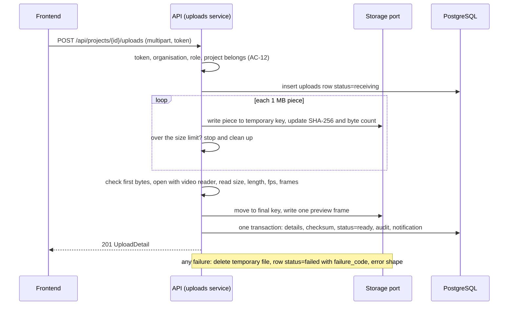

# Johnson Road — Low-Level Design

Version: 0.1 · Date: 2026-11-07 · Status: **draft, awaiting approval**

How the backend, the AI pipeline and the frontend wiring are built, step by step. Builds on SCOPE v0.4 (approved), REQUIREMENTS v0.3, ARCHITECTURE v0.2, DATA_MODEL v0.3 and `schema.sql`, and reuses their IDs (1.x to 6.x, AC-, NFR-, FR-, D1 to D5, F1 to F14, GAP-, O1 to O76, table names, invariant numbers).

> **Nothing here has been run.** No code, SQL, request or test was executed. "As built" means read in the code, with file and line. Every function name, path, request and response below is new design unless tagged As built. Where I could not verify something, the line says so.

**Tag key** (one tag per line or table row, never mixed): **As built** = verified in code, file and line, read not run. **Target** = design for later, from the blueprint or earlier docs. **Proposal** = my suggestion, needs the user's approval. **Open** = the user has not decided; owner the user; a default is given.

**Decisions in force** (SCOPE section 9, not re-opened): **B** (O48) backend PostgreSQL is the record, Supabase is sign-in only. **O72** PostgreSQL also for local development, tests run on a real Postgres. **O57** a retry is a new attempt of the same job, the failed attempt stays in `job_attempts`. **O66** `forward` = crossing from the left of the arrow from point 1 to point 2 toward its right. **O42** a job needs at least one line or one zone. Defaults kept: O1 (Supabase sign-in, backend verifies tokens), O3 (S3-compatible storage behind an interface), O4 (background task until Sprint 3, then worker), O7 (`running`), O16 (no Hooks layer), O24 (query value plus polling), O55, O56 as in ARCHITECTURE.

---

## 1. Backend module design

### 1.1 Folders and what each owns

| Folder | Owns | Today (As built) | Change (Target) |
|---|---|---|---|
| `routers/` | HTTP paths, status codes | 5 routers (`main.py:22-26`); `projects.py` serves `mock_data` | One router per area (section 5). No logic, no SQL |
| `schemas/` | Request and response shapes | Only processing and upload declare them; camel case | One file per area, camel case kept (REQ 4.36), fixed word lists (REQ 4.35) |
| `services/` | Rules, state moves, who may do what, transactions | `upload_service.py` also writes files and runs jobs (`:28-38,64-149`) | Services call repositories, the storage port and the engine entry point |
| `repositories/` | All SQL | Python lists (`processing_repository.py:6-10`) | SQLAlchemy queries; every function takes `org_id` (4.3) |
| `database/` | Engine, session, models | SQLite path in code (`database.py:4`); unused `Project` model (`models.py:7-36`) | URL from settings; models match DATA_MODEL; numbered SQL migrations (16.8) |
| `ai/` | Counting engine | Section 9 | One entry point `run_analysis` (9.1) |
| `core/` | Settings, errors, logging, request id | `config.py` fixed values (`:5-12`) | Section 3 |
| `auth/` (new) | Token check, principal, role table | none | Section 4 |
| `storage/` (new) | Storage port, two adapters | Folder `uploads` made at import (`upload_service.py:12-13`) | 6.2 |
| `jobs/` (new) | Claim, runner, heartbeat, recovery, scheduler | Background task (`upload_service.py:152-153`) | Sections 8, 12 |

- **Proposal**: import rule. `routers -> services -> repositories -> database`; `services -> storage`; `services -> auth` (role table only); `jobs -> services, repositories, storage, ai`; `ai` imports nothing above it; `core` and `schemas` importable by all. ARCHITECTURE section 4 states the same direction as a Proposal; `auth`, `storage`, `jobs` are added here.
- **Target**: a test fails the build if `app/ai` imports `routers`, `services`, `repositories`, `jobs` or `storage` (ARCHITECTURE section 4).
- **Proposal**: the engine gets the video and model as plain file paths from the caller, so `ai/` never needs the storage port.

### 1.2 What exists and what happens to it

| Item | Fact | Plan | Tag |
|---|---|---|---|
| `app/api/projects.py` | Not registered, imports names that do not exist (GAP-3) | Untouched until the user decides (O54); the new router is `routers/projects.py` | Open |
| In-memory repositories | Lists copied from `mock_data` | Replaced by SQL repositories, each deleted when its route is switched | Target |
| `services/mock_data.py` | Feeds every router except `POST /api/uploads` | Deleted when the last route stops reading it (Sprint 5) | Target |
| `upload_service.py` | Client name in path, runs the job, holds job dicts | Split into `upload_service`, `job_service` (create, cancel, retry), `jobs/runner.py` | Target |
| `airuntime`, `ai_pipeline` singletons | Built at import (`pipeline.py:76`, `runtime.py:146`); detector loads before startup (F3) | Engine built per job in the worker; `/health` reads a status that loads no model | Target |
| `main.py` startup | `airuntime.initialize()` (`:29-31`) | After Sprint 3 the API does not load a detector | Target |
| `DetectorFactory` | Reads private `airuntime._initialized` (`factory.py:7`) | Removed with the singleton | Target |

### 1.3 Module catalogue

| Module | Owns tables | Public functions (names are Proposal) | Called by |
|---|---|---|---|
| `account` | `users`, `organizations`, `organization_members`, `organization_invites` | `get_or_create_user`, `onboard`, `invite`, `change_role`, `remove_member`, `transfer_ownership`, `accept_invite` | routers `account`, `organizations` |
| `projects` | `projects` | `create_project`, `list_projects`, `get_project`, `rename`, `archive` | router `projects`, `dashboard` |
| `uploads` | `uploads` | `receive_upload`, `get_upload`, `delete_upload`, `get_preview_frame` | router `uploads` |
| `configurations` | `analysis_configurations`, `counting_zones`, `zone_points`, `counting_lines` | `create_configuration`, `get_configuration`, `new_version_from` | router, `jobs` |
| `jobs` | `jobs`, `job_attempts`, `job_events` | `create_job`, `list_jobs`, `get_job`, `cancel_job`, `retry_job`, `claim_next_job`, `record_progress`, `finish_job`, `fail_job` | router, `jobs/runner` |
| `results` | `job_results`, `count_buckets`, `job_artifacts` | `write_result`, `get_result`, `get_buckets`, `open_artifact` | runner, routers |
| `reports` | `reports`, `report_files` | `create_report`, `list_reports`, `export_report` | router |
| `dashboard` | none | `get_dashboard` | router |
| `notifications` | `notifications` | `notify`, `list_for_user`, `mark_read` | `jobs`, `uploads`, `reports` |
| `audit` | `audit_events` | `record` | every state-changing service |
| `settings_store` | `settings` | `get_limits`, `get_retention` | `uploads`, retention job |

- **Proposal**: the catalogue is mine; only table ownership follows DATA_MODEL section 2.

---

## 2. Process layout

| Period | Where jobs run | Tag |
|---|---|---|
| Today | FastAPI background task inside the web process; job is a dict (`upload_service.py:152-153`) | As built |
| Sprint 2 | Same background task, but on a real `jobs` row, calling the same claim and finish functions the worker will use | Proposal |
| After Sprint 3 | `python -m app.jobs.worker`: claim loop, engine, heartbeat, scheduler; the API never loads a detector (O4) | Target |

- **Open**: more than one worker, or a GPU worker. Owner: the user. Default: one worker, one job at a time (O50).

---

## 3. Shared pieces

### 3.1 Configuration loading

- **As built**: AI settings are read from environment at import; a bad number raises at import (`ai/settings.py:5-18`). `core/config.py:5-15` has fixed values; `model = "stub"` (`:7`) is read by nobody. No file loads `.env` (SCOPE 6.1).
- **Target**: one `Settings` object loaded once (REQ 6.8), `get_settings()`. **Proposal**: library `pydantic-settings`, not in `requirements.txt` (not verified installed).
- **Proposal**: existing variable names are kept (SCOPE 6.1 table). New ones:

| Variable | Default | Meaning | Tag |
|---|---|---|---|
| `DATABASE_URL` | required | PostgreSQL URL; driver package not chosen (not in `requirements.txt`) | Proposal |
| `SUPABASE_JWKS_URL` or `SUPABASE_JWT_SECRET`, `SUPABASE_ISSUER`, `SUPABASE_AUDIENCE` | required | Token check; which of the first two depends on O51 | Open |
| `STORAGE_BACKEND`, `STORAGE_ROOT` | `local`, `<repo>/data` | `local` or `s3` (O3); sources and outputs in separate sub-areas (NFR-4) | Proposal |
| `S3_ENDPOINT`, `S3_BUCKET_SOURCES`, `S3_BUCKET_OUTPUTS`, `S3_ACCESS_KEY`, `S3_SECRET_KEY` | none | Secrets from the platform, never git (NFR-3) | Proposal |
| `MODELS_DIR` | `<repo>/backend/models` | `MODEL_PATH` is resolved against it, never against the working folder (F2, REQ 5.28); production location is O49 | Proposal |
| `MAX_VIDEO_SIZE`, `MAX_VIDEO_LENGTH`, `ALLOWED_VIDEO_EXTENSIONS` | see O8, O18 | Read for the first time by upload code (D3); length unit is O8 | Open |
| `CORS_ORIGINS`, `API_PREFIX`, `APP_NAME` | as today | The root `.env` names the last two, nothing reads them | Proposal |
| `LOG_LEVEL`, `LOG_FORMAT` | `INFO`, `json` | 3.4 | Proposal |
| `HEARTBEAT_SECONDS`, `STALE_AFTER_SECONDS`, `JOB_TIMEOUT_SECONDS`, `JOB_MAX_RETRIES`, `SIGNED_LINK_SECONDS` | see O81, O46, O82 | Timeouts and retries have no default (O46) | Open |

- **Target**: `.env.example` lists every name with a blank or safe value; `.gitignore` gets `!.env.example` (REQ 6.7, 6.8, F7).
- **Proposal**: missing required variable: the process refuses to start with one plain message naming it.

### 3.2 Error type and one error shape

- **Open**: shape. Default (O26): `{ "error": { "code", "message", "diagnosticId" } }`, used below.
- **As built**: no handler of its own (REQ 4.9); an unknown job id returns 200 `not_found` (`routers/processing.py:20-28`).
- **Proposal**: one exception `AppError(code, http_status, message, diagnostic_id=None, details=None)` and three handlers: `AppError`, request validation (`invalid_input`, 422) and any other exception (`internal_error`, 500, fresh `diagnosticId`).
- **Proposal**: `diagnosticId` is set for every 5xx and every job failure; the raw exception and stack go to the log under it and nowhere else (NFR-9, REQ 4.33). `message` always comes from the catalogue (section 14); `str(exc)` is never copied into it (today it is: `upload_service.py:133`). `details` only for input errors (field, limit), never a path.

### 3.3 Request id and correlation id (NFR-11)

- **Proposal**: middleware accepts `X-Request-Id` matching `[A-Za-z0-9-]{8,64}` or makes a uuid, keeps it in a context variable, returns it on every response, writes it to `audit_events.request_id`.
- **Proposal**: `create_job` stores the request id in the `job_created` audit row; the worker puts `job_id` and that request id on every log line of the job. **Target**: one id travels API to job to worker (blueprint section 12).

### 3.4 Logging

- **As built**: no `basicConfig`, `dictConfig` or formatter in `backend/app`, so `extra=` fields (`upload_service.py:112-125,136-149`) never print; `log_inference` is never called (`runtime.py:113`; ARCHITECTURE 13).
- **Proposal**: `core/logging.py` configures logging once per process: one JSON object per line with `time, level, logger, message, request_id, job_id, org_id, user_id, route, status, duration_ms`. A redaction filter masks keys `authorization, token, password, secret, key, cookie` and bearer-looking values; client file names are logged only as the generated id (NFR-7). Existing logger names stay.
- **Open**: metrics product (NFR-16). No default (O47).

### 3.5 Pagination, ids, time

- **Proposal**: list routes take `limit` (default 25, max 100) and an opaque `cursor`, and return `{ "items": [...], "nextCursor": "..." | null }`. The frontend services unwrap `items`, so types keep returning arrays.
- **Target**: ids are uuids made by the database, sent as strings. Times are `timestamptz`, UTC, sent as ISO 8601 with `Z`; recorded camera date and times are plain `date` and `time` (O68).
- **Proposal**: display strings the types ask for (`startedAt`, `time`, `duration`) are made in the frontend services; `eta` and `currentFrame` are made in the backend (5.4).

---

## 4. Authentication and authorisation

### 4.1 Token check (O1, O51)

- **Target**: the browser signs in with Supabase and sends `Authorization: Bearer <token>` on every call except `/health` and `/` (O26 default).
- **Open**: signature check by public keys or shared secret. Default: public keys. Which this project uses: not verified (O51).
- **Proposal**: `verify_token(raw) -> TokenClaims` checks signature, expiry, issuer, audience (30 seconds clock tolerance); reads `sub` (becomes `users.auth_subject`) and `email`. Any failure is `401 invalid_token`. Library default `PyJWT`, not in `requirements.txt`. The key document is cached 10 minutes and refetched once on an unknown key id; if the fetch fails with no cache the answer is `503 auth_unavailable`, never "accepted".
- **Open**: verified email before first login (O11 default yes). The claim that carries it: not verified.

### 4.2 The principal and the dependency

```python
@dataclass(frozen=True)
class Principal:      # Proposal
    user_id: UUID; auth_subject: str; request_id: str
    org_id: UUID | None; role: Literal["owner", "admin", "researcher"] | None
```

- **Proposal**: dependency `current_principal` does AC-12 checks 1 and 2 (token; find or create user; find the one membership). Routes add `Depends(require(Action.X))` for check 4. Check 3 sits inside every repository call. No route builds its own check, so none can skip one (ARCHITECTURE 9.2).
- **Proposal**: `GET /api/me`, `POST /api/onboarding`, `POST /api/invites/accept` use `current_user_only` (no organisation needed); every other route returns `403 onboarding_required` when `org_id` is `None`.

### 4.3 Organisation scoping in every repository call

- **Proposal**: every repository function on an organisation-owned table takes `org_id` first and puts it in `WHERE`. No function reads a project, upload, configuration, job, result, report or notification by id alone. A foreign and a missing id both give `404 not_found` (AC-12 step 3). `job_events`, `job_attempts`, `job_artifacts` have no organisation column (invariant 5), so their functions join to `jobs` and filter there.
- **Target**: the database does not enforce reads (invariant 6); a test asks every function for the other organisation's data (16.3).

### 4.4 Roles (AC-1 to AC-17)

- **Target**: three code roles `owner`, `admin`, `researcher` (O15 default; `supabase.ts:15`).
- **Proposal**: the AC table is a Proposal in REQUIREMENTS; below it in code form. The "?" cells for project manager have no code role (O15), so they are not built.

| Action (code name) | owner | admin | researcher | AC |
|---|---|---|---|---|
| `ORG_DELETE`, `BILLING_MANAGE` | Y | N | N | AC-1 |
| `MEMBER_MANAGE` | Y | Y | N | AC-2 |
| `PROJECT_WRITE` | Y | Y | Y (default for the "?" cell) | AC-3 |
| `UPLOAD_WRITE`, `CONFIG_WRITE`, `JOB_CREATE`, `JOB_CANCEL`, `JOB_RETRY` | Y | Y | Y | AC-4, AC-5 |
| `READ`, `DASHBOARD_READ` | Y | Y | Y | AC-6, AC-8 |
| `REPORT_WRITE`, `REPORT_EXPORT` | Y | Y | Y | AC-7 |
| `USAGE_READ` | Y | Y | N | AC-9 |

- **Proposal**: a researcher may cancel or retry any job of the organisation, not only their own (part of O15).
- **Target**: the table lives in one dict in `auth/permissions.py`; roles are compared nowhere else. The frontend hides, the backend decides (AC-13).

### 4.5 Check order (AC-12, Proposal)

| Step | Check | Failure | Where |
|---|---|---|---|
| 1 | Token valid | `401 invalid_token` | `current_principal` |
| 2 | Which organisation | `403 onboarding_required` | `current_principal` |
| 3 | Thing belongs to it | `404 not_found` | repository `WHERE org_id` |
| 4 | Role allows | `403 forbidden` | `require(Action.X)` |
| 5 | Input valid | `422` with the rule's code | schema, service |
| 6 | Do the work | | service |

- **Proposal**: for list and create routes step 4 runs before 3 (no id yet); for routes with an id it runs after, so a researcher deleting a foreign project gets `404`, not `403`. Refusals at steps 1, 2, 4 write an `audit_events` row `outcome = refused` with `reason_code` (AC-14); step 1 has no organisation.

### 4.6 First-call user creation (O65 default) and onboarding (REQ 1.13, 1.34)

- **Target**: the `users` row is created on the first authenticated call, found by `auth_subject` (DATA_MODEL 4.1). **Proposal**: `INSERT ... ON CONFLICT (auth_subject) DO NOTHING` then select, so two first calls make one row; `email` is copied from the token once.
- **Proposal**: `onboard(user, org_name, full_name)` in one transaction: insert organisation (slug from the name plus a short random suffix), insert owner membership, set `users.full_name`, write audit `organization.created`; any failure rolls back all. A user who already has a membership gets `409 already_member` (O67). This replaces the three Supabase writes (`OnboardingPage.tsx:36,48,63`) and fixes F11.
- **Open**: suspended users. Default: `403 account_suspended` at step 2.

### 4.7 Fixing F12 inside the backend

- **Target**: `change_role` and `invite` refuse role `owner` from any caller (`409 owner_role_reserved`); `transfer_ownership` is owner-only and runs two statements in one transaction, demoting the old owner first, then promoting the new one (DATA_MODEL 4.2); demote, suspend or remove of the last owner is refused (`409 last_owner`, invariant 2).
- **Proposal**: a member cannot change their own role (`403 forbidden`).

---

## 5. API design

All paths are `/api/...`. Every new path is a **Proposal** (ARCHITECTURE section 7: REQUIREMENTS 4B names no paths). Field names are camel case and follow `frontend/src/types/*` (REQ 4.36). Auth: `P` public, `U` any signed-in user, `R` any member, otherwise the roles listed.

### 5.1 Existing routes: stay, change, go (O56 default: old routes keep working)

| Existing route (As built) | Plan | Tag |
|---|---|---|
| `GET /health`, `GET /` (`main.py:39-55`) | Stay, public; `/health` adds `databaseReady`, `workerReady` | Target |
| `GET /api/dashboard`, `/api/projects`, `/{id}`, `/{id}/videos`, `/{id}/reports`, `/location-suggestions` (`routers/projects.py:14-37`) | Stay with the same shapes; real data from Sprint 2 (dashboard Sprint 5) | Target |
| `GET /api/uploads` (`routers/uploads.py:14-17`) | Stays, same response (`files`, `locationSuggestions`); `files` empty by default | Proposal |
| `POST /api/uploads` (saves and creates the job, `:20-33`) | Works unchanged until the frontend moves; then becomes upload-only. Default: keep until moved (O56) | Open |
| `GET /api/processing` (`routers/processing.py:11-14`) | Stays with the `ProcessingResponse` shape, built from job rows (closes GAP-7) | Target |
| `GET /api/processing/jobs/{job_id}` (`:17-36`) | Stays; unknown id returns `404 not_found` instead of 200 `not_found` (REQ 4.34). Nothing in the frontend calls it today | Open |
| `GET /api/reports` and project reports | Stay; real in Sprint 5. Not read in detail for this file | Target |
| `app/api/projects.py` | Not served, not touched (O54). Nothing is removed in this version | Open |

### 5.2 Account, organisations, members, invites

| Method and path | Auth | Request | Response | Errors | Req |
|---|---|---|---|---|---|
| `GET /api/me` | U | none | `{ user, organization\|null, role\|null, needsOnboarding }` | 401 | 4.10, 1.12 |
| `POST /api/onboarding` | U | `{ organizationName, fullName? }` | `{ user, organization, role }` 201 | 409 `already_member` | 1.34 |
| `PATCH /api/me` | U | `{ fullName?, avatarUrl? }` | `{ user }` | 422 | 1.26 |
| `GET`/`PATCH /api/organization` | R / owner, admin | `{ name }` | `{ id, name, slug, plan, memberCount }` | 403, 422 | 1.31 |
| `GET /api/organization/members` | R | none | `{ items: [{ userId, email, fullName, role, status }] }` | | 1.15 |
| `PATCH`/`DELETE /api/organization/members/{userId}` | owner, admin | `{ role?, status? }` | member / 204 | 403, 409 `owner_role_reserved`, `last_owner` | 1.35 |
| `POST /api/organization/transfer-ownership` | owner | `{ toUserId }` | 204 | 403, 404 | 1.35 |
| `POST`/`GET /api/organization/invites`, `DELETE .../{id}` | owner, admin | `{ email, role }` (`admin` or `researcher`) | `{ id, email, role, expiresAt }` 201 | 409 `invite_exists`, `owner_role_reserved` | 1.16 |
| `POST /api/invites/accept` | U | `{ token }` | `{ organization, role }` | 404 `invite_not_found`, 410 `invite_expired`, 409 `already_member` | 1.16 |

- **Proposal**: invite token = 32 random bytes shown once in the link, only its hash stored (DATA_MODEL section 1). Delivery is O38; lifetime 7 days (O69).
- **Proposal**: no route deletes an organisation (AC-1) in this version; the purge (O73) is run from a script by the system owner because it cannot be undone. A route needs the user's approval.

### 5.3 Projects, uploads, configurations

| Method and path | Auth | Request | Response | Errors | Req |
|---|---|---|---|---|---|
| `POST /api/projects` | `PROJECT_WRITE` | `{ name, location?, description?, defaultOptions? }` | `Project` 201 | 409 `project_name_taken` | 2.2 |
| `GET /api/projects?search=&archived=` | R | | `Project[]` | | 2.5 |
| `PATCH /api/projects/{id}`, `POST .../archive` | `PROJECT_WRITE` | `{ name?, location?, description? }` | `Project` | 404, 409 | 2.2 |
| `GET /api/projects/{id}/jobs` | R | | `{ items: JobQueueItem[] }` | 404 | 4.12 |
| `POST /api/projects/{id}/uploads` | `UPLOAD_WRITE` | multipart `file`, optional `cameraId, roadName, recordedDate, recordedStartTime, recordedEndTime, weather, notes`; header `Idempotency-Key` | `UploadDetail` 201 | 413, 415, 422, 409 | 4.13 |
| `GET`/`DELETE /api/uploads/{id}` | R / `UPLOAD_WRITE` | | `UploadDetail` / 204 | 404, 409 `upload_in_use` | 4.14 |
| `GET /api/uploads/{id}/preview` | R | | image bytes (one real frame) | 409 `upload_not_ready` | 2.44 |
| `POST /api/uploads/{id}/configurations` | `CONFIG_WRITE` | `ConfigurationInput` | `ConfigurationDetail` 201 | 404, 422 | 4.15 |
| `GET /api/configurations/{id}` | R | | `ConfigurationDetail` | 404 | 4.15 |

- **Proposal**: the upload route sits under the project so the project check is one lookup. `UploadDetail` extends `UploadFile` (`types/upload.ts:1-10`: `id, name, size, duration, resolution, fps, progress, status`) with `projectId, durationSeconds, width, height, frameRate, checksum, previewUrl`. The existing status words are `uploading|queued|done|error`; the backend returns `done` for `ready`, `error` for `failed`.
- **Proposal**: `ConfigurationInput` omits what the wizard has no control for (O23); the response shows the final stored values (DATA_MODEL 4.5, R8):

```json
{ "modelName": "yolov8n", "tracker": "bytetrack", "confidenceThreshold": 0.45, "classes": ["car","truck","bus","motorcycle"],
  "generateReport": true,
  "zones": [{ "name": "Zone 1", "points": [{"x":0.1,"y":0.4},{"x":0.9,"y":0.4},{"x":0.9,"y":0.95}] }],
  "lines": [{ "name": "Line 1", "start": {"x":0.1,"y":0.6}, "end": {"x":0.9,"y":0.6}, "direction": "forward" }] }
```

### 5.4 Jobs

| Method and path | Auth | Request | Response | Errors | Req |
|---|---|---|---|---|---|
| `POST /api/jobs` | `JOB_CREATE` | `{ uploadId, configurationId }`, header `Idempotency-Key` | `JobDetail` 201 (200 on repeat) | 404, 409 `upload_not_ready`, 422 `no_line_or_zone` | 4.16, 2.49 |
| `GET /api/jobs?status=&projectId=` | R | | `{ items: JobQueueItem[] }` | | 4.17 |
| `GET /api/jobs/{id}` | R | | `JobDetail` | 404 | 3.39 |
| `GET /api/jobs/{id}/events?after=` | R | | `{ items: LogEntry[] }` | 404 | 3.6 |
| `POST /api/jobs/{id}/cancel`, `/retry`, `/rerun` | `JOB_CANCEL` / `JOB_RETRY` / `JOB_CREATE` | | `JobDetail` | 404, 409 `job_not_cancellable`, `job_not_retryable`, `job_not_finished` | 3.7, 3.10, 3.36 |

- **Proposal**: `JobDetail` = `JobQueueItem` (`types/processing.ts:4-19`) plus `ProcessingJob` fields (`:21-31`) plus `uploadId, configurationId, attempt, errorCode, safeMessage, diagnosticId, isRetryable, cancelRequested, finishedAt`.
- **Proposal**: `gpu`, `cpu`, `memory` return `0` until a source exists (O25); screens hide them when `0`. `vehicleCount` has no source while running (DATA_MODEL 5b): returned `0` until `completed`, and the page shows it only then; shown during a run, `0` would mislead.
- **Proposal**: `eta` is `"Queued"`, `"In progress"`, `"12 min"` (from frames and `processing_fps`), `"Done"` or `"—"` (the strings screens use today, `upload_service.py:49,81,98`); `currentFrame` is `"<frames_done>/<frames_total>"`. Pause is not offered (O30).

### 5.5 Results, evidence, reports, dashboard, notifications

| Method and path | Auth | Request | Response | Errors | Req |
|---|---|---|---|---|---|
| `GET /api/jobs/{id}/result` | R | | `ResultDetail` | 409 `job_not_completed` | 4.19 |
| `GET /api/jobs/{id}/result/buckets?class=&direction=&lineId=&zoneId=` | R | | `{ items: Bucket[] }` | 409 | 3.20 |
| `GET /api/jobs/{id}/artifacts`, `GET /api/artifacts/{id}/content` | R | | list / stream or `302` to a short link | 410 `artifact_deleted` | 4.20 |
| `POST /api/reports` | `REPORT_WRITE` | `{ jobId, reportType, options? }` | `ReportDetail` 201 (200 on repeat) | 409 `job_not_completed` | 3.19, 3.22 |
| `GET /api/reports?projectId=&type=&from=&to=`, `/{id}` | R | | `{ items: ProjectReport[] }` | | 3.20 |
| `GET /api/reports/{id}/export?format=csv\|pdf` | `REPORT_EXPORT` | | file | 422 `format_not_supported` | 3.21 |
| `GET /api/reports/analytics?projectId=&from=&to=`, `GET /api/dashboard?range=` | R | | `ReportAnalytics`, `DashboardData` | | 3.13 |
| `GET /api/notifications?unread=`, `POST .../{id}/read`, `POST .../read-all` | R | | `{ items }` / 204 | 404 | 3.11 |

- **Proposal**: `ResultDetail` has `method: "line_crossing"`, `isEstimate: true`, `confidenceMean`, `vehiclesCounted`, `framesProcessed`, `modelName`, `modelFileSha256`, `codeVersion`, `configurationVersion`, `bucketSeconds`, `timeBase` (R2, REQ 3.23).
- **Proposal**: Dashboard and analytics keep their existing keys; fields with no source (`aiInsights`, `aiTimeline`, `quickActions`, `segmentDetails`, `insightDetails`, DATA_MODEL 5b) return empty arrays or objects and the screens show empty states. **Open**: Excel and share link are not offered (O31).

### 5.6 Examples (Proposal; typed to `frontend/src/types/*`)

**A. Onboarding** `POST /api/onboarding`

```json
{ "organizationName": "Harbour City Roads", "fullName": "Ana Pereira" }
```
```json
{ "user": { "id": "5d1c...", "email": "ana@example.org", "fullName": "Ana Pereira" },
  "organization": { "id": "9a42...", "name": "Harbour City Roads", "slug": "harbour-city-roads-k3x", "plan": "starter" }, "role": "owner" }
```

**B. Upload accepted** `POST /api/projects/{id}/uploads` (matches `UploadFile` plus extras)

```json
{ "id": "c0f3...", "projectId": "7be1...", "name": "cam_01_northbound.mp4", "size": 412887040, "duration": "0h 12m",
  "resolution": "1920×1080", "fps": 30, "progress": 100, "status": "done", "durationSeconds": 726.4,
  "width": 1920, "height": 1080, "frameRate": 30.0, "checksum": "9b74...", "previewUrl": "/api/uploads/c0f3.../preview" }
```

**C. Create job** `POST /api/jobs` body `{ "uploadId": "c0f3...", "configurationId": "e81a..." }`, response (`JobQueueItem` plus extras)

```json
{ "id": "3f9d...", "projectName": "A406 East", "projectId": "7be1...", "progress": 0, "eta": "Queued", "status": "queued",
  "priority": "normal", "stage": "queued", "fps": 0, "gpu": 0, "cpu": 0, "memory": 0, "queuePosition": 2, "startedAt": "—",
  "uploadId": "c0f3...", "configurationId": "e81a...", "attempt": 1, "isRetryable": false }
```

**D. Running job** `GET /api/jobs/3f9d...` (`ProcessingJob` plus extras)

```json
{ "id": "3f9d...", "projectName": "A406 East", "progress": 42, "stage": "detecting", "eta": "7 min", "status": "running",
  "fps": 14, "currentFrame": "9100/21700", "vehicleCount": 0, "attempt": 1, "cancelRequested": false }
```

**E. Failed job** (same route, later; progress keeps its last value, today a failure resets it to 0, `upload_service.py:127`)

```json
{ "id": "3f9d...", "status": "failed", "progress": 42, "stage": "detecting", "eta": "—", "errorCode": "model_missing",
  "safeMessage": "The detection model could not be loaded. Please contact support with the reference below.",
  "diagnosticId": "JR-7Q4M2K", "isRetryable": false }
```

**F. Error shape** `POST /api/jobs/{id}/cancel` on a completed job, 409

```json
{ "error": { "code": "job_not_cancellable", "message": "This job has already finished and cannot be cancelled.", "diagnosticId": null } }
```

**G. Buckets** `GET /api/jobs/{id}/result/buckets?direction=forward`

```json
{ "items": [{ "bucketIndex": 0, "bucketStartSeconds": 0, "vehicleClass": "car", "direction": "forward",
              "lineId": "a7c2...", "zoneId": null, "vehicleCount": 41, "confidenceMean": 0.71 }] }
```

---

## 6. Upload flow in detail



| # | Step | Detail | Tag |
|---|---|---|---|
| 1 | Pre-checks | Role and project first. `Content-Length` over the limit gives `413` at once (the header can lie; step 3 is the real check) | Proposal |
| 2 | Name (D4) | Key is `<uuid>.<ext>`; `ext` from the allowed list and the container found in step 5, never from client text. `original_name` = client name with directory parts, drive letters and control characters removed, trimmed, cut to 120 characters, empty becomes `video` | Target |
| 3 | Streaming write (D3) | Read 1 MB pieces, write to `sources/tmp/<uuid>.part`, keep a running SHA-256 and byte count; when the count passes `MAX_VIDEO_SIZE` stop, delete the part, answer `413 file_too_large`. Memory stays at one piece. Replaces `buffer.write(file.file.read())` (`upload_service.py:32`) | Target |
| 4 | Extension | Not in `ALLOWED_VIDEO_EXTENSIONS`: `415 unsupported_type` before storing | Target |
| 5 | Content check | First 32 bytes: MP4 family has `ftyp` at bytes 4 to 8; Matroska starts `1A 45 DF A3`; AVI starts `RIFF` with `AVI ` at 8 to 12. No match: `415`, file deleted | Proposal |
| 6 | Real reader | Open with the reader (O77): frames, frame rate, width, height; duration = frames / rate. Cannot open or zero frames: `422 unreadable_video` | Target |
| 7 | Length | Over `MAX_VIDEO_LENGTH`: `422 video_too_long`; unit is O8 | Open |
| 8 | Preview | Decode one frame (position O85), JPEG to `sources/previews/<uuid>.jpg`, key in `preview_frame_key` | Proposal |
| 9 | Commit | Move part to `sources/<uuid>.<ext>`; update row to `ready` with every detail (CHECK, invariant 21); audit; notification | Target |
| 10 | Notes | Text trimmed and cut (200; notes 2000); times before `24:00` (invariant 30, O75) else `422 invalid_time` | Target |

- **Open**: reader library, default OpenCV headless, not in `requirements.txt` and not tried on this machine (O77). Upload transport, default one streamed request per file, no resumable upload (O86).
- **Proposal**: one file per request; the wizard sends files one after another so each has its own progress and Retry (REQ 2.42). The transfer holds a web thread for its duration; a background upload is not designed.

### 6.1 Failure, cleanup, retry

| Failure | Left behind | User sees | Tag |
|---|---|---|---|
| Over limit, wrong type, unreadable, too long | Row `failed` with `failure_code` (DATA_MODEL default), no file | Message of section 14 | Target |
| Connection dropped | `finally` deletes the part file, row `failed` `upload_interrupted` | Retry button | Proposal |
| API killed mid-upload | Part file and `receiving` row | After 1 hour the cleanup job deletes it and sets `failed` (12) | Proposal |
| Same request twice | `Idempotency-Key` (unique per organisation) returns the first row with 200 | One upload (REQ 4.39) | Proposal |
| Same file again (same checksum) | New row; response carries `duplicateOf` | Warning only (DATA_MODEL 4.4) | Open |

### 6.2 Storage interface (O3)

```python
class Storage(Protocol):   # Proposal; Area = "sources" | "outputs"
    def put_stream(self, area, key, chunks) -> StoredObject: ...   # size, sha256
    def open_read(self, area, key) -> BinaryIO: ...
    def local_path(self, area, key) -> Path: ...                   # worker; S3 downloads to a temp file
    def delete(self, area, key) -> None: ...
    def signed_url(self, area, key, seconds) -> str | None: ...    # S3 only
```

- **Proposal**: `LocalStorage` writes under `STORAGE_ROOT/<area>/<key>` and refuses a key containing `/`, `\` or `..` or not matching `[0-9a-f-]{36}\.(mp4|mkv|avi|jpg)` (D4 defence in depth). `S3Storage` uses one bucket per area; library not chosen (not in `requirements.txt`).
- **Target**: the database holds the key only, never a machine path; sources and outputs are separate (NFR-4, AC-17). **Proposal**: local files stream through the API after the same checks; S3 hands out a link valid `SIGNED_LINK_SECONDS`.
- **Open**: link lifetime. Default 5 minutes (O82).

---

## 7. Configuration and job creation

### 7.1 Validation (`create_configuration`)

| Rule | Error code | Tag |
|---|---|---|
| Upload exists, is `ready`, in the caller's organisation | `404 not_found`, `409 upload_not_ready` | Target |
| Every coordinate 0 to 1 inclusive; a line's two points differ (invariant 13) | `422 coordinates_out_of_range`, `line_too_short` | Target |
| Zone has at least 3 points (invariant 14); edges do not cross each other (my addition) | `422 zone_too_few_points`, `zone_self_crossing` | Proposal |
| `direction` is `forward`, `backward` or `both` | `422 invalid_direction` | Target |
| At least one line or one zone (O42) | `422 no_line_or_zone` | Target |
| `tracker` is `bytetrack`, `botsort` or `sort`; other names refused, never replaced (REQ 5.8) | `422 unsupported_tracker` | Target |
| `modelName` is in the server's list; `classes` are names the model knows (9.3) | `422 unsupported_model`, `unsupported_class` | Target |
| `confidenceThreshold` 0.10 to 0.95 (REQ 2.25) | `422 invalid_threshold` | Target |
| `iouThreshold` 0.05 to 0.95, `frameSkip` 1 to 30, `batchSize` 1 to 32, `bucketSeconds` 60 to 3600 (ranges mine) | `422 invalid_option` | Proposal |

- **Target**: the service writes a final value into every column (DATA_MODEL 4.5). `version_no` = previous maximum for the upload plus one, taken under a lock on the upload row so two saves give two numbers.
- **Target**: a configuration is immutable once locked (invariants 11, 12). Going back in the wizard and changing something calls `new_version_from(config_id, changes)`, which copies zones, points and lines into a new version (`based_on_id`). **Proposal**: an unlocked configuration with no job is deleted after 7 days by the cleanup job (value mine).

### 7.2 Creating a job (`create_job`)

```mermaid
sequenceDiagram
    participant FE as Frontend
    participant API as API
    participant DB as PostgreSQL
    FE->>API: POST /api/jobs {uploadId, configurationId} + Idempotency-Key
    API->>DB: begin
    API->>DB: job with this (org, key) exists? return it, 200
    API->>DB: upload (ready) and configuration (same upload), scoped to org
    API->>DB: insert jobs status=queued (jobs_insert_trg); trigger locks the configuration
    API->>DB: audit job.created with request id
    API->>DB: commit
    API-->>FE: 201 JobDetail (status queued, queuePosition)
```

- **Target**: `project_id` and `organization_id` of the job come from the upload row, never from the request. Creating a job locks its configuration (invariant 12).
- **Target**: repeat safety (REQ 4.39, invariant 24): `Idempotency-Key` (client makes one uuid when the Queue step opens, reuses it on a retry of the same click) maps to `jobs_idem_uq`. **Proposal**: without the header, an existing `queued` or `running` job for the same `(upload_id, configuration_id)` is returned; a deliberate second run uses `rerun`.
- **Proposal**: `create_job` writes no `job_events` line and no `job_attempts` row: the attempt row is created by the claim (8.2), because `job_events` needs it (FK) and an attempt that has not started does not exist yet. Queue position is computed, not stored.
- **Proposal**: `rerun` creates a new job on the same upload and configuration with `rerun_of_job_id` set; changed settings go through a new configuration version. `timeout_seconds` is copied from the setting at creation.

---

## 8. Job execution

### 8.1 State machine

```mermaid
stateDiagram-v2
    [*] --> queued: INSERT only as queued (jobs_insert_trg, inv. 27)
    queued --> running: worker claim (jobs_move_trg, inv. 8)
    queued --> cancelled: user cancels (jobs_move_trg)
    running --> completed: result first, then status, one transaction (jobs_completed_trg deferred inv. 10; CHECK progress 100 and finished_at)
    running --> failed: code, safe message, diagnostic id (CHECK inv. 9)
    running --> cancelled: worker sees cancel_requested_at (jobs_move_trg)
    failed --> queued: retry if is_retryable, new attempt (jobs_move_trg)
    completed --> [*]
    cancelled --> [*]
```



| Move | Done by | Database guard | Service rule | Tag |
|---|---|---|---|---|
| new to `queued` | `create_job` | `jr_check_job_insert` | upload ready, configuration valid | Target |
| `queued` to `running` | worker claim | `jr_check_job_move`; CHECK `started_at` | claim is one statement (8.2) | Target |
| `queued` to `cancelled` | `cancel_job` | `jr_check_job_move`; CHECK `finished_at` | sets `finished_at` | Proposal |
| `running` to `completed` | worker | `jr_check_result_job_running` on the result insert; `jr_check_completed_has_result` at commit; CHECK `progress_percent = 100`, `started_at`, `finished_at` | counts and status in one transaction (invariant 19) | Target |
| `running` to `failed` | worker, recovery | CHECK code, safe message, diagnostic id; CHECK `finished_at` | error mapped to a code (14) | Target |
| `running` to `cancelled` | worker | `jr_check_job_move` | only when `cancel_requested_at` is set | Target |
| `failed` to `queued` | `retry_job` | `jr_check_job_move` only if `is_retryable` | new attempt (8.5) | Target |
| out of `completed` or `cancelled` | nobody | trigger raises | a rerun is a new job | Target |

- **Open**: the moves (O9). Default: these.
- **Proposal**: the service raises the specific `409` before the trigger can; a trigger exception that still reaches the API is `500 internal_error` with a diagnostic id and is a bug. Cancelled jobs never keep partial results (REQ 3.38).

### 8.2 Worker loop

```mermaid
sequenceDiagram
    participant W as Worker
    participant DB as PostgreSQL
    participant E as Engine (run_analysis)
    participant ST as Storage port
    loop forever, sleep 2 s when idle
        W->>DB: claim: oldest queued FOR UPDATE SKIP LOCKED, set running, insert job_attempts, commit
        W->>DB: job_events attempt_started
        W->>ST: local_path of source
        W->>E: run_analysis(input, on_progress, should_stop)
        loop each batch
            E-->>W: frames_done, frames_total, stage
            W->>DB: progress, stage, fps, last_heartbeat_at; read cancel_requested_at
        end
        alt finished
            W->>ST: put artifacts into outputs
            W->>DB: one transaction: job_results, count_buckets, job_artifacts, job completed (100, finished_at), attempt completed, notification, audit
        else error
            W->>DB: one transaction: job failed (code, safe message, diagnostic id, is_retryable), attempt failed
        else stop requested
            W->>DB: one transaction: job cancelled, attempt cancelled; delete partial outputs
        end
    end
```

```sql
WITH next AS (SELECT id FROM jobs WHERE status = 'queued' ORDER BY queued_at LIMIT 1 FOR UPDATE SKIP LOCKED)
UPDATE jobs SET status='running', started_at=now(), last_heartbeat_at=now(), worker_id=:wid, stage='loading_video'
 WHERE id=(SELECT id FROM next) RETURNING *;   -- Proposal; same transaction inserts job_attempts (job_id, attempt_no, worker_id)
```

- **Target**: two workers cannot take one job (ARCHITECTURE 6.2). The `job_attempts` row commits with the claim, so the first log line already has its attempt (DATA_MODEL 4.6, FK on `job_events`).
- **Target**: model name and file hash, device and code version are written after the model loads and before the first frame (REQ 5.25). **Proposal**: `code_version` comes from a `CODE_VERSION` environment value set at build, falling back to `unknown`.
- **Proposal**: progress is written at most once per second; `progress_percent = floor(100 * frames_done / frames_total)` capped at 99 until completion. Each write also sets `last_heartbeat_at`; no separate heartbeat thread, because batches are small (default batch 1). How long a batch takes: not verified (O81).
- **Proposal**: `job_events` lines: `attempt_started`, `video_opened`, one per stage change, one per 10 percent, `cancel_seen`, `finished` or `failed`. Fixed templates with numbers; no exception text, no path.
- **Proposal**: cancel. A `queued` job goes straight to `cancelled`. A `running` job gets `cancel_requested_at` and `cancel_requested_by`, returns `cancelRequested: true`, stays `running` until the worker stops (at most one batch plus cleanup). **Open**: REQ 3.35 enables Cancel "only if the worker can stop safely"; default enabled whenever `should_stop` exists, which is always here.
- **Target**: an engine failure becomes a short code and a diagnostic id; the raw text goes to the log only (REQ 5.19).

### 8.3 Timeouts and restart recovery

- **Open**: timeout and retry values: no default (O46). **Proposal**: between batches the worker compares `now - started_at` with `timeout_seconds` (blank means off) and fails its own job `job_timeout`.
- **Open**: job left `running` by a dead worker. Default: `failed`, retryable, code `worker_lost` (O40).
- **Proposal**: recovery (12): `UPDATE jobs SET status='failed' ... WHERE status='running' AND last_heartbeat_at < now() - STALE_AFTER` plus its attempt row `failed`. A slow worker that wakes up finds its writes affect 0 rows, `should_stop` turns true, it discards its work. At worker start, jobs `running` with its own `worker_id` are failed at once.

### 8.4 Concurrency

- **Open**: jobs per worker at once. Default one (O50). **Proposal**: the model is cached per process by file path (as `lru_cache` does at `yolo_detector.py:48-50`).

### 8.5 Retry as a new attempt (O57)

- **Proposal**: `retry_job` in one transaction, only if `failed` and `is_retryable`: `status='queued', attempt_no = attempt_no + 1, queued_at = now(), started_at/finished_at/worker_id/cancel_requested_at = NULL, progress_percent = 0, frames_done = 0, stage = 'queued'`, error columns cleared, `is_retryable = false`. The schema does not forbid stale error columns on a queued job, so the service must clear them (test 16.3).
- **Target**: the failed attempt keeps its row with code and diagnostic id; the new attempt gets its own row at claim time and its own events.
- **Proposal**: retryable codes: `worker_lost`, `job_timeout`, `out_of_memory`, `storage_unavailable`, `internal_error`. Not retryable: `unreadable_video`, `model_missing`, `invalid_configuration`, `engine_failed`. List mine. **Open**: automatic retry and a limit; default none, retry is by click (O46).

---

## 9. AI pipeline internals

### 9.1 Entry point

```python
@dataclass(frozen=True)
class AnalysisInput:   # Proposal
    video_path: Path; model_path: Path; tracker: str; confidence: float; iou: float; frame_skip: int
    batch_size: int; classes: list[str]; bucket_seconds: int; zones: list[Zone]; lines: list[Line]
    annotate: bool; device: str
def run_analysis(inp: AnalysisInput, on_progress, should_stop, out_dir: Path) -> AnalysisOutput: ...   # Proposal
```

- **As built**: `AIPipeline.run(file_path)` takes only a path; model, tracker and thresholds come from `ai_settings` at import (`pipeline.py:27-41`). One tracker instance is made at import and `reset()` is never called (`pipeline.py:38,76`), so ids would carry across jobs.
- **Proposal**: the engine reads no environment variable and no database; everything arrives in `AnalysisInput`, built by the worker from the saved configuration (R8, ARCHITECTURE 5.4). The engine and its tracker are built per job.
- **Proposal**: stages: `loading_video`, then per batch `detecting`, `tracking`, `counting` (the stage field shows the current step), `aggregating`, `annotating`, `finishing` (O70). Stage start times have no stored source (DATA_MODEL 5b).

### 9.2 Video loader and frame reader

| Part | As built | Design | Tag |
|---|---|---|---|
| Video loader | Checks the path exists (`video_loader.py:5-9`) | `open_video(path) -> VideoInfo(width, height, frame_rate, frame_count, duration_seconds)`; unreadable raises `EngineError("unreadable_video")` | Target |
| Frame reader | `FrameBatch(source, frame_count=6)` (`frame_reader.py:8,12-13`) | `read_batches(path, batch_size, frame_skip)` yields `FrameBatch(frames, indices, times)` | Target |

- **Target**: frames in order, only `batch_size` in memory (REQ 5.4, F4). **Proposal**: frame skip keeps frame `n` when `n % frame_skip == 0` (D3, REQ 5.14); time is `n / frame_rate` from the real index. `frames_total = ceil(frame_count / frame_skip)`; if the container misreports its count, the reader stops at the first failed read and progress is set to 100 on completion. How often MKV or AVI misreport: not verified.

### 9.3 Detector (D1)

- **As built**: `YOLODetector.detect` passes `str(processed.source)`, the whole video path, to `model.predict` (`yolo_detector.py:114-117,78-88`); `frame_skip` stored, unused (`:44`); `Detection(...)` built without `class_id` (`:103-109`) while `interfaces.py:5-10` requires it, so the first real detection raises `TypeError` (D1).
- **Target**: D1 fix: `class_id=cls_index` (read on `yolo_detector.py:99`). The detector receives `FrameBatch.frames`, not a path; whether the installed Ultralytics version accepts a list of arrays in `predict`: not verified (O14).
- **Proposal**: `frame_index` is the real frame number from the batch, not a running count of results (`yolo_detector.py:92,111`).
- **Proposal**: class filter: the configuration lists names; the detector maps them to the model's own ids from `model.names` at load and keeps only those. A name the model lacks is `422 unsupported_class` at save time, `invalid_configuration` at run time. For COCO-trained weights the vehicle ids are 2, 3, 5, 7 from my general knowledge, not checked against `yolov8n.pt` here.
- **Proposal**: `warmup()` today calls `detect` on `Path("warmup.mp4")` and swallows the error (`runtime.py:95-101`), warming nothing; new warm-up runs one blank array.
- **Proposal**: the model path is `MODELS_DIR / MODEL_PATH` unless absolute; a missing file raises `EngineError("model_missing")`. The silent fallback to `yolov8n.pt` and the `parents[3]` guesses go (`runtime.py:77-89`, `yolo_detector.py:68`; F2, REQ 5.28) because a job would run with a different model than recorded. The `MODEL` word map becomes an explicit table of configuration `modelName` to file.

### 9.4 Tracker

- **As built**: `ByteTracker` and `SortTracker` make a new `TrackedObject` per detection (`bytetrack_tracker.py:13-27`, `sort_tracker.py:13-27`); `BoTSORTTracker` not read in detail. The factory silently falls back to ByteTrack (`trackers/factory.py:10-15`). `TrackedObject` has no box, centre or frame (`trackers/base.py:8-12`); `TrackObservation` (`interfaces.py:14-21`) has them and nothing uses it.
- **Plain words**: a tracker links the boxes of one vehicle across frames so it keeps one number. SORT does this with a motion guess and box overlap. ByteTrack adds the low-confidence boxes to keep a track alive when a vehicle is partly hidden. BoT-SORT adds camera-motion correction and can use appearance. Described from general knowledge, not from code in this repo.
- **Proposal**: interface `update(frame_index, time_s, detections) -> list[TrackObservation]` and `reset()`; `TrackObservation` is the existing type. An unknown name raises `invalid_configuration`; the silent fallback goes. Track ids are stable within one job only and are not stored (O58).
- **Open**: how the real trackers are provided. Default: adapters over the trackers shipped with Ultralytics for ByteTrack and BoT-SORT, own small SORT; not verified against the installed version, so the second default is an own simple overlap tracker (O78).
- **Proposal**: a track's class for counting is the class with most detections over its life (a track can flicker between `car` and `truck`).

### 9.5 Counter: line crossing

- **As built**: `Counter.count(tracks)` returns `len(tracks)` (`counter.py:6`); every function in `analytics.py` raises `NotImplementedError` (`:1-26`). **Target**: REQ 5.10, a vehicle counts once per line crossed, in the direction crossed, jitter does not count twice.

Lines and zones are stored 0 to 1; the counter converts to pixels (`x*width`, `y*height`) so distances are real. The count point `P` of a track is the bottom-centre of its box (reason: it touches the road, the centre moves with vehicle height). Per line from point `A` to point `B`, for every kept frame:

1. Signed distance: `d = ((B.x-A.x)*(P.y-A.y) - (B.y-A.y)*(P.x-A.x)) / length(A,B)`. With y growing downward, positive `d` is the right of the arrow as seen on screen. Check: `A=(0,0)`, `B=(100,0)`, `P=(50,20)` gives `d=20`, below the arrow, the right-hand side when facing along it.
2. Side with a band: `side=+1` if `d > band`, `-1` if `d < -band`, otherwise keep the last confirmed side. The band (default 1 percent of the frame diagonal) is the jitter rule: a wobble inside it never changes side.
3. Touch test: if the step from the previous point to `P` intersects the finite segment `A`-`B`, set `touched` for this track and line. This stops vehicles that pass beyond the end of the line from counting.
4. When the confirmed side changes: `-1` to `+1` is a forward crossing, `+1` to `-1` backward (O66). If `touched`, the crossing is real and `touched` is cleared; if not, ignore it.
5. Line `forward` counts forward crossings only, `backward` backward only, `both` counts either and records the actual direction (`count_buckets.direction` allows only `forward` or `backward`).
6. Once per line: a `(track, line)` pair counts at most once, at the first real crossing in an allowed direction. Another line counts the vehicle again.
7. A track first seen inside the band takes its first confirmed side as its start and cannot cross at that moment.
8. The count goes to the track's final class and to bucket `floor(time_s / bucket_seconds)` of the frame where the crossing was confirmed.
9. A vehicle lost and picked up under a new id counts twice; the counter does not repair this. Counts are labelled estimates (R2).

- **Proposal**: zones. Detections whose count point is outside every zone (ray-casting point-in-polygon in pixels) are dropped before tracking (ARCHITECTURE 5.3); with no zone the whole frame is used (O28).
- **Open**: count point, band, once-per-line. Default as above (O79). **Open**: a job with a zone and no line: default counts distinct tracks seen in the zone, once each, but `count_buckets.direction` allows only `forward` or `backward` so such a count has no valid direction; a schema decision is needed (O80).
- **Proposal**: aggregation key `(bucket_index, vehicle_class, direction, line_id, zone_id)`; `vehicle_count` incremented; `confidence_mean` = mean confidence of the counted tracks; `bucket_start_s = bucket_index * bucket_seconds`. **Open**: bucket index counts from video start; labels shift by the recorded start time (O34).
- **Proposal**: the seven `analytics.py` stubs are replaced by `aggregate_counts` and `peak_hours` (from buckets); speed, density, queue, turning, lane functions are deleted, not left raising (O35).

### 9.6 Annotated output, result writer, errors

- **Proposal**: when `annotate` is on (O36 default on) the engine writes `annotated.mp4` (boxes, ids, lines, zones, running counts) and up to 12 still frames to its `out_dir`; the worker stores them as `job_artifacts` after success and deletes partial output on failure or cancel. Codec support in the installed library: not verified.
- **Proposal**: the engine returns `AnalysisOutput(frames_processed, detections_total, tracks_total, vehicles_counted, confidence_mean/min/max, buckets, artifacts, model_info)` and writes no database row.
- **Proposal**: `EngineError(code)` with `unreadable_video`, `model_missing`, `out_of_memory`, `invalid_configuration`, `engine_failed`; any other exception becomes `engine_failed`. This replaces `PipelineError(str(exc))` (`pipeline.py:72-73`, REQ 5.19). The exact out-of-memory exception type is not verified.

### 9.7 Defects D1, D2 and what replaces each placeholder

| Item | Design | Tag |
|---|---|---|
| D1 | `class_id` fix, class filter, real frame numbers (9.3) | Target |
| D2 | Add `ultralytics`, `torch` and the reader of O77 to `requirements.txt`, versions tested on the project's Python (O14); after Sprint 3 the API process must not import them | Target |
| Existence check, `frame_count = 6`, whole-video predict | Replaced by `open_video`, `read_batches`, batch predict (`video_loader.py:5-9`, `frame_reader.py:8`, `yolo_detector.py:114-117`) | Target |
| One track per detection, `len(tracks)`, `NotImplementedError` stubs | Replaced by 9.4, 9.5 (`bytetrack_tracker.py:13-27`, `counter.py:6`, `analytics.py:1-26`) | Target |
| Fixed fps 24 and progress 0, 35, 100 | Measured fps and frame-based progress (`upload_service.py:70,81,96,99`) | Target |

---

## 10. Results, reports and exports

- **Target**: counts are written once, at completion, in the same transaction as `completed` (invariant 19). Reads use `count_buckets (result_id, bucket_index)` and `(job_id, vehicle_class)` (DATA_MODEL section 7).
- **Proposal**: filters (`class`, `direction`, `lineId`, `zoneId`, bucket range) are query parameters (REQ 3.20). Totals shown are always `SUM(vehicle_count)` over the filtered rows, so a filter and a total cannot disagree; the header `vehicles_counted` is the unfiltered sum written at completion.
- **Open**: a vehicle crossing two lines counts once per line (9.5), so a sum over lines counts it twice. Default: the headline `vehiclesCounted` is the highest single-line total when more than one line exists, labelled so; per-line totals are always shown. Not decided in any earlier doc.

| Dashboard figure | Query in plain words | Tag |
|---|---|---|
| `totalVehicles` | Sum of `vehicles_counted` of the latest completed job of each ready upload, in range | Target |
| `activeJobs` | Jobs `queued` or `running` | Target |
| `completedReports`, `avgConfidence`, `hoursAnalyzed` | Reports in range; mean `confidence_mean`; sum `duration_seconds / 3600` of uploads with a completed job | Target |
| `*Delta` | Same figure for the previous period; default previous 7 days (DATA_MODEL 5b) | Open |
| `trafficVolumeByHour`, `vehicleClassBreakdown`, `weeklyTrafficTrend`, `peakHours` | Group `count_buckets` by hour of clock time, class, weekday; top 5 buckets | Target |

- **Proposal**: "latest completed job of each upload" stops a rerun being added twice. Dashboard and report figures for the same job set call the same repository function, so they agree (REQ 3.16); a test compares them. No caching (O17).
- **Target**: `create_report(job_id, report_type, options)`: job `completed` and in the organisation; key `(job_id, report_type, options_hash, version)`, hash = SHA-256 of sorted options; **Proposal**: `INSERT ... ON CONFLICT DO NOTHING RETURNING`, then select, so a repeat returns the same row (REQ 3.22); a deliberate regeneration passes `version + 1`.
- **Proposal**: export is built on first request, stored in outputs, recorded in `report_files` (key, size, hash, `analysis_version`, `generated_at`); later requests stream the stored file and `generated_at` does not change (REQ 3.21).

| Report part | Content | Tag |
|---|---|---|
| Header | Title, project, upload, job id, type, filters, `generated_at` UTC, analysis version (configuration version, model name and hash, code version) | Target |
| Method and confidence | "Counts are estimates from automatic vehicle detection and line-crossing"; tracker, thresholds, frame skip, bucket length; mean, min, max confidence | Target |
| Totals and series | Per class, direction, line, zone; one row per bucket | Target |
| Evidence | List of annotated frames with times (PDF: up to 6 thumbnails) | Proposal |

- **Open**: libraries. Default Python `csv` (UTF-8, header row) and ReportLab; neither in `requirements.txt` (O83).

---

## 11. Frontend integration (no redesign)

### 11.1 API client (`services/api.ts`)

- **As built**: `axios.create({ baseURL: import.meta.env.VITE_API_URL })` only (`api.ts:3-5`); no token; imported by `auth.service.ts` which nothing imports.
- **Proposal**: add `Authorization` from the auth service, `X-Request-Id`, and turn every error response into `ApiError { code, message, diagnosticId, status }` (network failure: `network_error`; a `401` signs out once and goes to `/login`). Missing `VITE_API_URL` gives a clear message (REQ 1.30).

### 11.2 Services and what each returns (`src/types/` unchanged)

| Service | Functions (existing return types kept) | Calls | Tag |
|---|---|---|---|
| `project.service.ts` | `getProjects(): Promise<Project[]>`, `getProject`, `getProjectVideos`, `getLocationSuggestions`; new `createProject`, `archiveProject` | `/api/projects...` | Proposal |
| `upload.service.ts` | `getInitialUploadFiles(): Promise<UploadFile[]>`, `getUploadLocationSuggestions`; new `uploadVideo(projectId, file, notes, onProgress)`, `deleteUpload`, `getPreviewUrl` | `/api/projects/{id}/uploads`, `/api/uploads/{id}` | Proposal |
| `configuration.service.ts` (new) | `saveConfiguration(uploadId, input)` | `/api/uploads/{id}/configurations` | Proposal |
| `processing.service.ts` | `getJobQueue(): Promise<JobQueueItem[]>`, `getProcessingJobs()`, `getProcessingLogs(jobId)`, `getTimelineStages()`, `getSegments()`; new `createJob`, `getJob`, `cancelJob`, `retryJob`, `rerunJob` | `/api/jobs...` | Proposal |
| `report.service.ts`, `dashboard.service.ts` | Existing functions plus `createReport`, `downloadReport(id, format)` | `/api/reports...`, `/api/dashboard` | Proposal |
| `auth.service.ts`, `notification.service.ts` (new) | 11.4; `list`, `markRead` | Supabase, `/api/me`, `/api/notifications` | Proposal |

- **As built**: services also export synchronous arrays that pages import (`processing.service.ts:24-30`, `upload.service.ts:20`, `project.service.ts:21-25`, `dashboard.service.ts:71-84`), used at `JobQueuePage.tsx:15`, `ProcessingPage.tsx:23-29`, `UploadPage.tsx:34-35`.
- **Proposal**: an array export is removed only in the step that switches its page to the promise function, so no route breaks (FR-7). `lib/mockData` is deleted after the last import goes, including `SupportPage.tsx:14`, `BillingPage.tsx:15` which stay placeholders until their own step.
- **Proposal**: each page keeps `{ data, loading, error }` in its own state, set from the service promise in `useEffect`; empty and error cases reuse `EmptyState` (imported at `JobQueuePage.tsx:14`); text shown is `ApiError.message` plus `diagnosticId` for job failures, never a stack (REQ 1.20, 3.15).

### 11.3 Auth service and the Supabase calls (O41)

- **Open**: move the ten direct Supabase calls behind an auth service when real login is built (Sprint 1). Default as stated (O41).
- **Proposal**: `auth.service.ts` exposes `signIn`, `signUp`, `signOut`, `requestPasswordReset`, `updatePassword`, `getAccessToken`, `onAuthChange`; Supabase is imported only there and in `lib/supabase.ts`. Profile, organisation and onboarding data calls become `PATCH /api/me`, `PATCH /api/organization`, `POST /api/onboarding`, which removes D5 at its source.
- **Proposal**: `AuthProvider` keeps its context shape (`auth.tsx:123-138`) but loads from `supabase.auth.getSession()` and `GET /api/me`; `localStorage["jr-auth"]` and the fixed user go (`auth.tsx:62-111`), as does the unused `DEMO_USER` copy (`auth.service.ts:10-15`). **Target**: `needsOnboarding` comes from `/api/me` instead of the constant `false` (`auth.tsx:131`). **Proposal**: new route `/reset-password` (REQ 1.3); a new route breaks no old one.

### 11.4 Hooks (O16) and polling (O24)

- **Open**: no Hooks layer (default). Pages get data through services; polling is one plain function `pollUntil(fn, intervalMs, stop)` in `lib/`, returning a cancel function, called from `useEffect`. If hooks are wanted later it becomes `useJob(id)` with no service change.
- **Open**: job id as a query value (`/processing?job=<id>`) and a request every 3 seconds while `queued` or `running` (O24). **Target**: after a refresh the page reads `job` from the address and asks the server (REQ 3.39, 3.40).
- **Proposal**: polling stops on `completed`, `failed`, `cancelled` or unmount, pauses while the tab is hidden (one request on return); on error it keeps the last data, doubles the wait up to 30 seconds and shows a banner. `JobQueuePage` polls only while some job is `queued` or `running`. Log lines come from `GET /api/jobs/{id}/events?after=`; the random messages and starting `3628` (`ProcessingPage.tsx:49-67`) go, elapsed comes from `startedAt`.

### 11.5 Upload wizard, nine steps (`UploadPage.tsx`, 485 lines)

| # | Step | State kept | API call and when | Tag |
|---|---|---|---|---|
| 1 | Project | `selectedProject` or `newProjectName`, `location` | Projects from `GET /api/projects` on load; on Continue a new name calls `POST /api/projects` and keeps the id | Proposal |
| 2 | Upload | list of `{localId, file, status, progress, uploadId?}` | Per file on pick or drop (same type filter for both, REQ 2.56): `POST .../uploads` with progress; Retry repeats; remove calls `DELETE` if it exists. Continue needs one `done` file. The two sample files (`:61`) go | Proposal |
| 3 | Preview | chosen `uploadId` | `GET /api/uploads/{id}`; real frame from `previewUrl` in `VideoPreview` (props not read) | Proposal |
| 4 | Metadata | camera, road, date, times, weather, notes as controlled state (plain inputs today, `:259-293`) | Sent with the upload, or `PATCH /api/uploads/{id}` if edited later (new route). Default end time `23:59`, not `24:00` (O75) | Proposal |
| 5 | Detection Zone | `zones` lifted from the canvas | none | Proposal |
| 6 | Count Line | `lines` lifted from the canvas | none | Proposal |
| 7 | Settings | `confidence` (0.10 to 0.95), `tracker`, `modelName`, `generateReport` | none; `anonymizePlates` not sent (O21) | Proposal |
| 8 | Review | all above, read-only, text built from state (REQ 2.48) | On Continue: one `POST .../configurations`; keep `configurationId` | Proposal |
| 9 | Queue | `jobId` | `POST /api/jobs` with an `Idempotency-Key` made when the step opens; then `navigate('/job-queue?job=<id>')` | Proposal |

- **Proposal**: the step bar jumps only to steps up to the furthest valid one (REQ 2.41). The page is split into step files under 250 lines with no visual change (REQ 2.54). No draft kept on refresh (O29).
- **Open**: several files in one wizard run. Default: one job per file with the same configuration copied; steps 3 to 8 work on the first file. Not in earlier docs; owner the user.

### 11.6 The two canvases

- **As built**: both keep points in `useState`, props are only `width` and `height`, space is 480 by 270 (`DetectionZoneCanvas.tsx:10-17`, `CountLineCanvas.tsx:17-24`); the line direction is `forward` or `backward` only (`CountLineCanvas.tsx:14`), no `both` control.
- **Proposal**: optional props `value`, `onChange`, `frameSrc`, `frameWidth`, `frameHeight`. Controlled when `value` is given, as today when not. The canvas draws in its own space and `onChange` reports points divided by `width` and `height` (0 to 1, REQ 2.26, 2.27); `viewBox` follows the real frame's aspect ratio; `frameSrc` replaces the grey placeholder and its "CAM-A406-03 · LIVE PREVIEW" label (`DetectionZoneCanvas.tsx:53-59`, `CountLineCanvas.tsx:86-91`) with the real frame, the placeholder remaining if absent.
- **Quirk, flagged once**: `CountLineCanvas.tsx:107,123` rotates the arrow along the line (`atan2(end - start)`), so it points along the line, not across it, while O66 defines `forward` as crossing left to right of the arrow. Not changed here; the user decides.

### 11.7 Files that change

| File | Change | Tag |
|---|---|---|
| `src/services/api.ts`, `{project,upload,processing,report,dashboard,auth}.service.ts`, new `configuration.service.ts`, `notification.service.ts` | 11.1 to 11.3 | Proposal |
| `src/types/processing.ts` | Drop `'processing'` from `JobStatus` (O7); optional extras | Proposal |
| `src/types/user.ts` and others | `user.ts` gets the one `User`, `Profile`, `Organization`, `Role` (REQ 1.23); others only optional fields | Proposal |
| `src/lib/auth.tsx`, `src/lib/supabase.ts` | Real session; missing-env message (REQ 1.30, F1) | Proposal |
| `src/pages/UploadPage.tsx` (+ new step files), `src/components/shared/DetectionZoneCanvas.tsx`, `CountLineCanvas.tsx` | 11.5, 11.6 | Proposal |
| `src/pages/{JobQueue,Processing,Dashboard,Reports,Projects,ProjectDetail}Page.tsx` | Promises, states, polling; remove `processing` branches (`JobQueuePage.tsx:31`, `ProcessingPage.tsx:47`); `ReportsPage.tsx:53-61` Download and Share become real or hidden (O31) | Proposal |
| `src/pages/{MyProfile,Organization}Page.tsx`, `src/pages/auth/{Onboarding,Register,ForgotPassword,VerifyEmail}Page.tsx` | Calls move behind the auth service; failed save shows an error (`MyProfilePage.tsx:64-68`, REQ 1.27) | Proposal |
| `src/App.tsx`, `frontend/.env.example` | New route `/reset-password`; example file with `VITE_API_URL`, `VITE_SUPABASE_URL`, `VITE_SUPABASE_ANON_KEY` | Proposal |

- **Target**: AI_RULES kept: no redesign, Tailwind stays, strict TypeScript, pages call services, components under 250 lines, no route removed.

---

## 12. Background jobs

| Job | Trigger | Schedule | Steps | Failure handling | Tag |
|---|---|---|---|---|---|
| Worker loop | New `queued` row | Poll every 2 s when idle | Claim, run, write result (8.2) | Per-job failure (8.1); a dead loop is caught by recovery | Target |
| Stuck-job recovery | Timer; worker start | Every 30 s (value mine) | Fail `running` jobs with a stale heartbeat as `worker_lost`, set attempt `failed`, notify | Idempotent: touches only `running` rows | Proposal |
| Timeout check | Between batches | Each batch | `now - started_at` vs `timeout_seconds`; fail `job_timeout` | Off when blank (O46) | Proposal |
| Expired invite revocation | Timer; next invite to same email | Daily 03:00 UTC (time mine) | Set `revoked_at` where `expires_at < now()` and not accepted | Safe to repeat | Open |
| Retention and purge | Timer | Daily | For each retention setting with a value: set `source_deleted_at` then delete the file; `deleted_at` on artifacts then delete files; delete old events, results, audit, notifications. Organisation purge is run by a person, in dependency order, in one transaction starting `SET LOCAL jr.purge = 'on'` (O73, O76) | No period has a value, so it does nothing until O10 is answered. Row first, file second; a failed delete retries next day | Open |
| Report generation | Export request with no file; after a job with `generateReport` completes (O22) | On demand | Build, put in outputs, insert `report_files` | One file per format per report; a failed build leaves no row | Proposal |
| Artifact cleanup | Timer | Hourly | Delete part files older than 1 hour and set their rows `failed`; delete outputs of failed or cancelled attempts; delete unused configurations older than 7 days | Each item independent, errors logged with a diagnostic id | Proposal |
| Notification dispatch | Domain event | Immediate | Insert `notifications` rows (13) | Default: after commit, a lost notice is accepted; the alternative is inside the transaction | Open |

- **Proposal**: the scheduler is an in-memory table of `(name, interval, last_run)`; two workers may both run a daily job, which is safe because each is idempotent. No lock table.

---

## 13. Domain events and notifications

- **Proposal**: events are plain calls (`notify(...)`, `audit.record(...)`) inside the service; no event bus or outbox in this version.

| Event | `kind` | Recipients | Link | Tag |
|---|---|---|---|---|
| Upload `ready` / `failed` | `upload_ready` / `upload_failed` | The uploader | `/upload` | Proposal |
| Job `completed` | `job_completed` | `jobs.created_by` | `/processing?job=<id>` | Proposal |
| Job `failed` (incl. `worker_lost`) | `job_failed` | `created_by` and all owners and admins | `/processing?job=<id>` | Proposal |
| Job `cancelled` | `job_cancelled` | `created_by`, and the canceller if different | `/job-queue` | Proposal |
| Report created | `report_ready` | The creator | `/reports` | Proposal |
| Invite for an email that already has a `users` row | `invite` | That user | `/organization` | Proposal |
| Invite for an unknown email | none | Email only (O38) | | Open |

- **As built**: `NotificationPanel.tsx:5` reads sample data; no table exists (REQ 1.21). **Open**: channels beyond in-app; default in-app only (O84). **Target**: a notification's `job_id` must be in the same organisation (DATA_MODEL 4.10); `user_id` in the organisation is a service rule.

---

## 14. Error catalogue

Shape `{ "error": { "code", "message", "diagnosticId" } }` (O26); HTTP codes per REQ 4.34 (Proposal). Messages are plain words, no paths or stack text. Tag **Proposal** unless the rule is D3, D4 or a DATA_MODEL invariant (Target).

| Code | HTTP | Message | Rule | Tag |
|---|---|---|---|---|
| `invalid_token` / `auth_unavailable` | 401 / 503 | Your sign-in has expired or is not valid. Please sign in again. / Sign-in could not be checked right now. Please try again. | Check 1 | Proposal |
| `onboarding_required` / `account_suspended` | 403 | Please finish setting up your organisation first. / This account has been suspended. | Check 2 | Proposal |
| `forbidden` / `not_found` | 403 / 404 | You do not have permission to do this. / We could not find what you asked for. | Checks 4, 3 | Proposal |
| `invalid_input` | 422 | Some of the information is not valid. Please check the highlighted fields. | Schema | Proposal |
| `coordinates_out_of_range`, `line_too_short`, `zone_too_few_points` | 422 | A point is outside the video frame. / A counting line needs two different points. / A detection zone needs at least three points. | Invariants 13, 14 | Target |
| `zone_self_crossing` | 422 | The detection zone crosses over itself. Please redraw it. | 7.1 | Proposal |
| `no_line_or_zone` | 422 | Draw at least one counting line or detection zone before queuing. | O42 | Target |
| `unsupported_tracker`, `unsupported_model`, `unsupported_class` | 422 | That tracker, model or vehicle type is not available. | REQ 5.8 | Target |
| `invalid_threshold`, `invalid_option`, `invalid_direction` | 422 | One of the analysis settings is outside the allowed range. | 7.1 | Proposal |
| `file_too_large` | 413 | This video is larger than the allowed size of {limit}. Please choose a smaller file. | D3, 6 step 3 | Target |
| `unsupported_type` | 415 | This file is not a supported video. Please use MP4, MKV or AVI. | D3, D4, steps 4, 5 | Target |
| `unreadable_video`, `video_too_long` | 422 | We could not read this video. It may be damaged. / This video is longer than the allowed {limit}. | D3, steps 6, 7 | Target |
| `invalid_time` | 422 | The recording time must be before 24:00. | O75, invariant 30 | Target |
| `upload_interrupted` | 400 | The upload was interrupted. Please try again. | 6.1 | Proposal |
| `upload_not_ready`, `upload_in_use` | 409 | This video is not ready yet. / This video has been analysed and cannot be deleted. | Upload state; RESTRICT | Target |
| `project_name_taken` | 409 | A project with this name already exists. | DATA_MODEL 4.3 | Proposal |
| `job_not_cancellable`, `job_not_retryable`, `job_not_finished`, `job_not_completed` | 409 | This job has already finished and cannot be cancelled. / cannot be retried; run it again as a new job. / is still running. / Results are available only when the job has completed. | 8.1 moves | Target |
| `artifact_deleted` | 410 | This file has been removed according to the retention settings. | Retention | Proposal |
| `owner_role_reserved`, `last_owner` | 409 | The owner role cannot be assigned this way; use ownership transfer. / An organisation must always have an owner. | F12, invariant 2 | Target |
| `already_member`, `invite_exists`, `invite_not_found`, `invite_expired` | 409, 409, 404, 410 | You already belong to an organisation. / An invitation to this email is already open. / This invitation was not found. / This invitation has expired. | O67, O69 | Proposal |
| `format_not_supported` | 422 | This export format is not available. | O31 | Proposal |
| `rate_limited` | 429 | Too many requests. Please wait and try again. | O43, no values | Open |
| `internal_error` | 500 | Something went wrong on our side. Please try again and quote the reference if it continues. | Anything unexpected | Proposal |

Job failure codes (`jobs.error_code`, text in `jobs.safe_message`; retryable per 8.5): `unreadable_video` (the video could not be read during processing), `model_missing` (the detection model could not be loaded; contact support with the reference), `invalid_configuration` (the saved analysis settings could not be used), `out_of_memory`, `storage_unavailable`, `job_timeout`, `worker_lost` (processing was interrupted by a server restart; O40), `engine_failed`. **Proposal** for all names and messages.

---

## 15. Security details

| Area | Design | Tag |
|---|---|---|
| Token | 4.1; never in logs, URLs or error text (NFR-3) | Target |
| Input validation | Pydantic schemas with fixed word lists and ranges; ids parsed as uuids; unknown fields rejected on write routes (4.38) | Target |
| File handling | 6: streaming limit, name never in a path, content check, reader check, deletion on refusal (NFR-1, NFR-2, D3, D4) | Target |
| Untrusted video | After Sprint 3 the worker, not the API, decodes video for processing; the API still opens it once at upload, and a decoder crash there is a risk I cannot test | Proposal |
| Path safety | Only the storage adapter joins paths, from an area and a key matching the pattern in 6.2 | Proposal |
| Secrets and redaction | Environment or platform store; none in git, `audit_events.details`, `job_events.message`; 3.4 filter; raw exception only in the server log under `diagnostic_id` (NFR-3, NFR-7, NFR-9) | Target |
| CORS | Origins from settings (NFR-5) | Target |
| Rate limits | Values not set (O43). Where: an in-process counter per user on the upload route; sign-in is Supabase's | Open |
| Audit events | `user.first_seen`, `organization.created`, `member.invited`, `member.role_changed`, `member.removed`, `ownership.transferred`, `invite.accepted`, `upload.created`, `upload.refused`, `upload.deleted`, `configuration.created`, `job.created`, `job.cancel_requested`, `job.cancelled`, `job.completed`, `job.failed`, `job.retried`, `report.created`, `report.exported`, `purge.run`, every refused request (AC-14, REQ 4.42) | Proposal |
| Audit limits | Append-only is enforced by triggers, not against the table owner; the grants block holds only after roles exist (O71) and the app never connects as owner (DATA_MODEL 4.11, invariant 23) | Target |
| Audit write failures | A failed audit insert fails a state-changing request; a failed refusal-audit write is logged and the refusal still returned | Proposal |
| IP address | Not stored (O62) | Open |
| Purge setting caveat | `jr.purge` can be set by any connected role: it guards against mistakes, not a compromised app role; purge runs only from the purge routine (O76) | Open |
| Models and review | Weights outside git, hash per job; the model table lists vehicle models only (R9, 5.27); results are estimates and nothing acts on a count (AC-16) | Target |

---

## 16. Testing and delivery

### 16.1 Layers

| Layer | What | Tool | Tag |
|---|---|---|---|
| Unit | Geometry, point-in-polygon, side and crossing, buckets, class filter, name cleaning, error mapping, permission table | `pytest` | Open (O87) |
| Integration | Repositories and services on a real PostgreSQL 16 (container or local install, O72) with `schema.sql` loaded; each test in a rolled-back transaction | `pytest` | Proposal |
| API contract | Each response parsed against the same-named frontend type (REQ 4.37): a script reads field names in `src/types/*.ts` and compares keys and value kinds | `pytest` + script | Proposal |
| Pipeline | Short consented fixture video (O37), run twice, same counts within the tolerance (O44; until set, exact equality is tested and a difference is reported); fake detector tests with no model | `pytest` | Target |
| Frontend | Service tests with mocked axios; route smoke tests. Vitest is not in the repo as far as I read (not verified) | | Open (O87) |
| End to end | The paths of REQ 6.5 | not designed | Target |

- **Target**: fixtures are short, consented, small, never private media in git (REQ 6.10).

### 16.2 One test per database-enforced invariant (DATA_MODEL section 6)

- **Target**: invariants 1, 7, 8, 9, 10, 11, 12, 13, 15, 16, 17, 20, 21, 23, 27, 28, 30 each get a test that tries the forbidden action and expects the database error: second owner; status `done`; `completed` to `queued`; `failed` without code; `completed` without a result; update of a locked configuration; moving a zone to an unlocked configuration; coordinate 1.5; a count naming another configuration's line; duplicate bucket with null zone; deleting an upload that has a job; `ready` upload without checksum; update, delete and truncate on `audit_events` as a non-owner role; job inserted as `running`; result inserted while `queued`; time `24:00:00`. Invariants 8, 10, 11, 12, 17, 23, 27, 28 are Postgres-only and are also tested through the service.
- **Target**: demote-then-promote: `transfer_ownership` succeeds in that order; promote-first and one swapping UPDATE fail (DATA_MODEL 4.2). Purge: without `SET LOCAL jr.purge = 'on'` it fails on the first locked configuration; with it the organisation is removed and audit rows remain. Completed job: omitting `progress_percent = 100` or `finished_at` in the update is refused.

### 16.3 Scoping, state and retry tests

- **Proposal**: two organisations A and B: every id from A used by B returns `404`, never `403`; lists contain none of A's rows; a researcher is refused every N in 4.4; a signed-out call to a foreign id returns `401`.
- **Proposal**: each allowed move works; every other pair is refused by the service (`409`) and, bypassing the service, by the trigger. Retry: error columns cleared, `attempt_no` 2, old attempt keeps its code and diagnostic id, new attempt has its own events. Cancel: a `running` job with `cancel_requested_at` stops at the next batch, ends `cancelled`, no `job_results` row. Recovery: a stale `running` job becomes `failed` / `worker_lost` / retryable and a late write from the old worker changes no row. Claim: two claims on one queued job give one winner.

### 16.4 The five defects, each with its proof

| Defect | Test that proves it fixed | Tag |
|---|---|---|
| D1 | Fake YOLO result with one box returns one `Detection` with the right `class_id`, no `TypeError`; a pipeline run with a fake detector that returns detections ends with a count | Target |
| D2 | New empty environment, install only from `requirements.txt`, start the API, `GET /health` is 200 (REQ 6.20); after Sprint 3 the same for the API without the AI libraries | Target |
| D3 | Over-limit upload gives `413`, no file left, memory does not grow by the file size; text file renamed `.mp4` gives `415`; over-length video `422`; valid short video `201`; frame skip 3 reads every third frame (REQ 4.52 to 4.55, 5.14) | Target |
| D4 | Names `../x.mp4`, `a/b.mp4`, `C:\x.mp4`, `x.exe`, 300 characters: accepted files land under a generated key in the sources area, `x.exe` refused, display name clean, job project is the chosen project (REQ 4.50, 4.51) | Target |
| D5 | After real sign-in the profile and organisation on screen match the database; a failing save shows an error and no "Saved"; password change works with the real session (REQ 1.25 to 1.29) | Target |

### 16.5 Counting and reconciliation tests

- **Proposal**: hand-made tracks, no model: crossing forward; crossing backward; wobble inside the band (no count); cross, go back, cross again (one count); passing beyond the line's end (none); two lines (two counts); `both` line (actual direction recorded); track first seen inside the band; zone drops outside points; bucket boundary at an exact multiple of `bucket_seconds`; a fixture with known counts. Also: dashboard and report figures equal for the same job set (REQ 3.16); report created twice gives one row; re-export keeps `generated_at`.

### 16.6 CI outline (REQ 6.12)

- **Open**: CI product, no default (O5). Whatever the product: install; backend lint and unit tests; start Postgres and load the schema; integration and API tests; frontend lint, typecheck and build (the scripts exist, As built, `package.json:7-11`); contract script; pipeline test; image build (Sprint 7). A failing step blocks merge.

### 16.7 Migrations, environment, run commands

- **Open**: migration tool; default plain numbered SQL files (O63). `migrations/0001_initial.sql` is `schema.sql` after it has been run once on an empty test database and corrected (DATA_MODEL says it is untested). A `schema_migrations(version, applied_at)` table records what ran; `python -m app.database.migrate` applies missing files in order, one transaction each. **Proposal**: no down scripts; rollback is a restore from a backup taken before. The user must approve this.
- **Proposal**: SQLAlchemy models are written to match `schema.sql`; the app never calls `create_all`; a test compares model columns with the live schema.
- **Proposal**: run commands (REQ 6.9; not run). Backend: `python -m venv .venv`, `pip install -r backend/requirements.txt`, `python -m app.database.migrate`, then from `backend/` `uvicorn app.main:app --reload`, `python -m app.jobs.worker` (after Sprint 3), `pytest backend`. Frontend from `frontend/`: `npm install`, `npm run dev`, `npm run lint`, `npm run typecheck`, `npm run build`.
- **As built**: `backend/.venv` was made on a Mac and cannot run here (F6); a new environment is needed.

### 16.8 Order of work (blueprint section 9; Sprint 2 in detail, O6)

Build order. Items need this file approved and O13 answered first.

| # | Work item | Satisfies | Done means |
|---|---|---|---|
| 0.1 | `.env.example`, settings loader, `!.env.example`, run commands | 6.7 to 6.9, 4.41, F7 | Fresh clone starts from the file; a missing variable gives one clear message |
| 0.2 | Logging, request id, error type and handlers | NFR-11, 4.32, 4.33 | One JSON line per request with request id; error shape on all failures; tests |
| 0.3 | First backend tests, `/health` test | 6.2, GAP-19 | `pytest` runs and passes |
| 2.1 | Fix D2 | 6.20 to 6.23 | Clean install starts; `/health` 200 |
| 2.2 | Fix D1 with test | 5.30 to 5.32 | Test passes |
| 2.3 | PostgreSQL in dev, run `schema.sql` on an empty DB, correct it, save as migration 0001, migrate command | 6.14, O63, O72 | Empty DB becomes the schema; 16.2 tests for invariants 1, 7, 13, 21 pass |
| 2.4 | Token check, principal, first-call user, `GET /api/me` (Sprint 1; needs O1, O51) | 4.10, 4.30, AC-12 | Valid token returns the user; bad token 401; scoping test passes |
| 2.5 | Onboarding, members, invites, roles (Sprint 1) | 1.34, 1.35, AC-1 to AC-9 | F11 and F12 tests pass; one owner; no admin can make an owner |
| 2.6 | Projects repository, service, routes; switch Projects and Detail pages | 2.2 to 2.8, 4.11, 4.12 | Create, rename, archive, search work from the pages; other-organisation test |
| 2.7 | Storage port, local adapter, name handling (D4) | 4.50, 4.51, NFR-2 | D4 test passes |
| 2.8 | Upload route: streaming limit, checks, metadata, preview (D3) | 4.13, 4.14, 4.52 to 4.55 | D3 tests pass; a real short video returns details |
| 2.9 | Configuration save and validation | 4.15, 4.38, 5.22 | 7.1 rules tested; versions increment; lock on first job |
| 2.10 | Job row, create, list, read, claim, state rules; Sprint 2 runner thread with a stub engine | 4.16 to 4.18, 3.30 to 3.33 | 16.3 state tests pass; `GET /api/processing` works after an upload (GAP-7) |
| 2.11 | API client, services, wizard steps 1 to 4, upload progress and Retry | 2.20 to 2.22, 2.40 to 2.44, FR-4 | A user uploads a real video from the wizard and sees real details |
| 2.12 | Canvas props and real frame, steps 5 to 9, review from state, queue step | 2.26, 2.27, 2.45 to 2.49 | A job is created from the wizard; no fixed text left in it |
| 2.13 | Job Queue and Processing on real jobs with polling; `processing` word removed | 3.4 to 3.6, 3.30, 3.31, 3.39 to 3.41 | Refresh in the middle keeps the true state |
| 2.14 | Contract test script | 4.37 | Every response matches its type |
| 3.x | Worker process, recovery, cancel, retry, timeout settings; real loader, reader, detector first | 3.7, 3.10, 3.43 to 3.45, 5.17 to 5.19, 5.28, 5.29 | 16.3 tests pass; one real short run completes |
| 4.x | Tracker, counter, zones, buckets, result tables, annotated output, repeatability | 5.9 to 5.16, 5.21 to 5.25 | 16.5 tests pass; fixture counts match |
| 5.x | Dashboard and reports queries, CSV and PDF, reconciliation | 3.13 to 3.25, 4.21, 4.22 | Reconciliation test passes; exports carry time and analysis version |
| 6.x | Rate limits, audit grants, retention, purge routine, reliability tests | 4.40 to 4.43, NFR-1 to NFR-9, 6.15 | Invariant 23 test; large and malformed file tests |
| 7.x | CI, images, managed services, recovery and acceptance checks | 6.12, 6.16 to 6.19 | As decided in O2, O3, O5, O47 |

---

## 17. Open items

Owner for all: the user. Defaults apply until answered. Inherited by ID, not redefined: O1 to O76 (SCOPE section 10, REQUIREMENTS, ARCHITECTURE section 16, DATA_MODEL section 11). New items are numbered from O77, the next free number after the highest used (O76; searched, no O77 or higher exists in `docs/`).

| ID | Question | Default | Section |
|---|---|---|---|
| O77 | Video reader and writer library; how container type is checked | OpenCV headless; first-bytes check as in 6 step 5 | 6, 9.2 |
| O78 | How the real trackers are provided | Adapters over Ultralytics trackers for ByteTrack and BoT-SORT, own small SORT; fallback an own simple overlap tracker. Not verified against the installed version | 9.4 |
| O79 | Count point, jitter band, once-per-line rule | Bottom-centre, 1 percent of the frame diagonal, once per line per track | 9.5 |
| O80 | What a zone-only job counts, since `count_buckets.direction` allows only `forward` or `backward` | Distinct tracks seen in the zone, once each; needs a DATA_MODEL change (a third direction word or a nullable column) | 9.5 |
| O81 | Heartbeat and stale-job thresholds | Progress writes are the heartbeat; stale after 90 seconds (mine); a heartbeat thread only if batches are slower | 8.2, 8.3 |
| O82 | Signed link lifetime (NFR-18) | 5 minutes | 6.2 |
| O83 | CSV and PDF libraries | Python `csv`; ReportLab | 10 |
| O84 | Notification channels beyond in-app | In-app only | 13 |
| O85 | Preview frame position | Frame at 10 percent of the duration (a first frame is often black) | 6 |
| O86 | Upload transport | One streamed request per file, no resumable upload | 6 |
| O87 | Test tools and CI product | `pytest` with the FastAPI test client, Vitest; no CI product | 16.1, 16.6 |

- **Open**: raised in the text with a clear default and no number: headline total across several lines (10); several files in one wizard run (11.5); researcher may cancel any job (4.4); old `POST /api/uploads` behaviour (5.1); suspended users (4.6); duplicate-file warning (6.1). Owner: the user.

---

## 18. Traceability

| Section | REQUIREMENTS | SCOPE | DATA_MODEL |
|---|---|---|---|
| 1, 2 Modules, process | 4.1 to 4.9, 4.41, FR-4 | GAP-3, GAP-8, F3, O4, O54 | 3, 9 |
| 3 Shared pieces | 4.32, 4.33, 4.41, NFR-3, 5, 7, 9, 11, 6.7, 6.8 | GAP-1, F2, F7 | 1 |
| 4 Auth | 1.5, 1.11, 1.13, 1.34, 1.35, 4.10, 4.30, 4.31, AC-1 to AC-17 | AU-1, AU-5, AU-9, AU-10, R7, F10 to F12, O1, O51 | 4.1, 4.2, inv. 1 to 6, 26, O65, O67 |
| 5 API | 4.10 to 4.25, 4.34 to 4.39, 3.39 to 3.41 | GAP-5, GAP-7, R4c, O26, O56 | 5b |
| 6 Upload | 2.20 to 2.22, 2.43, 2.44, 4.13, 4.14, 4.50 to 4.55 | UP-2 to UP-5, D3, D4, GAP-4, O8, O18 | 4.4, inv. 21, 22, 30, O75 |
| 7 Configuration, job creation | 2.26, 2.27, 2.46, 2.47, 2.49, 4.15, 4.16, 4.38, 4.39, 5.22 | AN-1 to AN-4, PR-1, O28, O42 | 4.5, 4.6, inv. 11 to 14, 24, 27 |
| 8 Job execution | 3.7, 3.10, 3.30 to 3.45, 5.17 to 5.19, 5.25 | R4, R5, GAP-6, GAP-8 to GAP-10, section 4, O4, O9, O40, O46, O57 | 4.6, inv. 7 to 10, 18, 19, 28 |
| 9 AI pipeline | 5.1 to 5.32 | PR-2 to PR-4, GAP-11 to GAP-14, D1 to D3, F2 to F4, O14, O20 | 4.5 (O66), 4.7, inv. 15 to 17 |
| 10 Results, reports | 3.13 to 3.25, 4.19 to 4.22 | DB-2, RP-1 to RP-5, GAP-15, R2, R6 | 4.7, 4.9, 5b, 7 |
| 11 Frontend | 1.3, 1.20, 1.22, 1.23, 1.30, 2.40 to 2.56, 3.4 to 3.6, FR-1 to FR-14 | R10, F1, F14, D5, O16, O24, O41 | 5b |
| 12, 13 Background jobs, events | 3.11, 3.43, 3.44, 4.42, 4.43, 1.21, NFR-8 | O10, O38, O73, O74, O76, AU-11 | 4.2, 4.10, 8, inv. 29 |
| 14 Errors | 4.32, 4.34, 4.50 to 4.54, 5.19 | R5, D3, D4 | inv. 9, 13, 14, 30 |
| 15 Security | NFR-1 to NFR-9, NFR-18, 4.40 to 4.43, AC-14 | GAP-16, R9, O43, O62, O71, O76 | 4.11, 10, inv. 23 |
| 16 Testing, delivery | 6.1 to 6.23, 4.37, 5.23, 5.30 to 5.32 | GAP-1, GAP-17 to GAP-19, D1 to D5, O37, O63, O72 | 6, 9 |
